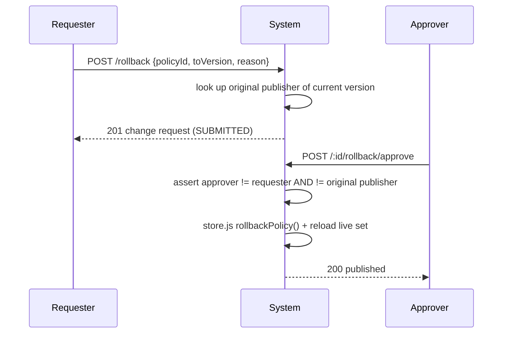
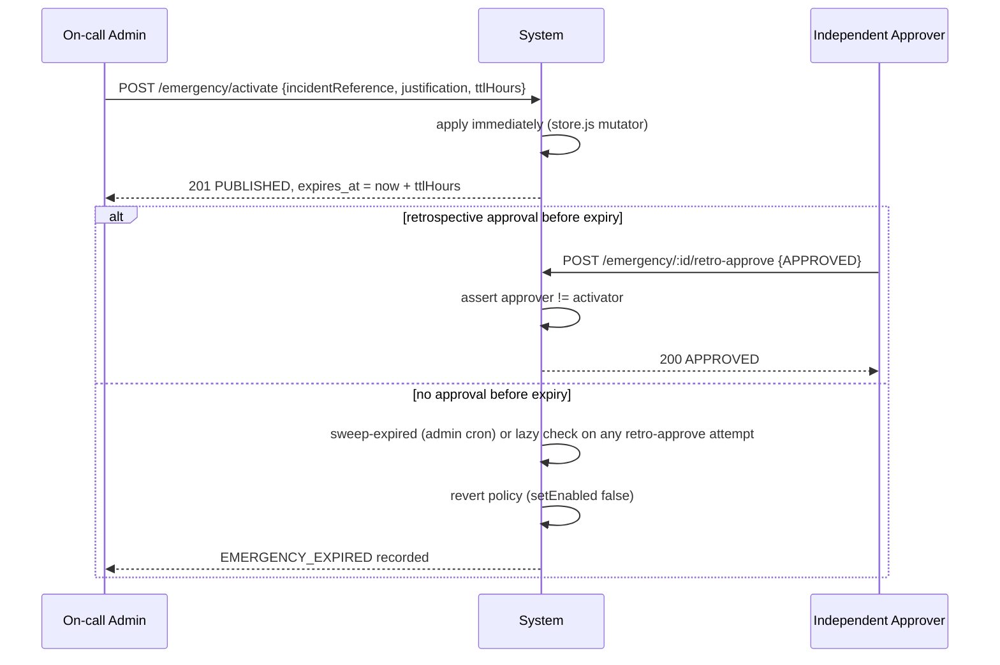

# Policy Governance — Maker-Checker (Four-Eyes) Framework — QODIQA

**Version:** 1.0
**Date:** 2026-07-18
**Remediates:** "No maker-checker separation in policy lifecycle" (Critical)

---

## 1. Introduction and Scope

> **[ status note, 2026-10-06 — text below kept as written for]** the live enforcement
> set is **not** `policies.json`: policy state lives in the control plane (PostgreSQL `control_plane_records` in
> production; `src/core/policy/store.js` header), every replica derives its enforced set from it, and
> `POLICY_FILE`/`policies.json` is import-only (`writePoliciesJson()` throws in production or PostgreSQL mode,
> `store.js:863-870`). The live enforcement point is `src/validation/checkPolicy.js` →
> `services/policy/evaluatePolicyDecision.js` (`middleware/enforcePolicy.js` was removed in `4bae6188`). Where this
> document says "the write to `policies.json`" or "file-based policy store", read "the control-plane write"; the §11/§12
> file-vs-PostgreSQL non-transactionality caveat applies only to non-production memory mode.

Before this remediation, `src/core/policy/store.js`'s mutators
(`createPolicy`, `updatePolicy`, `setEnabled`, `rollbackPolicy`) were
single-call, single-actor, and immediately effective: the write to
`policies.json` (the live enforcement set) happened synchronously inside
the same function that created the change. A single administrator could
create AND activate production enforcement policy with no independent
second actor — a critical governance gap under any four-eyes/dual-control
requirement (SOC 2, ISO 27001, NIST CSF, PCI DSS, financial-institution
change-management controls).

This document describes the maker-checker governance layer added to close
that gap. It sits **in front of** the existing file-based policy store —
`store.js` remains the live-enforcement source of truth, untouched, so the
hot enforcement path (`services/policy/loader.js`, `middleware/
enforcePolicy.js`) carries zero additional risk. Only one function anywhere
in the new code (`PolicyGovernanceService.publish()`, plus the equivalent
single functions in `RollbackGovernanceService` and `EmergencyPolicyService`)
ever calls `store.js`'s mutators.

## 2. Root Cause

`store.js` was designed for correctness of policy *content* versioning
(full snapshot history, diffing, rollback by version) but never separated
*proposing* a change from *activating* it — there was no intermediate
state at all. The one existing "audit" table for policy changes,
`policy_provenance_versions` (migration 009), is a deliberately read-only,
append-only, after-the-fact forensic ledger (no `UPDATE`/`DELETE` grant or
RLS policy exists for it) — it records what happened, it cannot gate what's
about to happen. No maker-checker, four-eyes, or dual-control concept
existed anywhere else in the codebase (confirmed by direct search prior to
this remediation).

## 3. Lifecycle State Machine

```mermaid
stateDiagram-v2
    [*] --> DRAFT: draft()
    DRAFT --> SUBMITTED: submit() [author only]
    SUBMITTED --> IN_REVIEW: startReview() [!= author]
    IN_REVIEW --> REVIEWED: review(APPROVED)
    IN_REVIEW --> DRAFT: review(CHANGES_REQUESTED)
    REVIEWED --> APPROVED: approve() [!= author, != reviewer*]
    SUBMITTED --> APPROVED: approve() [relaxed mode only]
    REVIEWED --> REJECTED: reject()
    APPROVED --> SCHEDULED: schedule()
    APPROVED --> PUBLISHED: publish() [!= author]
    SCHEDULED --> PUBLISHED: publish() [!= author, after scheduled_for]
    DRAFT --> WITHDRAWN: withdraw()
    SUBMITTED --> WITHDRAWN: withdraw()
    IN_REVIEW --> WITHDRAWN: withdraw()
    REVIEWED --> WITHDRAWN: withdraw()
    APPROVED --> WITHDRAWN: withdraw()
    SCHEDULED --> WITHDRAWN: withdraw()
    SCHEDULED --> EXPIRED: (no auto-fire; see §8)
    PUBLISHED --> [*]
    REJECTED --> [*]
    WITHDRAWN --> [*]
    EXPIRED --> [*]
```

**`DRAFT` and `PUBLISHED` are never adjacent, in either mode.** This is a
structural guarantee, not a convention: `src/core/policy/governance/
ChangeRequestStateModel.js` is a pure, frozen module (mirroring
`ConsentStateModel.js`'s shape) whose transition map simply has no such
edge — `PolicyGovernanceService` cannot skip it even by accident, because
every stage function calls `isValidTransition()` before writing anything.

**Strict vs. relaxed mode** (`POLICY_GOVERNANCE_STRICT_MODE` env var,
default `true`): strict mode requires the full `SUBMITTED → IN_REVIEW →
REVIEWED → APPROVED` chain and forbids the same individual from being both
reviewer and approver. Relaxed mode allows `SUBMITTED → APPROVED` directly,
merging the reviewer stage into the approver stage — the finding's own
"Reviewer == Approver (if enterprise mode requires)" qualifier, made
concrete and off by default (reduced-assurance, documented here rather than
silently available).

**Rollback** uses a deliberately simpler two-stage flow (`requestRollback()`
→ `approveAndPublishRollback()`) rather than the full review chain — see §6.

## 4. Roles and Permissions

QODIQA's RBAC is role-based, one role per account, from a fixed 5-role
matrix (`src/core/rbac/roles.js`). Every prior component in this codebase
extended capability by adding new **permissions** to that matrix, never new
roles — this remediation follows the same pattern rather than introducing
a breaking re-staffing of every existing admin account:

| Permission | Roles | Covers |
|---|---|---|
| `READ_POLICY_GOVERNANCE` | admin, auditor, compliance, operator | List/inspect requests, events, evidence |
| `PROPOSE_POLICY_CHANGE`  | admin, operator, compliance | Create/submit/withdraw drafts |
| `REVIEW_POLICY_CHANGE`   | admin, compliance, auditor | Non-binding review sign-off |
| `APPROVE_POLICY_CHANGE`  | admin, compliance | Formal approval / rejection |
| `PUBLISH_POLICY_CHANGE`  | admin | The one step that touches the live store |
| `REQUEST_POLICY_ROLLBACK`| admin, compliance, operator | Request a rollback |
| `APPROVE_POLICY_ROLLBACK`| admin, compliance | Independent rollback approval |
| `EMERGENCY_POLICY_OVERRIDE` | admin | Break-glass activation |
| `APPROVE_EMERGENCY_POLICY`  | admin, compliance | Retrospective approval |

**These permissions gate capability — who is allowed to attempt a stage.
They do not, by themselves, deliver the maker-checker guarantee.** Two
different admins may legitimately author and approve the same change,
because they hold the same permission but are different individuals. The
guarantee comes from §5.

## 5. Maker-Checker Identity Separation (the actual guarantee)

`src/core/policy/governance/makerCheckerRules.js` compares **individual
actor identity** (`req.rbacUser.id` — a UUID distinct from `.role`,
confirmed to already be load-bearing elsewhere in this codebase, e.g. the
RBAC store's `LAST_ADMIN` protection) at every transition, server-side,
fail-closed:

| Rule | Enforced by | Forbidden combination |
|---|---|---|
| `assertReviewerNotAuthor` | `startReview()`, `review()` | Author == Reviewer |
| `assertApproverNotAuthor` | `approve()` | Author == Approver |
| `assertApproverNotReviewer` (strict mode only) | `approve()` | Reviewer == Approver |
| `assertPublisherNotAuthor` | `publish()` | Author == Publisher |
| `assertRollbackApproverNotAuthor` | `approveAndPublishRollback()` | Rollback requester == Rollback approver |
| `assertRollbackApproverNotOriginalPublisher` | `approveAndPublishRollback()` | Rollback approver == whoever activated the version being rolled back |
| `assertEmergencyRetroApproverNotActivator` | `retroApprove()` | Emergency activator == Retrospective approver |

Each function throws `MakerCheckerViolationError` (mapped to HTTP `403` by
the router) rather than returning a boolean — a forgotten call site fails
loudly instead of silently allowing a self-approval. **Client input is
never trusted for "I am a different person"** — every comparison reads
identity attached to the request by upstream RBAC middleware, never the
request body.

## 6. Article — Rollback Governance

`src/core/policy/governance/RollbackGovernanceService.js`. "Rollback must
not be executable by the same person who activated the policy" is enforced
in two directions at once:

1. The rollback **requester** may not also be the rollback **approver**
   (ordinary maker-checker).
2. The rollback **approver** may not be whoever originally **activated**
   the version currently in force — looked up from `policy_publications`
   at approval time, independent of who authored the rollback request.

Every completed rollback writes one row to `policy_rollbacks` (affected
version, original activator, approver, reason, timestamp — the finding's
explicit rollback-evidence field list) at the moment of approval — a single
atomic insert, not a request-then-update row, since every field is already
known by then.

## 7. Emergency (Break-Glass) Workflow

`src/core/policy/governance/EmergencyPolicyService.js`. This is the **one
deliberate bypass** of the normal gate in the whole system — every other
mutation requires independent review/approval/publish before it touches
the live store; an emergency activation applies immediately, single-actor.
It is compensated for, not left ungoverned:

- Mandatory `incidentReference` and written `justification`.
- Mandatory, hard `expires_at` (TTL, max 7 days).
- Mandatory retrospective approval by a **different** individual than the
  activator (`assertEmergencyRetroApproverNotActivator`).
- **Automatic expiration**: if retrospective approval never happens, the
  activation auto-reverts (the policy is disabled). This is checked lazily,
  under a row lock, on every `retroApprove()` attempt (correctness never
  depends on an external trigger), and also via an admin-triggered
  `POST /emergency/sweep-expired` — mirroring exactly how `retention.js`'s
  `runRetentionCycle()` is operated in this codebase today: there is no
  in-process scheduler anywhere in this platform, so this, like retention,
  is only ever triggered by an external cron hitting the admin endpoint.

## 8. Scheduled Activation — Known Scope Limit

`schedule()` sets `scheduled_for`; `publish()` refuses to run before that
timestamp. There is **no background auto-fire** — nothing calls `publish()`
automatically when the scheduled time arrives. This is an explicit,
documented scope limit, not an oversight: there is no in-process scheduler
anywhere else in this codebase either (retention is admin-triggered the
same way — see §7). An operator must call `publish()` at or after the
scheduled time, or wire an external cron to do so.

## 9. Version Immutability

Once a change request reaches `PUBLISHED`, `policy_change_requests` is
never further mutated for that row (the state machine has no outgoing edge
from `PUBLISHED`), and the resulting `store.js` policy version snapshot
(`versions[]`) is itself immutable by pre-existing design — `updatePolicy()`
always appends a new version, never edits history in place. Subsequent
changes always create a brand-new change request, never reopen a published
one.

## 10. Cryptographic Integrity

Every workflow transition is recorded as a hash-chained row in
`approval_events` (`src/core/policy/governance/governanceEvents.js`) — one
chain per `change_request_id`, `previous_event_hash → event_hash`, using a
dedicated hash domain (`ARTIFACT_DOMAINS.POLICY_GOVERNANCE`,
`src/infra/crypto/hashing.js`) so these hashes can never collide with the
platform's other domain-separated hashes (the audit chain, artifacts,
certificates, etc.). `governanceEvents.verifyChain()` walks the chain and
recomputes every hash from its own stored fields (tamper detection, not
just chain-linkage) — surfaced via `GET /:id/evidence`.

## 11. Database Schema

Migration `029_policy_governance.sql` (see file for full DDL, RLS, and
grants — tenant-aware, mirroring `consent_records`/`dsr_requests`):

| Table | Mutable? | Purpose |
|---|---|---|
| `policy_change_requests` | Yes, optimistic-locked (`version` column, trigger-bumped) | The workflow object |
| `policy_reviews` | No (append-only) | Review-round decisions |
| `policy_approvals` | No (append-only) | Approval/rejection decisions |
| `policy_rollbacks` | No (append-only) | Rollback governance evidence |
| `policy_publications` | No (append-only) | Every live-effect activation |
| `policy_emergency_activations` | Yes (retrospective bookkeeping) | Emergency workflow state |
| `approval_events` | No (append-only) | Unified hash-chained audit trail |

**Optimistic concurrency**: `policy_change_requests.version` closes the
"two checkers approve the same stale proposal" race — `ChangeRequestStore.
updateStatus`/`updateStatusInTx` require `WHERE id=$1 AND version=$2`
and throw `ConcurrentModificationError` (HTTP `409`) on a zero-row update,
the same pattern `consent_records.version` already uses elsewhere in this
codebase (migration 007).

**Transactional consistency**: every stage function performs its status
hop and its evidence write(s) inside one Postgres transaction —
`ChangeRequestStore.updateStatusInTx(tx, ...)` and `governanceEvents.
recordEvent(tx, ...)` are always given the same `tx`, so "no partial
approvals" holds structurally.

**Known limitation** (identical to a pre-existing limitation of the file
store, not new here): the one function per service that actually calls
`store.js`'s mutators does so as a synchronous file write, which cannot be
transactionally rolled back together with the surrounding Postgres commit.
If the Postgres commit fails after the file write already succeeded, the
change request may not reflect `PUBLISHED` even though the live policy
changed. This mirrors the exact same caveat the legacy `policyManagement.js`
endpoints have always had (`RELOAD_FAILED` handling).

## 12. Governance Publish Reconciliation

Section 11's "Known limitation" is exactly what this section closes — with
**detection**, not prevention: the file write to `policies.json` still
cannot be made transactional with the Postgres commit, but a divergence
between them no longer goes unnoticed.

**What runs**: `src/core/policy/governance/reconciliation.js`'s `reconcile()`
runs once, automatically, at server startup (after `pgPool.initialize()`),
comparing the live file-based policy repository against
`policy_change_requests`/`policy_publications` and, for full-content hash
comparison, `policy_provenance_versions` (§10's provenance ledger — see the
module's header for why `policy_publications.policy_hash`, a hash of the
submitted change-request *payload*, is not directly comparable to file
content, and why the provenance ledger's *full-snapshot* hash is used
instead).

**Divergence types detected**:

| Type | Meaning |
|---|---|
| `MISSING_FILE` | A `PUBLISHED` policy_id has no corresponding entry in `policies.json` |
| `MISSING_PUBLICATION` | A `PUBLISHED` change request has no matching `policy_publications` row |
| `VERSION_MISMATCH` | The file's current version number doesn't match the latest publication's `resulting_policy_version` |
| `HASH_MISMATCH` | The file snapshot's recomputed content hash doesn't match `policy_provenance_versions.policy_hash` for that version |
| `PUBLICATION_STATE_INCONSISTENT` | An orphaned publication (its change request isn't `PUBLISHED`), duplicate publications for one change request, or a missing provenance row for a published version |

**Alerting**: every divergence emits `GOVERNANCE_RECONCILIATION_DIVERGENCE_DETECTED`
(structured payload: `policyId`, `publicationId`, `version`, `expectedHash`,
`actualHash`, `divergenceType`, `timestamp`, `reconciliationResult`), which
reaches the alerting pipeline (`src/alerting`) via two rules in
`OperationalDetector.js`'s `GOVERNANCE_RULES` — `HASH_MISMATCH`/
`VERSION_MISMATCH`/`PUBLICATION_STATE_INCONSISTENT` page at `CRITICAL`
(cryptographic/version integrity, tamper-adjacent); `MISSING_PUBLICATION`/
`MISSING_FILE` alert at `HIGH` (structural drift). A clean run emits a single
`GOVERNANCE_RECONCILIATION_COMPLETE` (`INFO`) summary with
`policiesScanned`/`publicationsScanned`/`mismatches`/`durationMs`/`outcome`.

**What it deliberately does not do**: it never writes to `policies.json` or
any table (every query is a read-only `SELECT`), never blocks startup, and
never calls `process.exit()` — a governance divergence is drift requiring
operator investigation, not evidence the platform is unsafe to serve
traffic. Reconciliation is strictly a verification/alerting mechanism.

**Operator response to a divergence alert**: investigate which side is
correct using `GET /:id/evidence` (§10) and `policy_provenance_versions` (the
authoritative content-history record) before deciding whether to re-publish
the change request (repairing the file) or restore the file from provenance
history — reconciliation itself never picks a side.

## 13. Legacy Endpoint Compatibility

`src/api/routes/policyManagement.js`'s `/policy-ui` write endpoints
(`POST/PUT /policies`, `/enable`, `/disable`, `/rollback`) keep their URLs
and `MANAGE_POLICIES` gate, but no longer mutate anything immediately: they
now create a governed change request (draft + auto-submit, or an
auto-submitted rollback request) and return it. The response includes a
`message` field pointing to the corresponding `/v1/policy/governance/...`
endpoint to continue the workflow. Draft-time validation (policy id/type/
priority/config shape, duplicate-id check, policy-existence check for
enable/disable) runs immediately, matching prior behavior for invalid
input — only the final activation step is deferred.

## 14. Administrative API

Mounted at `/v1/policy/governance`:

| Method & Path | Permission | Purpose |
|---|---|---|
| `GET /` | READ_POLICY_GOVERNANCE | List change requests |
| `GET /:id` | READ_POLICY_GOVERNANCE | Detail + event trail |
| `GET /:id/evidence` | READ_POLICY_GOVERNANCE | Evidence package of the change request |
| `POST /draft` | PROPOSE_POLICY_CHANGE | Create a draft |
| `POST /:id/submit` | PROPOSE_POLICY_CHANGE (author) | DRAFT → SUBMITTED |
| `POST /:id/review` | REVIEW_POLICY_CHANGE | Claim + decide (single call) |
| `POST /:id/approve` | APPROVE_POLICY_CHANGE | → APPROVED |
| `POST /:id/reject` | APPROVE_POLICY_CHANGE | → REJECTED |
| `POST /:id/schedule` | APPROVE_POLICY_CHANGE | APPROVED → SCHEDULED |
| `POST /:id/publish` | PUBLISH_POLICY_CHANGE | → PUBLISHED (live effect) |
| `POST /:id/withdraw` | PROPOSE_POLICY_CHANGE (author) or admin | → WITHDRAWN |
| `POST /rollback` | REQUEST_POLICY_ROLLBACK | Request a rollback |
| `POST /:id/rollback/approve` | APPROVE_POLICY_ROLLBACK | Approve + apply |
| `POST /emergency/activate` | EMERGENCY_POLICY_OVERRIDE | Break-glass activation |
| `POST /emergency/:id/retro-approve` | APPROVE_EMERGENCY_POLICY | Retrospective decision |
| `POST /emergency/sweep-expired` | EMERGENCY_POLICY_OVERRIDE | Admin-triggered expiry sweep |

Response envelope matches the platform's newer routers: `{status:'success',
timestamp, requestId, data}` on success, `{status:'error', timestamp,
requestId, error:{code, message}}` on failure. Maker-checker violations
return `403`; invalid transitions and concurrent-modification conflicts
return `409`; not-found returns `404`.

## 15. Testing

See `src/core/policy/governance/__tests__/*.test.js` (state model, maker-
checker rules, `ChangeRequestStore` optimistic locking, full service happy
paths, self-approval/double-approval/invalid-transition rejection,
transactional-failure handling), `src/api/routes/admin/policyGovernance.test.js`
(RBAC via the real permission matrix, full lifecycle, negative security
tests), `src/infra/postgres/__tests__/migration029.test.js`. Full counts
are.
