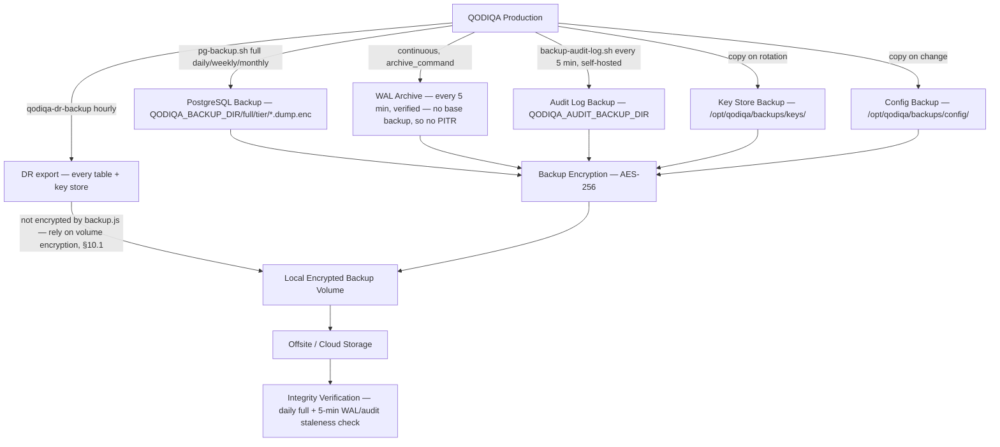

# QODIQA Backup Runbook

**Operations & Production Readiness**

| Field | Value |
|-------|-------|
| Document | Backup Runbook |
| Version | 1.0.0 |
| Owner | Platform Engineering |
| Audience | SRE, Platform Engineer, On-Call |
| Classification | Internal — Operational |
| Last Updated | 2026-07-03 |

---

## Table of Contents

1. [Overview](#1-overview)
2. [Backup Architecture](#2-backup-architecture)
3. [Database Backup](#3-database-backup)
4. [Artifact Backup](#4-artifact-backup)
5. [Audit Chain Backup](#5-audit-chain-backup)
6. [Transparency Log Backup](#6-transparency-log-backup)
7. [Configuration Backup](#7-configuration-backup)
8. [Key Store Backup](#8-key-store-backup)
9. [Retention Policies](#9-retention-policies)
10. [Backup Encryption](#10-backup-encryption)
11. [Backup Integrity Verification](#11-backup-integrity-verification)
12. [Backup Checklist](#12-backup-checklist)

---

## 1. Overview

QODIQA's backup strategy protects the following distinct data categories, each with different recovery requirements and security classifications:

| Data Category | Authoritative Store | Sensitivity | RPO Target |
|---------------|-------------------|-------------|-----------|
| PostgreSQL database | PostgreSQL | High | **Achievable today:** the last hourly `qodiqa-dr-backup` export (`scripts/dr/backup.js --with-postgres`) or the last daily `pg-backup.sh full`. The 5-minute WAL-archiving figure needs point-in-time restore, which is **not supported** — see §3.5 |
| Audit chain — single-node mode | `audit.log` NDJSON file | Critical | 5 minutes (`scripts/backup-audit-log.sh`, self-hosted; met via the PG mirror in Kubernetes — see [Disaster Recovery §1](disaster-recovery.md#1-recovery-objectives)) |
| Audit chain — distributed mode, or PG mirror in single-node mode | `audit_chain` table | Critical in distributed mode, High as a single-node mirror | As PostgreSQL above (WAL-based 5 minutes not available — §3.5) |
| Transparency log | `transparency_log_entries` table | High | As PostgreSQL above (WAL-based 5 minutes not available — §3.5) |
| Encrypted key store | `keys.json` file | Critical | Every rotation |
| Policies (enforced set) | PostgreSQL control plane — `POLICY_FILE` is an import source only | High | As PostgreSQL above |
| TLS certificates | File system / K8s Secrets | High | Every rotation |
| Application configuration | Environment / ConfigMap | Medium | Every change |

**In single-node mode** (`QODIQA_AUDIT_ORDERING_MODE=single-node`, the
default), the audit chain file (`audit.log`) and the encrypted key store
(`keys.json`) are the two most critical backups. The PostgreSQL database is
a queryable replica of the audit chain — if the database is lost but the
file is intact, the database can be rebuilt.

**Production is single-node only**: `docker-compose.prod.yml` runs
`QODIQA_DEPLOYMENT_MODE: single-node`, the Kubernetes production overlay is `single-node` (StatefulSet `qodiqa`,
`replicas: 1`), and the production boot validator refuses the distributed mode
(`src/infra/config/bootValidator.js`).

**In distributed mode** (the Kubernetes `distributed` overlay — **non-production only**), there is no `audit.log` file at all —
the `audit_chain` table itself is the sole authoritative store and one of
the two most critical backups, alongside the key store. `scripts/dr/backup.js`
records which mode was actually in effect at backup time
(`manifest.auditOrderingMode`), and restore verifies audit evidence from
that mode's own authoritative source, never the other (see [Backup →
Restore Validation
§2.1](backup-restore-validation.md#21-deployment-mode-aware-audit-evidence)).

**"PostgreSQL database" above means the entire schema — every table.** `scripts/pg-backup.sh` runs an unfiltered `pg_dump` (no `--table`/`--exclude-table`), so consent (`consent_records`, `consent_audit_log`), investigation (`investigations`, `investigation_artifacts`), compliance (`compliance_reports`, `compliance_control_assessments`), security (`kms_provider_events`, `signing_keys`), and operational-state tables are all covered alongside the audit chain and transparency log named in the table above — see [Backup → Restore Validation §2](backup-restore-validation.md#2-supported-backup-components) for the definitive, automatically-maintained table inventory.

---

## 2. Backup Architecture



---

## 3. Database Backup

### 3.1 Automated Full Backup (daily / weekly / monthly)

QODIQA includes a PostgreSQL backup script at `scripts/pg-backup.sh` (invoke as `./scripts/pg-backup.sh full [daily|weekly|monthly]`).
The shipped schedules run it **daily (02:00 UTC), weekly and monthly**, not hourly (`deploy/kubernetes/base/backup-cronjobs.yaml`,
`deploy/systemd/`); the only hourly job is `qodiqa-dr-backup` (`scripts/dr/backup.js --with-postgres`, a JSON export
of every table plus the key store). See [Backup Scheduling §3](backup-scheduling.md#3-the-eight-cronjobs). Run it as the
backup role `qodiqa_backup` (migration 067) with `PGHOST`/`PGPORT`/`PGUSER` and a `PGPASSFILE` — never a password in a
URL or on the command line.

> ** Corrected.** This section previously showed a hand-rolled
> `pg_dump --no-acl --no-owner` to a plaintext `qodiqa-<ts>.dump.gz`. That dump is unencrypted, cannot restore grants
> or ownership, and is not the format the restore runbook expects. The supported path is `scripts/pg-backup.sh`
>. Git history keeps the original block.

```bash
# Encrypted, sealed full backup (never hand-roll pg_dump)
export QODIQA_BACKUP_REQUIRE_ENCRYPTION=true   # refuse to write plaintext
# QODIQA_BACKUP_ENCRYPTION_KEY and QODIQA_BACKUP_HMAC_KEY come from custody (distinct values, >= 32 characters)
./scripts/pg-backup.sh full daily
# Writes ${QODIQA_BACKUP_DIR}/full/<tier>/qodiqa_<UTC timestamp>.dump.enc plus its .seal (without a tier argument:
# ${QODIQA_BACKUP_DIR}/full/); owners and ACLs are kept in the dump. QODIQA_BACKUP_DIR defaults to /var/backups/qodiqa
# (the Kubernetes backup ConfigMap sets /backups/pg). Expect BACKUP_ENCRYPTED. The full table set is captured — no
# --table allow-list.
./scripts/pg-backup.sh verify daily            # newest backup in full/daily: expect BACKUP_SEAL_OK and BACKUP_VERIFY_OK
```

> ** Encryption is now the default for both backup paths.**
> - `scripts/pg-backup.sh`: without `QODIQA_BACKUP_ENCRYPTION_KEY` a run now FAILS (`BACKUP_ENCRYPTION_REQUIRED`) even
>   when `QODIQA_BACKUP_REQUIRE_ENCRYPTION` is unset. A plaintext dump (and verifying / restoring a legacy plaintext
>   dump) needs the explicit opt-in `QODIQA_BACKUP_ALLOW_PLAINTEXT=true`, logged as `BACKUP_PLAINTEXT_OPT_IN` on every
>   run; the opt-in never overrides an explicit `QODIQA_BACKUP_REQUIRE_ENCRYPTION=true`. Throwaway targets only.
> - `scripts/dr/backup.js` (the hourly `qodiqa-dr-backup` JSON export of every table): with
>   `QODIQA_BACKUP_ENCRYPTION_KEY` + `QODIQA_BACKUP_HMAC_KEY` every archive is written only as `<name>.enc` — the same
>   openssl AES-256-CBC / PBKDF2-SHA256 200 000 scheme as `pg-backup.sh`, so
>   `openssl enc -d -aes-256-cbc -pbkdf2 -iter 200000 -md sha256 -pass env:QODIQA_BACKUP_ENCRYPTION_KEY -in <file>.enc`
>   decrypts any archive — and `manifest.json.seal` is the HMAC-SHA256 of the manifest (which records every
>   ciphertext's sha256: encrypt-then-MAC). It refuses to write plaintext under `QODIQA_BACKUP_REQUIRE_ENCRYPTION=true`
>   or `NODE_ENV=production` (override for throwaway targets: `QODIQA_BACKUP_ALLOW_PLAINTEXT=true`, logged as
>   `BACKUP_PLAINTEXT_OVERRIDE`; it cannot lift an explicit require). `dr:verify` / `dr:restore` need both keys for an
>   encrypted backup and refuse a plaintext one under the same rule. The shipped `qodiqa-dr-backup` and
>   `qodiqa-dr-restore-validation` CronJobs now mount both key secrets (required). Details:
> [Backup → Restore Validation §4.4](backup-restore-validation.md#44-encryption-at-rest-and-chain-heads).

**Failure handling and artifacts.** Every
unexpected failure in `pg-backup.sh`, `pg-wal-archive.sh --verify` and `backup-audit-log.sh` logs exactly one
`*_FAILED` event, sends one alert and writes `success=0`. Before, a failure inside a mode function (e.g. a `pg_dump`
authentication or version error) exited silently. The webhook URL is passed to curl on stdin, never on the command
line. A failed or killed `pg_dump` leaves `<dump>.partial`, never a `.dump`. It is quarantined under
`${QODIQA_BACKUP_DIR}/quarantine/` (it is plaintext), and `verify` with encryption required refuses while one is
present. `BACKUP_FULL_COMPLETE` includes the stored artifact's `sha256`; the off-site wrapper
(`QODIQA_BACKUP_OFFSITE_COMMAND`) should compare the uploaded object against it. Plaintext artifacts are created
owner-only: the dump is 0600, audit-log copies are 0600 and the DR backup directory is 0700. `verify <tier>` also fails
when the newest backup of that tier is older than its limit (daily 26 h, weekly 8 d, monthly 32 d;
`QODIQA_BACKUP_MAX_AGE_SECONDS` overrides, `0` disables).

### 3.2 Kubernetes CronJob for Database Backup

**This is no longer a hypothetical example — it is implemented.**
(no automated backup scheduling shipped in any form) found that this
section previously described a CronJob that did not exist anywhere in the
repository. It now does: see `deploy/kubernetes/base/backup-cronjobs.yaml`
(`qodiqa-pg-backup-daily` / `-weekly` / `-monthly` / `-verify` / `-verify-wal`, plus `qodiqa-dr-backup` and
`qodiqa-dr-restore-validation`; `qodiqa-pg-backup-incremental` ships **suspended** and `pg-backup.sh incremental`
exits 2 with `BACKUP_INCREMENTAL_UNSUPPORTED` — `pg_basebackup` needs `REPLICATION` on `qodiqa_backup`, which is not
granted, design decision), `deploy/kubernetes/base/backup-configmap.yaml`,
`deploy/kubernetes/base/backup-pvc.yaml`, and the self-hosted/systemd equivalent
in `deploy/systemd/`. Full operational detail — configuration, retention
tiers, observability, troubleshooting — is in
[Backup Scheduling](backup-scheduling.md); this section stays focused on
what the backup *contains* (below), not how it's scheduled.

### 3.3 Full Logical Backup (pg_dumpall)

For full cluster backup including roles and tablespaces:

```bash
# Full cluster backup — includes all roles, databases, tablespaces
TIMESTAMP=$(date +%Y%m%d-%H%M%S)
pg_dumpall -U postgres \
  --globals-only \
  > "/opt/qodiqa/backups/pg/globals-${TIMESTAMP}.sql"

# Compress separately
gzip "/opt/qodiqa/backups/pg/globals-${TIMESTAMP}.sql"
```

### 3.4 Specific Table Backups

For high-frequency backup of the audit chain PostgreSQL replica:

```bash
# Export audit chain table (hourly)
TIMESTAMP=$(date +%Y%m%d-%H%M%S)
psql -d "${QODIQA_PG_DATABASE:-qodiqa}" -c \
  "COPY (SELECT * FROM audit_chain ORDER BY seq) TO STDOUT WITH CSV HEADER" \
  | gzip > "/opt/qodiqa/backups/audit-chain-pg-${TIMESTAMP}.csv.gz"

# Export transparency log entries (hourly)
psql -d "${QODIQA_PG_DATABASE:-qodiqa}" -c \
  "COPY (SELECT * FROM transparency_log_entries ORDER BY id) TO STDOUT WITH CSV HEADER" \
  | gzip > "/opt/qodiqa/backups/transparency-log-${TIMESTAMP}.csv.gz"
```

The exports above are human-inspectable CSV snapshots you schedule yourself (nothing in the repository runs them).
The PostgreSQL recovery point that is actually achievable is set by the hourly `qodiqa-dr-backup` export and the
daily `pg-backup.sh full` backup — not by §3.5's WAL archive (see its note).

### 3.5 Continuous WAL Archiving

> **The 5-minute PostgreSQL RPO below is NOT AVAILABLE in production.** Archived WAL can
> only be replayed on top of a physical base backup, and the only producer of one — `pg-backup.sh incremental`
> (`pg_basebackup`) — is unsupported: it exits 2 with `BACKUP_INCREMENTAL_UNSUPPORTED`, and the
> `qodiqa-pg-backup-incremental` CronJob ships `suspend: true`, because `qodiqa_backup` deliberately lacks the
> `REPLICATION` attribute (design decision; [database role management](database-role-management.md)).
> Point-in-time restore is therefore not supported ([Restore Runbook §5.5](restore-runbook.md#55-point-in-time-restore-from-continuous-wal-archive)),
> and the achievable PostgreSQL recovery points are the hourly `qodiqa-dr-backup` export and the daily/weekly/monthly
> `pg-backup.sh full` backups. WAL archiving and its 5-minute verification still run and stay useful once the owner
> grants `REPLICATION`; until then do not plan an RPO on them.

Before this remediation, the fastest PostgreSQL-wide recovery point was
whatever the periodic `pg_basebackup` snapshot (§3.2's `-incremental`
CronJob, every 6h) or the hourly `qodiqa-dr-backup` JSON export produced —
bounding the real-world RPO at 1 hour, looser than continuous archiving can
deliver. `scripts/pg-wal-archive.sh` is PostgreSQL's own `archive_command`
target, invoked on every completed WAL segment (and, via `archive_timeout`,
even under zero write load) — it gzips and HMAC-seals each segment into a
rolling, age-retained archive, designed to give every table in the schema (including
the `audit_chain` and `transparency_log_entries` mirrors) a continuously
verified 5-minute RPO — once a base backup exists (not today: see the note above).

**Required PostgreSQL server configuration** (this repo does not own a
Postgres server manifest — Postgres is external/managed here, the same
assumption §3.1's `run_incremental_backup` prerequisites already make about
`wal_level`/`archive_mode`):

```
wal_level = replica
archive_mode = on
archive_timeout = 300          # forces a segment switch at least every 5 min, even idle
archive_command = '/opt/qodiqa/scripts/pg-wal-archive.sh %p %f'
```

**Verification** (proves archiving is actually happening, not just
configured once — a silently-stalled `archive_command` is a classic,
dangerous PostgreSQL failure mode):

```bash
./scripts/pg-wal-archive.sh --verify
```

Scheduled every 5 minutes: `deploy/systemd/qodiqa-audit-log-backup-verify.timer`'s
sibling `qodiqa-pg-backup-verify-wal` CronJob
(`deploy/kubernetes/base/backup-cronjobs.yaml`) in Kubernetes, or an equivalent
`*/5 * * * *` cron entry self-hosted. Fails closed and alerts
(`ALERT_WEBHOOK_URL`) if the newest archived segment is older than
`QODIQA_WAL_ARCHIVE_MAX_AGE_SECONDS` (default 600s = 2x `archive_timeout`).

**Restore (not available until a base backup exists — see the note at the top of §3.5):** see `scripts/pg-backup.sh pitr-restore` — a bounded,
prepare-and-instruct point-in-time-recovery helper that extracts a
`pg_basebackup` base backup and wires PostgreSQL's own
`recovery.signal`/`restore_command` to replay archived WAL up to a target
time (or the latest available). It stops at "PGDATA is prepared" and prints
the exact start command; it does not itself own the PostgreSQL service
lifecycle (see [Restore Runbook](restore-runbook.md) for the full
procedure).

---

## 4. Artifact Backup

Signed artifacts (including their Ed25519 signatures, transparency log entries, and evidence packages) are stored in PostgreSQL. The full database backup captures these. No additional artifact-specific backup is required beyond the PostgreSQL backup.

However, for forensic preservation of specific high-value artifacts:

```bash
# Export evidence packages for a specific investigation
psql -d "${QODIQA_PG_DATABASE:-qodiqa}" -c "
  COPY (
    -- evidence_packages: id / artifact_id / generated_at (migration 001); the evidence-chain ledger table is
    -- evidence_chain_records (migration 010), linked by artifact_id
    SELECT ep.*, ec.evidence_id AS chain_evidence_id, ec.id AS chain_record_id
    FROM evidence_packages ep
    LEFT JOIN evidence_chain_records ec ON ec.artifact_id = ep.artifact_id
    WHERE ep.generated_at > NOW() - INTERVAL '30 days'
  ) TO STDOUT WITH CSV HEADER
" > "/opt/qodiqa/backups/evidence-packages-$(date +%Y%m%d).csv"
```

---

## 5. Audit Chain Backup

### 5.1 File-Authoritative Audit Chain (single-node mode only)

**This section applies only to single-node/file-authoritative deployments**
(`QODIQA_AUDIT_ORDERING_MODE=single-node`, the default). In distributed mode
there is no `audit.log` file — the PostgreSQL `audit_chain` table is the
sole authoritative source instead, covered by the ordinary PostgreSQL
backup in Section 2 above (no separate file-backup step exists or is
needed). See [Backup → Restore Validation
§2.1](backup-restore-validation.md#21-deployment-mode-aware-audit-evidence)
for how a backup records which mode was actually in effect.

The NDJSON audit log file (`$QODIQA_AUDIT_LOG`) is the authoritative source of the audit chain in single-node mode. `scripts/backup-audit-log.sh` backs up this file every 5 minutes — this section previously showed the intended shape of that script as an illustrative example without the script actually existing in the repo (the same gap found and fixed for `scripts/pg-backup.sh`); it now ships for real, with the same HMAC seal, Prometheus metrics, and alert-webhook conventions as `pg-backup.sh`, plus a `verify` mode that fails closed if the newest backup is stale (the schedule has stopped firing) — see its own header comment for the full contract.

```bash
# Equivalent to what the script does — prefer calling the real script below.
./scripts/backup-audit-log.sh backup
./scripts/backup-audit-log.sh verify    # non-destructive; also the staleness check
./scripts/backup-audit-log.sh restore <backup_file> <target_path>
```

**Scheduling — self-hosted/systemd:**

```bash
deploy/systemd/qodiqa-audit-log-backup.timer          # OnCalendar=*:0/5
deploy/systemd/qodiqa-audit-log-backup-verify.timer   # OnCalendar=*:2/5
```

Equivalent plain-cron form for hosts without systemd:

```cron
*/5 * * * * /opt/qodiqa/scripts/backup-audit-log.sh backup >> /var/log/qodiqa/backup.log 2>&1
*/5 * * * * /opt/qodiqa/scripts/backup-audit-log.sh verify >> /var/log/qodiqa/backup.log 2>&1
```

**Kubernetes:** this is deliberately **not** a standalone CronJob — the audit
log lives on a per-pod-exclusive `ReadWriteOnce` volume a separate backup
pod cannot reach (see `deploy/kubernetes/base/backup-cronjobs.yaml`'s "Known
scope boundary" note). In that topology, the audit chain is recovered from
the Postgres-mirrored `audit_chain` table, so its recovery point is PostgreSQL's: the hourly `qodiqa-dr-backup`
export or the daily `pg-backup.sh full` backup. Continuous WAL archiving (§3.5) cannot shorten that until point-in-time
restore is supported (§3.5's note) — see
[Disaster Recovery §1](disaster-recovery.md#1-recovery-objectives) for
which mechanism satisfies the claim in which topology.

### 5.2 Audit Log Rotation

Large audit logs must be rotated without losing entries. Use `logrotate` with `copytruncate`:

```
# /etc/logrotate.d/qodiqa-audit
/opt/qodiqa/logs/audit.log {
    hourly
    rotate 720
    compress
    delaycompress
    missingok
    notifempty
    copytruncate
    postrotate
        # Back up the rotated file immediately
        cp /opt/qodiqa/logs/audit.log.1 /opt/qodiqa/backups/audit/audit-$(date +%Y%m%d-%H%M%S).log.1
    endscript
}
```

**Note:** `copytruncate` copies the file then truncates in place. QODIQA's file I/O handles this correctly because it appends to the file descriptor, not a path. However, there is a small window where a few entries may be lost. The WAL (`audit.log.wal`) provides crash safety during this window.

---

## 6. Transparency Log Backup

The transparency log is stored in PostgreSQL (`transparency_log_entries`, `transparency_roots`, `transparency_verifications` tables). It is backed up as part of the full PostgreSQL backup (Section 3).

For additional integrity protection, export Merkle roots separately:

```bash
# Export transparency roots (these are the integrity anchors)
psql -d "${QODIQA_PG_DATABASE:-qodiqa}" -c "
  SELECT root_id, seq_from, seq_to, root_hash, signature, signer_key_id, generated_at
  FROM transparency_roots
  ORDER BY seq_to;
" --csv > "/opt/qodiqa/backups/transparency-roots-$(date +%Y%m%d).csv"

# These roots can be used to verify the transparency log even after a full restore
# from backup, by recomputing Merkle roots and comparing signatures
```

---

## 7. Configuration Backup

### 7.1 Policy File Backup

**Superseded (see `server/startup.js` and [Control plane](control-plane.md)).**
the enforced policy set is control-plane state in PostgreSQL (`control_plane_records`), versioned by the policy API
and backed up with the database (§3). `POLICY_FILE` (`policies.json`) is only the source of the one-time control-plane
import; it is never written afterwards, and `SIGHUP` no longer reloads it (it re-derives the enforced set from the
control plane). There is nothing to back up "on SIGHUP": keep the original import file with the deployment record
(`node scripts/controlPlane/import.js --report <path>` records what was imported).

### 7.2 Kubernetes ConfigMap Backup

```bash
# Export all QODIQA ConfigMaps
kubectl get configmap -n qodiqa -o yaml > \
  "/opt/qodiqa/backups/k8s/configmaps-$(date +%Y%m%d-%H%M%S).yaml"

# Export all non-secret manifests
kubectl get all -n qodiqa -o yaml > \
  "/opt/qodiqa/backups/k8s/all-resources-$(date +%Y%m%d-%H%M%S).yaml"
```

### 7.3 Environment Configuration Backup

```bash
# Back up the env file (secrets excluded — backed up separately)
# Remove secret values before backing up the env file structure
cat /etc/qodiqa/env | \
  sed 's/=.*/=REDACTED/' > \
  "/opt/qodiqa/backups/config/env-structure-$(date +%Y%m%d).env"
```

---

## 8. Key Store Backup

### 8.1 Encrypted Key Store Backup Policy

The key store file (`keys.json`) contains Ed25519 private keys encrypted with AES-256-GCM using the KEK. The file is safe to back up because:

1. Private key material is stored in encrypted form (`enc_private_key_b64`, `enc_iv_b64`, `enc_auth_tag_b64`).
2. The KEK itself is **never** stored in the key store file.
3. Without the KEK, the key store backup is cryptographically useless.

```bash
# Back up the key store on every key rotation event
KEYS_PATH="${QODIQA_KEYS_PATH:-/opt/qodiqa/data/keys.json}"
BACKUP_DIR="/opt/qodiqa/backups/keys"
mkdir -p "$BACKUP_DIR"

TIMESTAMP=$(date +%Y%m%d-%H%M%S)
cp "$KEYS_PATH" "${BACKUP_DIR}/keys-${TIMESTAMP}.json"

# Verify the backup is valid JSON
jq . "${BACKUP_DIR}/keys-${TIMESTAMP}.json" > /dev/null && \
  echo "Key store backup valid JSON: OK" || \
  { echo "FATAL: Key store backup is not valid JSON"; exit 1; }

echo "Key store backed up: keys-${TIMESTAMP}.json"
```

### 8.2 KEK Backup

**The KEK (Key Encryption Key) is the most sensitive value in the entire system.** It must be backed up using a separate, highly secure mechanism from the key store.

Acceptable KEK backup methods:
- Hardware Security Module with redundant backup
- Shamir's Secret Sharing across multiple custodians (minimum 2-of-3)
- Cloud KMS with cross-region key replication (for `aws-kms`, `azure-kv`, `gcp-kms` providers)

**Never store the KEK and the key store backup in the same location.**

```bash
# For local KEK provider: the KEK is in QODIQA_KEY_ENCRYPTION_KEY env var
# Back up via your secrets management system (Vault, AWS Secrets Manager, etc.)
# This procedure is specific to your secrets management platform

# Verify Vault KEK is backed up (example for Vault provider)
vault kv get secret/qodiqa/kek > /dev/null 2>&1 && \
  echo "KEK in Vault: accessible" || \
  echo "WARNING: KEK not accessible in Vault"
```

### 8.3 HSM Key Backup

For hardware HSM providers, key backup depends on the HSM vendor:

| HSM Provider | Backup Method |
|-------------|-------------|
| PKCS#11 hardware | HSM vendor backup procedure; key backup token |
| AWS CloudHSM | CloudHSM cluster backup via AWS console |
| AWS KMS | Automatic cross-AZ replication; no user action needed |
| Azure Key Vault | Geo-redundant by default; manual backup via `az keyvault key backup` |
| GCP KMS | Automatic replication per key ring location |
| HashiCorp Vault Transit | Vault Raft snapshots / DR replication |

---

## 9. Retention Policies

| Backup Type | Retention Period | Number of Copies | Location |
|-------------|-----------------|-----------------|---------|
| PostgreSQL full backup (`pg-backup.sh full <tier>`) | By count, per tier | 7 daily + 4 weekly + 12 monthly (defaults of `QODIQA_BACKUP_RETAIN_DAILY/WEEKLY/MONTHLY`); untiered runs: 30 days (`QODIQA_BACKUP_RETAIN_DAYS`) | Local + offsite |
| PostgreSQL WAL archive | 7 days | — | Local + offsite |
| PostgreSQL table export (audit chain) | 90 days | — | Offsite only |
| Audit log file | 90 days | — | Local + offsite |
| Transparency roots export | 1 year | — | Offsite |
| Key store backup | Permanent (all rotations) | — | Secure offsite |
| Policies | With the PostgreSQL backups | — | — |
| TLS certificate backup | Duration of certificate + 1 year | — | Secure offsite |
| Kubernetes ConfigMap backup | 30 days | — | Git repository |
| Pre-deployment backups | 30 days | — | Local |

### 9.1 Automated Retention Enforcement

**Now actually automated:** `scripts/pg-backup.sh full <daily|weekly|monthly>`
enforces count-based retention per tier (`QODIQA_BACKUP_RETAIN_DAILY/WEEKLY/MONTHLY`, defaults 7 / 4 / 12) every time
it runs, and `scripts/pg-backup.sh full` without a tier prunes untiered backups older than `QODIQA_BACKUP_RETAIN_DAYS`
(default 30) — in both cases deleting each `*.dump.enc` together with its `.seal`. `scripts/dr/retention.js` does the
equivalent for `scripts/dr/backup.js` output. Both run on a schedule (see
[Backup Scheduling §3](backup-scheduling.md#3-the-eight-cronjobs)), not manually. **Do not prune PostgreSQL backups
with a hand-written `find … -delete`:** it would orphan `.seal` files (or delete seals without their backups), and the
`*.dump.gz` pattern the earlier example used matches nothing `pg-backup.sh` writes.

**Also automated:** `scripts/backup-audit-log.sh backup` self-prunes
by age (`QODIQA_AUDIT_BACKUP_RETAIN_DAYS`, default 90) on every run, and
`scripts/pg-wal-archive.sh --verify` self-prunes the WAL archive
(`QODIQA_WAL_ARCHIVE_RETAIN_DAYS`, default 7) every 5 minutes — both driven
by the same schedules documented in §3.5 and §5.1 above, not a separate
manual step.

The only categories with no automatic pruning are the operator-held copies outside these scripts (key store copies,
exported CSVs, configuration exports). Key store backups are **never** deleted automatically; prune the others by
your own retention policy.

### 9.2 Legal Hold

When a legal hold is active for a tenant or investigation, backup deletion must be suspended for the affected data:

```bash
# Mark backup files (and their seals) for legal hold (immutable flag — Linux ext4/xfs). Note that pg-backup.sh's
# own retention will then fail to prune them — expected while the hold lasts.
chattr +i "${QODIQA_BACKUP_DIR:-/var/backups/qodiqa}"/full/*/qodiqa_YYYYMMDDT*.dump.enc \
          "${QODIQA_BACKUP_DIR:-/var/backups/qodiqa}"/full/*/qodiqa_YYYYMMDDT*.dump.enc.seal

# Query active legal holds in PostgreSQL (table audit_legal_holds, migration 003; a hold is active until released)
psql -d "${QODIQA_PG_DATABASE:-qodiqa}" -c "
  SELECT id, hold_name, tenant_id, artifact_id, event_category, reason, held_by, held_at
  FROM audit_legal_holds
  WHERE released_at IS NULL
  ORDER BY held_at;
"
```

---

## 10. Backup Encryption

All backups that leave the production environment must be encrypted.

### 10.1 Encryption at Rest (Local Backups)

Local backup volumes should be encrypted at the block-device level:
- Linux: LUKS (`cryptsetup`)
- AWS: EBS encryption enabled on the backup volume
- GCP: CMEK on the backup persistent disk
- Azure: Azure Disk Encryption

### 10.2 Backup File Encryption for Offsite Transfer

Encryption is built into `pg-backup.sh`: every full backup is written as an encrypted `*.dump.enc` (AES-256,
PBKDF2) with an HMAC `.seal` over the ciphertext, using `QODIQA_BACKUP_ENCRYPTION_KEY` and `QODIQA_BACKUP_HMAC_KEY`;
with `QODIQA_BACKUP_REQUIRE_ENCRYPTION=true` it refuses to write or restore plaintext. Copy the `.dump.enc` and `.seal`
off-site with `QODIQA_BACKUP_OFFSITE_COMMAND` (run with the backup file and its seal as its two arguments; a non-zero
exit fails the run). Never encrypt by hand with `openssl … -pass pass:<key>`: that puts the key in the process list.

### 10.3 Cloud Storage Encryption (S3 / GCS / Azure Blob)

```bash
# AWS S3 with server-side encryption
aws s3 cp "$ENCRYPTED_FILE" \
  "s3://qodiqa-backups-prod/pg/$(basename $ENCRYPTED_FILE)" \
  --sse aws:kms \
  --sse-kms-key-id "$BACKUP_KMS_KEY_ID"

# GCP Cloud Storage
gsutil cp -Z "$ENCRYPTED_FILE" \
  "gs://qodiqa-backups-prod/pg/$(basename $ENCRYPTED_FILE)"

# Azure Blob
az storage blob upload \
  --account-name qodiqabackups \
  --container-name pg-backups \
  --name "$(basename $ENCRYPTED_FILE)" \
  --file "$ENCRYPTED_FILE"
```

---

## 11. Backup Integrity Verification

### 11.1 Daily Integrity Verification

Run daily. All backup files must be verifiable. Most of this is already scheduled: `qodiqa-pg-backup-verify`
(`pg-backup.sh verify daily`, 02:30 UTC), `qodiqa-dr-backup`'s `verify.js` step, the WAL-archive check and, self-hosted,
`backup-audit-log.sh verify` ([Backup Scheduling §3](backup-scheduling.md#3-the-eight-cronjobs)); the Prometheus rules
`QodiqaBackupFailed` / `QodiqaBackupStale` (per tier: daily 26 h, weekly 8 d, monthly 32 d) alert on the results
([Metrics & Alerting §11.8](metrics-and-alerting.md#118-shipped-prometheus-alerts)).

The script below is an **example to save as your own operator script** — no ships in the
repository. Run it from the repository root with the backup environment loaded (`QODIQA_BACKUP_DIR`,
`QODIQA_BACKUP_HMAC_KEY`, `QODIQA_BACKUP_ENCRYPTION_KEY`, `QODIQA_BACKUP_REQUIRE_ENCRYPTION=true`, PG* + `PGPASSFILE`).

```bash
#!/bin/bash
# operator-owned example (not shipped in the repository)

ERRORS=0
BACKUP_DIR="${QODIQA_BACKUP_DIR:-/var/backups/qodiqa}"

echo "=== QODIQA Backup Integrity Verification ==="
echo "Date: $(date -u +%Y-%m-%dT%H:%M:%SZ)"

# 1. Verify the newest daily PostgreSQL backup: seal, decryptability and full table coverage
./scripts/pg-backup.sh verify daily && \
  echo "PASS: PostgreSQL backup verified (BACKUP_SEAL_OK / BACKUP_VERIFY_OK)" || \
  { echo "FAIL: pg-backup.sh verify failed"; ERRORS=$((ERRORS + 1)); }

# 2. Verify the newest audit log backup (self-hosted single-node only — in Kubernetes the audit file is not
#    reachable from a backup pod): seal check plus staleness (fails if older than QODIQA_AUDIT_BACKUP_MAX_AGE_SECONDS)
if [[ -n "${QODIQA_AUDIT_LOG:-}" ]]; then
  ./scripts/backup-audit-log.sh verify && \
    echo "PASS: audit log backup verified" || \
    { echo "FAIL: backup-audit-log.sh verify failed"; ERRORS=$((ERRORS + 1)); }
fi

# 3. Verify key store backup exists and is valid JSON
LATEST_KEYS=$(ls -t /opt/qodiqa/backups/keys/*.json 2>/dev/null | head -1)
if [[ -z "$LATEST_KEYS" ]]; then
  echo "WARN: No key store backup found (expected if no key rotation has occurred)"
else
  jq . "$LATEST_KEYS" > /dev/null 2>&1 && \
    echo "PASS: Key store backup valid JSON: $(basename $LATEST_KEYS)" || \
    { echo "FAIL: Key store backup invalid JSON: $(basename $LATEST_KEYS)"; ERRORS=$((ERRORS + 1)); }
fi

# 4. Verify backup age. pg-backup.sh full runs DAILY (not hourly), so the newest full backup in any tier must be
#    younger than 26 h (93,600 s — the same threshold as the QodiqaBackupStale alert). A missing backup is a FAIL.
LATEST_PG=$(ls -t "$BACKUP_DIR"/full/*.dump.enc "$BACKUP_DIR"/full/*/*.dump.enc 2>/dev/null | head -1)
if [[ -z "$LATEST_PG" ]]; then
  echo "FAIL: No PostgreSQL full backup (*.dump.enc) found under $BACKUP_DIR/full"
  ERRORS=$((ERRORS + 1))
else
  BACKUP_AGE=$(( $(date +%s) - $(stat -c %Y "$LATEST_PG") ))
  if [[ $BACKUP_AGE -gt 93600 ]]; then
    echo "FAIL: Latest PG backup $(basename "$LATEST_PG") is ${BACKUP_AGE}s old (> 26 hours)"
    ERRORS=$((ERRORS + 1))
  else
    echo "PASS: PG backup age: ${BACKUP_AGE}s (< 26 hours) — $(basename "$LATEST_PG")"
  fi
fi

# 5. Verify offsite backup sync is current (audit via cloud storage)
# Adjust for your cloud provider
OFFSITE_COUNT=$(aws s3 ls s3://qodiqa-backups-prod/pg/ | wc -l 2>/dev/null)
echo "INFO: Offsite backup count (S3): $OFFSITE_COUNT"

echo ""
echo "Verification complete. Errors: $ERRORS"
exit $ERRORS
```

### 11.2 Monthly Full Restore Test

Once per month, perform a full restore test in an isolated environment, following
[Restore Runbook §5](restore-runbook.md#5-database-restore) (restore into a new database as `qodiqa_test`; the weekly
`qodiqa-dr-restore-validation` CronJob covers the DR export path automatically):

```bash
# Document the result of the restore test
RESTORE_DATE=$(date +%Y-%m-%d)
BACKUP_FILE=$(ls -t "${QODIQA_BACKUP_DIR:-/var/backups/qodiqa}"/full/monthly/*.dump.enc | head -1)

echo "$RESTORE_DATE: Full restore test from $BACKUP_FILE" >> \
  /opt/qodiqa/logs/restore-test-history.log
```

---

## 12. Backup Checklist

```
BACKUP STATUS CHECKLIST — QODIQA
Date: __________  Operator: __________

SCHEDULED BACKUPS (verify automation is running)
[ ] PostgreSQL daily full backup (pg-backup.sh full daily) and hourly qodiqa-dr-backup: cron/CronJob active
[ ] PostgreSQL backup age: latest full backup < 26 hours (QodiqaBackupStale threshold)
[ ] Audit log 5-minute backup (self-hosted single-node): timer/cron active
[ ] Key store: backup exists for every rotation event
[ ] Policies: in the PostgreSQL backups — no separate file backup
[ ] ConfigMap: committed to Git / backed up

INTEGRITY VERIFICATION
[ ] §11.1 operator verification script: PASS (0 errors)
[ ] Latest PG backup: ./scripts/pg-backup.sh verify shows BACKUP_SEAL_OK / BACKUP_VERIFY_OK
[ ] Latest PG backup: FULL table coverage verified (scripts/pg-backup.sh verify
    checks every table in scripts/dr/table-registry.js, not a fixed sample —)
[ ] Latest audit backup (self-hosted): ./scripts/backup-audit-log.sh verify succeeds
[ ] Key store backup: valid JSON
[ ] Transparency roots export: current (< 1 day)

ENCRYPTION
[ ] Local backup volume encrypted at block level
[ ] Offsite backups encrypted before transfer
[ ] Backup encryption key accessible and verified (separate from KEK)

OFFSITE REPLICATION
[ ] Latest backups synced to offsite storage
[ ] Offsite backup count matches expected
[ ] Offsite access verified (can list and download)

RETENTION
[ ] Old PG backups pruned by pg-backup.sh itself (per-tier counts 7/4/12; untiered > 30 days)
[ ] Old audit backups purged (> 90 days)
[ ] Legal hold objects checked — no unauthorized deletion
[ ] Key store backups NEVER deleted (verify)

RESTORE TEST (monthly)
[ ] Last restore test date: __________  Result: PASS / FAIL
[ ] Next scheduled restore test: __________

SIGN-OFF
Operator: __________  Time: __________
```

---

*Cross-references: [Backup Scheduling](backup-scheduling.md) | [Restore Runbook](restore-runbook.md) | [Disaster Recovery](disaster-recovery.md) | [Key Compromise Runbook](key-compromise-runbook.md) | Audit Chain Architecture*
