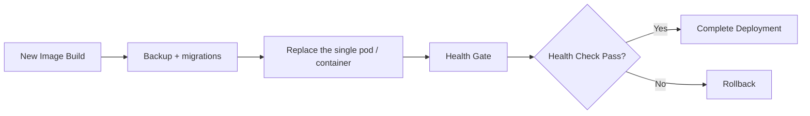

# QODIQA Deployment Runbook

**Operations & Production Readiness**

| Field | Value |
|-------|-------|
| Document | Deployment Runbook |
| Version | 1.0.0 |
| Owner | Platform Engineering |
| Audience | SRE, Platform Engineer, Release Engineer |
| Classification | Internal — Operational |
| Last Updated | 2026-07-03 |

---

## Table of Contents

1. [Overview](#1-overview)
2. [Pre-Deployment Requirements](#2-pre-deployment-requirements)
3. [Production Deployment](#3-production-deployment)
4. [Blue/Green Deployment](#4-bluegreen-deployment) — not supported in production
5. [Rolling Deployment](#5-rolling-deployment)
6. [Canary Deployment](#6-canary-deployment) — not supported in production
7. [Deployment Verification](#7-deployment-verification)
8. [Deployment Smoke Tests](#8-deployment-smoke-tests)
9. [Health Verification](#9-health-verification)
10. [Post-Deployment Validation](#10-post-deployment-validation)
11. [Deployment Rollback Triggers](#11-deployment-rollback-triggers)
12. [Deployment Checklist](#12-deployment-checklist)
13. [Durable-evidence vs sign-only deployments](#13-durable-evidence-vs-sign-only-deployments)

---

## 1. Overview

**Supported in production: one strategy only — an in-place rolling replacement of the single
pod.** Production runs the single-node topology: the Kubernetes `single-node` overlay
(`deploy/kubernetes/overlays/single-node/statefulset.yaml`, a **StatefulSet** named `qodiqa`, `replicas: 1`) or
`deploy/docker/docker-compose.prod.yml` (one `qodiqa` container). The constraint is that **only one QODIQA instance may
write the audit chain at any moment**: `replicas: 1` is a correctness bound (a second single-node replica dual-writing
`audit_chain` is the illegal topology the boot refuses), and the `distributed` topology, which allows more replicas, is
refused by the production boot validator until its audit chain has signed checkpoints and anchors (
`src/infra/config/bootValidator.js`).



**Rollout behaviour:** the StatefulSet uses `updateStrategy: RollingUpdate` with `maxUnavailable: 1` and has no
`maxSurge` equivalent — the old pod is terminated **before** its replacement starts, so every deployment is a brief
full outage (startup probe window up to 120 s). Blue/green (§4) and canary (§6) would run two writers at once and are
**not supported in production**.

---

## 2. Pre-Deployment Requirements

### 2.1 Deployment Gate Criteria

All gates must pass before initiating any production deployment:

| Gate | Verification | Blocking |
|------|-------------|---------|
| CI pipeline passes | All GitHub Actions jobs green | Yes |
| Security scan passes | npm audit zero high/critical | Yes |
| Supply chain verified | `node scripts/verify-supply-chain.js` passes | Yes |
| SBOM generated | `sbom.cdx.json` present and current | Yes |
| Docker image built and pushed | `docker manifest inspect qodiqa:VERSION` succeeds | Yes |
| Image vulnerability scan | No CRITICAL CVEs | Yes |
| Staging deployment successful | All smoke tests pass in staging | Yes |
| Database migrations reviewed | Migration SQL reviewed by a second engineer | Yes (for schema changes) |
| Rollback plan documented | This checklist's rollback section completed | Yes |
| Change management approval | Approved in change management system | Yes |

### 2.2 Image Tagging Convention

```
qodiqa:<semver>              — release image (e.g., qodiqa:1.1.0)
qodiqa:<semver>-<git-sha>   — build-tagged image for traceability
qodiqa:latest                — NOT used in production (always pin to semver)
```

```bash
# Verify the target image digest before deploying
docker manifest inspect qodiqa:1.1.0 | jq '.manifests[0].digest'
# Record this digest in the deployment record
```

### 2.3 Environment Parity Check

```bash
# Verify production env vars match the new version's requirements
diff <(grep -E '^[A-Z_]+=' deploy/env/production.env.example | sort) \
     <(env | grep -E '^QODIQA_|^REDIS_|^NODE_|^PORT=' | sort)
# Review any new required variables introduced in this release
```

### 2.4 Database Migration Review

```bash
# List pending migrations (the runner compares files with qodiqa_migrations and checks checksums)
node src/infra/postgres/migrate.js --status
node src/infra/postgres/migrate.js --dry-run
#
```

Review each pending migration for:
- Backward compatibility (can old version run against new schema?)
- Lock acquisition risk (e.g., `ALTER TABLE` on large tables)
- Data transformation risk
- Reversibility (is a rollback migration available?)

---

## 3. Production Deployment

### 3.1 Docker Compose Production Deployment

```bash
# Set the new image version
export NEW_VERSION="1.1.0"
export CURRENT_VERSION="1.0.0"

# 1. Pull the new image
docker pull qodiqa:${NEW_VERSION}

# 2. Take a pre-deployment database backup
./scripts/pg-backup.sh full && ./scripts/pg-backup.sh verify   # expect BACKUP_SEAL_OK, BACKUP_VERIFY_OK

# 3. Stop current instance (gracefully)
docker-compose -f deploy/docker/docker-compose.prod.yml stop --timeout 60 qodiqa

# 4. Update docker-compose.prod.yml image tag (never --scale: one qodiqa container is the only supported count)
sed -i "s/qodiqa:${CURRENT_VERSION}/qodiqa:${NEW_VERSION}/" deploy/docker/docker-compose.prod.yml

# 5. Apply pending migrations with the runner, then start.
#    QODIQA_PG_HOST/PORT/DATABASE must name this deployment's database explicitly (migrate.js defaults to
#    localhost:5432); the password comes from QODIQA_PG_MIG_PASSWORD in the environment, never argv.
QODIQA_PG_MIG_USER=qodiqa_test node src/infra/postgres/migrate.js --dry-run
QODIQA_PG_MIG_USER=qodiqa_test node src/infra/postgres/migrate.js
docker-compose -f deploy/docker/docker-compose.prod.yml up -d qodiqa

# 6. Monitor startup
docker-compose -f deploy/docker/docker-compose.prod.yml logs -f qodiqa
```

In this Compose topology `redis` and `postgres` run with `read_only: true`. PostgreSQL's TLS key is copied into the
private tmpfs `/run/pg-tls`, not `/var/lib/postgresql` (`deploy/docker/docker-compose.prod.yml`, PL13-11).

### 3.2 Kubernetes Production Deployment

```bash
export NEW_VERSION="1.1.0"
export NAMESPACE="qodiqa"

# 1. Pre-deployment backup — encrypted + sealed, as the backup role (qodiqa_backup), with the PG* target and a
#    PGPASSFILE (never a password in a URL or on the command line). Same tool as the scheduled CronJobs.
./scripts/pg-backup.sh full && ./scripts/pg-backup.sh verify   # expect BACKUP_SEAL_OK, BACKUP_VERIFY_OK

# 2. Configuration changes (if any) — apply the overlay, not the base file alone, and do it FIRST: `kubectl apply -k`
#    re-applies the manifest's `replicas: 1` and its image, so running it after step 3 would restart the old pod, and
#    running it after step 5 would revert the image. To keep the new image across later applies, record NEW_VERSION
#    in the overlay (a kustomize `images:` entry) in your deployment repository. Policies are not in the ConfigMap:
#    they are control-plane state changed through the policy API (docs/operations/control-plane.md).
kubectl apply -k deploy/kubernetes/overlays/single-node

# 3. Stop the single writer (migrations are applied with no writer — upgrade-runbook.md §4.3); the outage starts here
kubectl scale statefulset/qodiqa --replicas=0 -n "$NAMESPACE"
kubectl get pods -n "$NAMESPACE" -l app.kubernetes.io/name=qodiqa,app.kubernetes.io/component=gateway   # expect none

# 4. Apply pending migrations with the runner (single-node startup does not migrate).
#    Role-management migrations run as qodiqa_test (docs/operations/database-role-management.md); the password comes
#    from QODIQA_PG_MIG_PASSWORD in the environment, never argv. Set QODIQA_PG_HOST / QODIQA_PG_PORT /
#    QODIQA_PG_DATABASE to the target explicitly and leave QODIQA_PG_URL unset (it takes precedence) — migrate.js
#    otherwise defaults to localhost:5432, which on an operator workstation is usually some other, live cluster.
QODIQA_PG_MIG_USER=qodiqa_test node src/infra/postgres/migrate.js --dry-run
QODIQA_PG_MIG_USER=qodiqa_test node src/infra/postgres/migrate.js

# 5. Update the StatefulSet image and bring the single pod back (replicas 1 is the only supported count)
kubectl set image statefulset/qodiqa \
  qodiqa=qodiqa:${NEW_VERSION} \
  -n "$NAMESPACE"
kubectl scale statefulset/qodiqa --replicas=1 -n "$NAMESPACE"

# 6. Annotate the rollout for audit trail
kubectl annotate statefulset/qodiqa \
  -n "$NAMESPACE" \
  kubernetes.io/change-cause="Deploy qodiqa:${NEW_VERSION} — change ref: $(git rev-parse HEAD)" \
  --overwrite

# 7. Monitor the rollout
kubectl rollout status statefulset/qodiqa -n "$NAMESPACE" --timeout=300s

# 8. Verify the pod is running the new image
kubectl get pods -n "$NAMESPACE" -o jsonpath='{range .items[*]}{.metadata.name}{"\t"}{.spec.containers[0].image}{"\n"}{end}'
```

---

## 4. Blue/Green Deployment

> **NOT SUPPORTED IN PRODUCTION.** Blue/green runs the old and the new version side by side
> against the same PostgreSQL, so for the length of the switch **two instances write the audit chain** — exactly what
> the single-writer constraint (§1) forbids. In the only production topology (single-node StatefulSet `qodiqa`,
> `replicas: 1`, `deploy/kubernetes/overlays/single-node/statefulset.yaml`) a second gateway writing `audit_chain` is the
> illegal topology the boot refuses, and the multi-writer `distributed` topology is refused by the production boot
> validator. The single-node StatefulSet also has no `slot` label and the Service is named `qodiqa`
> (`overlays/single-node/service.yaml`), not `qodiqa-service`, so the previous commands could not have worked as
> written. Use the rolling replacement in [§5](#5-rolling-deployment) and the
> [Rollback Runbook](rollback-runbook.md) instead. The previous procedure remains in git history; do not reconstruct it.

---

## 5. Rolling Deployment

The production strategy (single-node StatefulSet `qodiqa`, `replicas: 1`): `updateStrategy.type: RollingUpdate`,
`rollingUpdate.maxUnavailable: 1`. A StatefulSet has **no `maxSurge`**: the old pod is terminated first and the new
pod (same ordinal, `qodiqa-0`, same audit-log PVC) starts after it, so there is never a second writer — and there is a
short full outage while the replacement starts (startup probe window up to 120 s). If that outage is unacceptable, the
answer today is a maintenance window, not a second replica (see §1).

### 5.1 Rolling Update Sequence

```mermaid
sequenceDiagram
    participant K as Kubernetes
    participant P0 as qodiqa-0 (old)
    participant N0 as qodiqa-0 (new)

    K->>P0: Send SIGTERM (preStop 10 s, drain ≤ SHUTDOWN_TIMEOUT_MS 30 s; grace 60 s)
    P0->>K: Exit 0
    K->>K: Remove qodiqa-0 from Service endpoints
    K->>N0: Create pod qodiqa-0 with the new image (same PVCs)
    N0->>K: startupProbe passes (up to 120s)
    N0->>K: readinessProbe passes
    K->>K: Add qodiqa-0 to Service endpoints
```

### 5.2 Kubernetes Rolling Update Configuration

`deploy/kubernetes/overlays/single-node/statefulset.yaml` configures:

```yaml
updateStrategy:
  type: RollingUpdate
  rollingUpdate:
    maxUnavailable: 1    # StatefulSet has no maxSurge
```

Verify before each deployment:

```bash
kubectl get statefulset qodiqa -n qodiqa -o jsonpath='{.spec.replicas}{"\t"}{.spec.updateStrategy}{"\n"}'
# Expected: 1	{"rollingUpdate":{"maxUnavailable":1,"partition":0},"type":"RollingUpdate"}
```

### 5.3 Monitoring the Rolling Update

```bash
# Real-time rollout status
kubectl rollout status statefulset/qodiqa -n qodiqa --timeout=300s

# Watch the pod transition
kubectl get pods -n qodiqa -l app.kubernetes.io/name=qodiqa,app.kubernetes.io/component=gateway -w

# Verify no readiness probe failures
kubectl describe statefulset qodiqa -n qodiqa | grep -A 10 Events
```

### 5.4 Rolling Update Pause and Rollback

`kubectl rollout pause` / `resume` work only on Deployments, not StatefulSets, and with one replica there is nothing
to pause between. To back out, roll the StatefulSet back:

```bash
kubectl rollout undo statefulset/qodiqa -n qodiqa
kubectl rollout status statefulset/qodiqa -n qodiqa --timeout=300s
```

Schema changes are not undone by this — see the [Rollback Runbook](rollback-runbook.md).

---

## 6. Canary Deployment

> **NOT SUPPORTED IN PRODUCTION.** A canary is a second gateway serving (and therefore
> auditing) traffic next to the stable one: two audit-chain writers, which the single-writer constraint (§1) forbids.
> The production topology is a single-node StatefulSet with `replicas: 1` (a correctness bound), and the multi-writer
> `distributed` topology is refused by the production boot validator. The previous procedure (an extra
> `qodiqa-canary` Deployment selected by the same Service, then scaled) remains in git history; do not reconstruct it.
> Validate a new version in staging instead (§2.1 gate "Staging deployment successful"), then use the rolling
> replacement in [§5](#5-rolling-deployment).

---

## 7. Deployment Verification

### 7.1 Image Verification

```bash
# Verify the running pods are using the expected image
kubectl get pods -n qodiqa -o jsonpath='{range .items[*]}{.metadata.name}{"\t"}{.spec.containers[0].image}{"\t"}{.status.phase}{"\n"}{end}'

# Expected (single-node StatefulSet, replicas 1 — exactly one pod):
# qodiqa-0   qodiqa:1.1.0   Running
```

### 7.2 Version Endpoint Verification

```bash
# Confirm the running version matches the deployed version
curl -sf http://localhost:3000/health | jq .
# Check for version field in response
```

### 7.3 Schema Version Verification

```bash
# Verify schema is at expected version after migrations
node src/infra/postgres/migrate.js --status
# or (PG* target + PGPASSFILE; never a password in a URL): psql -d "${QODIQA_PG_DATABASE:-qodiqa}" -c "SELECT version, name, applied_at FROM qodiqa_migrations ORDER BY version DESC LIMIT 5;"
```

### 7.4 Policy Version Verification

There is no `/policy/status` endpoint, and policies are not deployed with the image: they are control-plane
state in PostgreSQL ([Control plane](control-plane.md)) and `POLICY_FILE` is an import source only. Check the enforced
set through the authenticated policy API:

```bash
# Operator API key with READ_POLICIES; the Authorization header is read from a 0600 file (see §8.1)
curl -sf -H @"$OPS_AUTH_HEADER_FILE" http://localhost:3000/policy-ui/policies | jq .
# The boot log line POLICIES_RELOADED carries the enforced count (source: control-plane)
```

---

## 8. Deployment Smoke Tests

Run the complete smoke test suite immediately after deployment, before lifting any traffic restrictions. No smoke-test
script ships in the repository: the eight tests are the commands below.

Credentials are never put on the command line (argv is visible in `ps` and shell history). Each bearer credential
lives in a `0600` file holding one header line, which curl reads with `-H @file`:
- `OPS_AUTH_HEADER_FILE` — `Authorization: Bearer <operator API key>` (a viewer key is enough for `/metrics`; `/audit`
  needs `READ_AUDIT`). `/metrics` is on the ops-only surface (`src/app.js:179`): it also needs
  `QODIQA_DIAGNOSTICS_ENABLED=true` and a source address inside `QODIQA_OPS_IP_ALLOWLIST`.
- `SIGN_AUTH_HEADER_FILE` — `Authorization: Bearer <sk_… signing-identity key>`.

### 8.1 Core Endpoint Smoke Tests

```bash
BASE_URL="${QODIQA_BASE_URL:-http://localhost:3000}"

# Test 1: Liveness
STATUS=$(curl -so /dev/null -w '%{http_code}' "$BASE_URL/health")
[[ "$STATUS" == "200" ]] && echo "PASS: /health" || echo "FAIL: /health returned $STATUS"

# Test 2: Readiness
STATUS=$(curl -so /dev/null -w '%{http_code}' "$BASE_URL/ready")
[[ "$STATUS" == "200" ]] && echo "PASS: /ready" || echo "FAIL: /ready returned $STATUS"

# Test 3: Public key
STATUS=$(curl -so /dev/null -w '%{http_code}' "$BASE_URL/public-key")
[[ "$STATUS" == "200" ]] && echo "PASS: /public-key" || echo "FAIL: /public-key returned $STATUS"

# Test 4: JWKS endpoint
STATUS=$(curl -so /dev/null -w '%{http_code}' "$BASE_URL/.well-known/qodiqa/keys")
[[ "$STATUS" == "200" ]] && echo "PASS: /.well-known/qodiqa/keys" || echo "FAIL"

# Test 5: Metrics
INTEGRITY=$(curl -sf -H @"$OPS_AUTH_HEADER_FILE" "$BASE_URL/metrics" | grep '^qodiqa_execution_integrity_full' | awk '{print $NF}')
[[ "$INTEGRITY" == "1" ]] && echo "PASS: metrics — integrity full" || echo "FAIL: integrity=$INTEGRITY"

# The signing key is not a shared secret — there is no QODIQA_SIGN_TOKEN. It is the
# sk_... key from a provisioned signing identity (see
# docs/guides/quickstart.md#provision-a-signing-identity or scripts/provision-signing-identity.js),
# held in the header file SIGN_AUTH_HEADER_FILE.

# Test 6: Sign endpoint
REQUEST_OBJ='{"method":"POST","path":"/ai/chat","body":{"prompt":"smoke test"}}'
SIGN_BODY="{\"request\":$REQUEST_OBJ}"
SIGNED=$(curl -sf \
  -X POST "$BASE_URL/sign" \
  -H "Content-Type: application/json" \
  -H @"$SIGN_AUTH_HEADER_FILE" \
  -d "$SIGN_BODY")
ARTIFACT_B64=$(node -e "
  const d = JSON.parse(require('fs').readFileSync('/dev/stdin','utf8'));
  process.stdout.write(Buffer.from(JSON.stringify(d.artifact)).toString('base64'));
" <<< "$SIGNED")
[[ -n "$ARTIFACT_B64" ]] && echo "PASS: /sign returned an artifact" || echo "FAIL: /sign response=$SIGNED"

# Test 7: Verify the signed artifact (dry-run — no execution, no nonce registered).
# /verify/v2 takes the artifact directly in the JSON body as {artifact, request} — it
# does NOT use the x-qodiqa-artifact header /ai/chat uses (src/api/routes/verify.js's
# verifyBodySchema). Extract the raw (non-base64) artifact object from the sign response.
ARTIFACT_JSON=$(echo "$SIGNED" | jq -c '.artifact')
VERIFY=$(curl -sf \
  -X POST "$BASE_URL/verify/v2" \
  -H "Content-Type: application/json" \
  -d "{\"artifact\":$ARTIFACT_JSON,\"request\":$REQUEST_OBJ}")
VDECISION=$(echo "$VERIFY" | jq -r '.decision // empty')
[[ "$VDECISION" =~ ^(EXECUTE|BLOCK)$ ]] && echo "PASS: /verify/v2 decision=$VDECISION" || echo "FAIL: /verify/v2 response=$VERIFY"

# Test 8: Enforcement endpoint — registers a nonce, so sign fresh rather than reusing the artifact above
SIGNED2=$(curl -sf \
  -X POST "$BASE_URL/sign" \
  -H "Content-Type: application/json" \
  -H @"$SIGN_AUTH_HEADER_FILE" \
  -d "$SIGN_BODY")
ARTIFACT2_B64=$(node -e "
  const d = JSON.parse(require('fs').readFileSync('/dev/stdin','utf8'));
  process.stdout.write(Buffer.from(JSON.stringify(d.artifact)).toString('base64'));
" <<< "$SIGNED2")
RESPONSE=$(curl -sf \
  -X POST "$BASE_URL/ai/chat" \
  -H "Content-Type: application/json" \
  -H "x-qodiqa-artifact: $ARTIFACT2_B64" \
  -d '{"prompt":"smoke test"}')
DECISION=$(echo "$RESPONSE" | jq -r '.decision // empty')
[[ "$DECISION" =~ ^(EXECUTE|BLOCK)$ ]] && echo "PASS: /ai/chat decision=$DECISION" || echo "FAIL: /ai/chat response=$RESPONSE"
```

### 8.2 Audit Chain Smoke Test

`/audit` is an operator endpoint — it requires `Authorization: Bearer <QODIQA_OPS_TOKEN>` (or a per-operator RBAC API key) and returns `401 UNAUTHORIZED` without it.

```bash
# Verify the audit chain accepted the smoke test operations
AUDIT=$(curl -sf http://localhost:3000/audit \
  -H @"$OPS_AUTH_HEADER_FILE" | jq '.entries | length')
echo "Audit chain entries: $AUDIT (should be > 0 after smoke tests)"
```

### 8.3 Smoke Test Success Criteria

All eight smoke tests must pass. If any fail:
1. Do not route production traffic.
2. Check the startup logs for error messages.
3. If unresolvable, invoke the Rollback Runbook.

---

## 9. Health Verification

Health verification during deployment uses Kubernetes probe responses as the authoritative signal.

### 9.1 Startup Probe

The startup probe (`/health`, every 5s, up to 24 attempts = 120s maximum) is satisfied as soon as the HTTP listener binds. If not satisfied within 120s:

```bash
kubectl describe pod <pod-name> -n qodiqa | grep -A 5 "Startup probe"
kubectl logs <pod-name> -n qodiqa | tail -50
```

### 9.2 Readiness Probe

The readiness probe (`/ready`, every 5s, `failureThreshold: 3`) determines whether the pod receives traffic. If it fails:

```bash
# Check what is causing /ready to fail
kubectl port-forward pod/qodiqa-0 3001:3000 -n qodiqa &
curl -s http://localhost:3001/ready | jq .          # { "ready": false, "components": { ... } }
curl -sf -H @"$OPS_AUTH_HEADER_FILE" http://localhost:3001/metrics | grep redis_store_up
kill %1
```

`/ready` answers `{ "ready": <bool>, "components": { … } }` (`src/api/routes/ready.js`) and is 503 when any
**required** component is false: `nonceStore`, `anomalyStore`, `rateLimitStore` (Redis), `persistenceStore`
(PostgreSQL, when enabled), `consentSubscriber` (Redis revocation subscriber), `admission` (an admission queue is
full) and `auditBacklog` (the audit-mirror backlog is above `QODIQA_AUDIT_MIRROR_MAX_DEPTH`). `consentCache` is
reported but never gates readiness. Fix the component that is `false`: Redis ([Redis failure](redis-failure.md)),
PostgreSQL ([PostgreSQL failure](postgresql-failure.md)), or saturation / mirror backlog
([Alert runbooks](alert-runbooks.md#admission-saturation)).

### 9.3 Liveness Probe

The liveness probe (`/health`, every 15s, `failureThreshold: 3`) kills the pod if the HTTP listener becomes unresponsive. If triggering:

```bash
kubectl describe pod <pod-name> -n qodiqa | grep -A 10 "Liveness probe"
# Liveness failures indicate a hung process — check for deadlocks or OOM
kubectl logs <pod-name> -n qodiqa --previous
```

---

## 10. Post-Deployment Validation

Run the following validations within **30 minutes** of completing deployment (`OPS_AUTH_HEADER_FILE` as in §8; PG*
target and `PGPASSFILE` for `psql` — never a password in a connection URL):

### 10.1 Metrics Baseline Comparison

```bash
# Compare request rates before and after deployment
curl -sf -H @"$OPS_AUTH_HEADER_FILE" http://localhost:3000/metrics | grep -E 'qodiqa_(requests|blocks)_total'

# Alert if block rate increases > 10% without a policy change
```

### 10.2 Error Rate Verification

```bash
# Check structured error logs since deployment (log envelope: timestamp / severity / eventType)
kubectl logs -l app.kubernetes.io/name=qodiqa,app.kubernetes.io/component=gateway -n qodiqa --since=30m | \
  jq -r 'select(.severity=="ERROR" or .severity=="CRITICAL" or .severity=="FATAL") | [.timestamp, .eventType, .error] | @tsv' | \
  sort | uniq -c | sort -rn | head -20
```

### 10.3 Audit Chain Continuity

```bash
# Verify the audit chain was not interrupted during deployment (audit_chain's timestamp column is recorded_at)
psql -d "${QODIQA_PG_DATABASE:-qodiqa}" -c "
  SELECT COUNT(*) as total_entries,
         MAX(recorded_at) as latest_entry,
         MIN(recorded_at) as earliest_entry
  FROM audit_chain
  WHERE recorded_at > NOW() - INTERVAL '1 hour';
"
```

### 10.4 Transparency Log Continuity

```bash
# transparency_log_entries is ordered by its BIGSERIAL primary key id (there is no sequence_number column)
psql -d "${QODIQA_PG_DATABASE:-qodiqa}" -c "
  SELECT id, entry_type, created_at
  FROM transparency_log_entries
  WHERE created_at > NOW() - INTERVAL '1 hour'
  ORDER BY id DESC
  LIMIT 10;
"
```

### 10.5 Performance Baseline

```bash
# Measure p50/p95/p99 latency over the first 100 enforcement requests post-deploy
curl -sf -H @"$OPS_AUTH_HEADER_FILE" http://localhost:3000/metrics | grep qodiqa_request_duration_ms
```

Compare with pre-deployment baseline. Latency regression > 20% triggers investigation.

---

## 11. Deployment Rollback Triggers

Initiate the [Rollback Runbook](rollback-runbook.md) immediately if any of the following are observed:

| Trigger | Threshold | Action |
|---------|-----------|--------|
| Smoke test failure | Any single test fails | Immediate rollback |
| Error rate increase | > 1% of requests returning 5xx | Rollback if not immediately resolvable |
| Readiness probe failures | Pod marked unready after restart | Rollback |
| `qodiqa_execution_integrity_full{}` = 0 | For > 60 seconds | Rollback |
| Enforcement decision rate anomaly | BLOCK rate changes > 10% without policy change | Rollback |
| Migration failure | Any migration fails | Restore pre-deployment backup |
| Audit chain integrity failure | Any hash mismatch | Immediate rollback + incident |
| Latency regression | p95 latency > 2× baseline | Investigate; rollback if not resolved in 15 min |
| Memory leak indicators | RSS growing continuously over 30 min | Rollback |
| HSM connectivity lost | Any HSM operation failing | Rollback |

---

## 12. Deployment Checklist

```
DEPLOYMENT CHECKLIST — QODIQA
Date: __________  Operator: __________
Version: OLD: __________ → NEW: __________
Strategy: [ ] Rolling replacement of the single pod (the only production strategy — §1; blue/green and canary are not supported)

PRE-DEPLOYMENT GATES
[ ] CI pipeline: all jobs green — ref: __________
[ ] Security scan: zero high/critical — audit ref: __________
[ ] Supply chain verified: node scripts/verify-supply-chain.js passed
[ ] SBOM generated and archived
[ ] Docker image pulled and digest recorded: __________
[ ] Staging smoke tests: all passed
[ ] Pending migrations reviewed by: __________
[ ] Change management approval: ref __________
[ ] Rollback plan documented (rollback-runbook.md section referenced)

BACKUP
[ ] Pre-deployment database backup completed: __________
[ ] Backup verified (./scripts/pg-backup.sh verify → BACKUP_SEAL_OK, BACKUP_VERIFY_OK): __________
[ ] Current image version recorded: __________
[ ] Current ConfigMap/secrets version recorded: __________

DEPLOYMENT
[ ] Strategy chosen: __________
[ ] Deployment initiated at: __________
[ ] Rollout completed at: __________
[ ] Pod qodiqa-0 running new image (replicas 1): confirmed
[ ] Schema version post-migration: __________

VERIFICATION
[ ] /health → 200: confirmed
[ ] /ready → 200: confirmed
[ ] Smoke test 1 /health: PASS
[ ] Smoke test 2 /ready: PASS
[ ] Smoke test 3 /public-key: PASS
[ ] Smoke test 4 /.well-known/qodiqa/keys: PASS
[ ] Smoke test 5 metrics integrity: PASS (value=1)
[ ] Smoke test 6 /sign: PASS (artifact returned)
[ ] Smoke test 7 /verify/v2: PASS (decision=EXECUTE or BLOCK)
[ ] Smoke test 8 /ai/chat enforcement: PASS (decision=EXECUTE or BLOCK)
[ ] Audit chain continuity: confirmed
[ ] Transparency log continuity: confirmed

POST-DEPLOYMENT (30 min validation window)
[ ] Error rate: within baseline
[ ] Block rate: within expected range
[ ] Latency p95: within 120% of baseline
[ ] No rollback triggers observed
[ ] Monitoring dashboards reviewed

SIGN-OFF
[ ] Deployment owner: __________  Time: __________
[ ] Secondary approver: __________  Time: __________
```

---

*Cross-references: [Startup Runbook](startup-runbook.md) | [Shutdown Runbook](shutdown-runbook.md) | [Rollback Runbook](rollback-runbook.md) | [Upgrade Runbook](upgrade-runbook.md) | Operational Validation*

---

## 13. Durable-evidence vs sign-only deployments

QODIQA has two evidence postures, and the production profile
(`NODE_ENV=production`) only permits one of them.

**File-only mode is evidence-incomplete (REL-02).** Since audit schema v7 an
authenticated decision is audited only with a caller pseudonym whose key is held
in PostgreSQL. Without PostgreSQL every such append fails closed
(`AUDIT_APPEND_FAILED` / `SUBJECT_PSEUDONYM_UNAVAILABLE`): nothing
authenticated can EXECUTE, and the resulting BLOCKs are not in the audit chain.
A non-production boot with `QODIQA_PG_ENABLED` not `true` logs
`WARN EVIDENCE_INCOMPLETE_FILE_ONLY_MODE` saying so. Use file-only mode only
for local work that does not need evidence.

### Evidence authority

**PostgreSQL is the evidence authority in the production profile; file-backed
stores are bootstrap and local cache only.** Concretely, in production:

- **Transparency log, consent records, evidence chain ledger** — authoritative
  in PostgreSQL (`transparency_log_entries`, `consent_records`,
  `evidence_chain_records`); no file equivalent exists or is permitted.
- **Audit chain** — in `QODIQA_DEPLOYMENT_MODE=distributed`, PostgreSQL
  `audit_chain` is the ordering authority. In single-node mode
  (single replica + PG, the small-production topology), the instance's
  `audit.log` remains the ordering authority and PostgreSQL holds the
  durable mirror — but the boot still requires PG (this section's gate).
- **Key store** (`keys.json`) — file-backed *by design* in every topology;
  its HA is volume durability + DR backups + KMS-held KEK, not replication.
- Anything else file-backed may serve only as **bootstrap state or a local
  cache**; production must never treat a file copy of transparency, consent,
  or evidence data as the system of record.

Non-production file mode keeps file-authoritative semantics for development.
Full topology/HA rationale: .

### What each posture guarantees

| | Durable-evidence | Sign-only |
|---|---|---|
| Configuration | `QODIQA_PG_ENABLED=true` with a migrated database (single-node; `distributed` is refused in production until) | PostgreSQL disabled (the earlier default) |
| Transparency entries | Signed **and** persisted to `transparency_log_entries`; inclusion/consistency proofs and signed roots available | Signed only — `persisted: false`; nothing survives the process, no proofs, no roots |
| Consent records | Durable in `consent_records` (fail-closed store) | Consent verification denies whenever the store is needed; dev bootstrap auto-grants only |
| Evidence chain ledger | Every audit append mirrored into `evidence_chain_records` | Absent |
| API responses | **Byte-identical shape in both postures** — the only honest signal is the `persisted` field (see below) | Same shape; `transparency.persisted: false` |
| Allowed in production | Yes — and required: boot refuses otherwise | **No** — `NODE_ENV=production` exits 1 with `EVIDENCE_DURABILITY_VIOLATION` |

Non-production keeps the old behaviour: sign-only boots normally with the
`PG_DISABLED` WARN and per-decision `TRANSPARENCY_PERSISTENCE_DEGRADED` WARNs.

### How to tell which one you are running

One line, zero traffic — read the startup log's resolution event:

```bash
grep DEPLOYMENT_MODE_RESOLVED server.log | tail -1 | jq .persistenceBackend   # "postgresql" = durable-evidence, "file" = sign-only
```

Or per decision, at runtime: every `POST /ai/chat` EXECUTE response carries
`transparency.persisted` (`true` = durable-evidence; `false` = sign-only —
impossible in the production profile). `POST /v1/transparency/register`
and `POST /v1/transparency/admin/roots/generate` responses carry the same
`persisted` field.

### Boot behaviour matrix

| NODE_ENV | PostgreSQL | Boot result |
|---|---|---|
| `production` | disabled | **Refuses**: FATAL `EVIDENCE_DURABILITY_VIOLATION` (`cause: PG_DISABLED`), exit 1 |
| `production` | enabled, but `consent_records` / `transparency_log_entries` / `evidence_chain_records` unreadable (unreachable, unmigrated, or mis-granted) | **Refuses**: FATAL `EVIDENCE_DURABILITY_VIOLATION` (`cause: STORE_NOT_READY`, failing stores enumerated), exit 1 |
| anything else | disabled | Boots; `PG_DISABLED` WARN; sign-only |
| anything else | enabled | Boots; durable-evidence |

The readiness probe is `src/infra/postgres/evidenceStoreReadiness.js` — one
`SELECT … LIMIT 1` per store as the application role, so a passing boot proves
connectivity, migrations, and grants in one step.

## Listen address

The gateway listens on `0.0.0.0:$PORT` by default (`QODIQA_BIND_HOST`). That is what a container needs: who can reach the port is decided by the platform or the port mapping, and the shipped compose files publish it on `127.0.0.1` only. When the gateway runs directly on a host behind a local reverse proxy, set `QODIQA_BIND_HOST=127.0.0.1` so that nothing but the proxy can connect.
