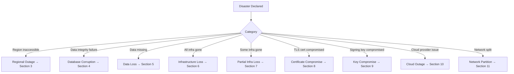

# QODIQA Disaster Recovery Guide

**Operations & Production Readiness**

| Field | Value |
|-------|-------|
| Document | Disaster Recovery Guide |
| Version | 1.0.0 |
| Owner | Platform Engineering / SRE |
| Audience | SRE, CISO, On-Call, Incident Commander |
| Classification | Internal — Confidential |
| Last Updated | 2026-07-03 |

---

## Table of Contents

1. [Recovery Objectives](#1-recovery-objectives)
2. [Disaster Categories](#2-disaster-categories)
3. [Regional Outage](#3-regional-outage)
4. [Database Corruption](#4-database-corruption)
5. [Data Loss](#5-data-loss)
6. [Complete Infrastructure Loss](#6-complete-infrastructure-loss)
7. [Partial Infrastructure Loss](#7-partial-infrastructure-loss)
8. [Certificate Compromise](#8-certificate-compromise)
9. [Key Compromise](#9-key-compromise)
10. [Cloud Provider Outage](#10-cloud-provider-outage)
11. [Network Partition](#11-network-partition)
12. [Recovery Sequence](#12-recovery-sequence)
13. [Validation Checklist](#13-validation-checklist)

---

## 1. Recovery Objectives

| Metric | Target | Notes |
|--------|--------|-------|
| **RTO** (Recovery Time Objective) | 4 hours | Step-budget estimate (§3.4, §6.2, §12) — not yet measured against a live drill. See DR RTO Measurement for how the next drill produces a real number. |
| **RPO** (Recovery Point Objective) | 5 minutes | PostgreSQL — continuous WAL archiving (`scripts/pg-wal-archive.sh`), verified every 5 minutes and alarmed if archiving stalls. |
| **Audit chain RPO** | 5 minutes | Self-hosted/systemd: `scripts/backup-audit-log.sh`, every 5 minutes, directly on the authoritative file (a daily base plus 5-minute incremental segments in a sealed chain — same cadence, I/O proportional to new data; see backup-scheduling.md §3). Kubernetes: the standalone backup pod cannot reach the per-pod-exclusive audit-log volume at all (§6.1 below is unaffected by this — see the note directly below this table), so the claim is met through the Postgres-mirrored `audit_chain` table via the PostgreSQL RPO row above. |
| **MTTR** (Mean Time to Recover) | 2 hours | Target for well-practised scenarios |

**Which mechanism satisfies the audit chain RPO depends on topology:** in
the self-hosted/systemd deployment, the file itself is backed up every 5
minutes. In the Kubernetes CronJob topology, a standalone backup pod cannot
reach the audit log's per-pod-exclusive `ReadWriteOnce` volume (a
deliberate, previously-remediated design decision — see
`deploy/kubernetes/overlays/single-node/statefulset.yaml`'s own header comment on ``,
and the "Known scope boundary" note in
`deploy/kubernetes/base/backup-cronjobs.yaml`), so the claim is met instead
through the Postgres-mirrored `audit_chain` table, itself captured within 5
minutes by continuous WAL archiving. `scripts/dr/cycle.js`'s
`auditChainValid: false` / `postgresValid: true` result is the expected,
healthy signal for that standalone job — not a gap.

**These objectives assume:**
- Current production backups are accessible and verified.
- DR runbook was last exercised within the past 90 days.
- At least two engineers with production access are available.
- Secrets (KEK, API keys) are accessible from the secrets management system.

---

## 2. Disaster Categories



**Disaster declaration criteria:**
- Service is unavailable or degraded for > 15 minutes and cannot be resolved by standard operational procedures.
- Cryptographic material (keys or certificates) is known or suspected to be compromised.
- Data integrity failure is confirmed.
- Infrastructure loss affects more than 50% of serving capacity.

---

## 3. Regional Outage

A regional outage occurs when a cloud provider availability zone or region becomes inaccessible.

### 3.1 Detection

```bash
# Verify the outage is regional (not local to your VPC/cluster)
curl -sf https://status.aws.amazon.com/rss/ec2-us-east-1.rss | head -20
# Or: check provider status page directly

# Verify internal health
kubectl get nodes -o wide  # Check if nodes are returning
kubectl get pods -n qodiqa  # Check pod status
```

### 3.2 Single-AZ Failure (HA Cluster)

If your cluster spans multiple AZs (which it should), single-AZ failure causes pod eviction but automatic recovery:

```bash
# Monitor pod redistribution
kubectl get pods -n qodiqa -o wide -w

# TopologySpreadConstraints in deployment.yaml ensures pods spread across AZs
# Kubernetes will schedule replacement pods on healthy AZs within 60 seconds
```

Expected log during AZ failure:
```
Node node-az-b not found / Pod evicted → Kubernetes schedules replacement on node-az-a
```

### 3.3 Full Regional Failover

If the entire region is inaccessible, fail over to the DR region:

```bash
# 1. Declare disaster — do NOT attempt further recovery in the failed region
# 2. Open the DR incident channel
# 3. Identify the latest verified backup in the DR region's storage

# Step 1: Verify DR region infrastructure is ready
kubectl config use-context qodiqa-dr-region
kubectl get nodes -n qodiqa

# Step 2: Verify the latest backup is accessible in DR
aws s3 ls s3://qodiqa-backups-dr-region/pg/ | tail -5
# Or for GCP:
gsutil ls gs://qodiqa-backups-dr/pg/ | tail -5

# Step 3: Restore database in DR region (Section 5 — Database Restore)
BACKUP_FILE="s3://qodiqa-backups-dr-region/pg/qodiqa-latest.dump.gz"
aws s3 cp "$BACKUP_FILE" /tmp/qodiqa-restore.dump.gz

# Step 4: Update DNS to point to DR region endpoint
# (procedure depends on your DNS provider)

# Step 5: Start QODIQA in DR region following the Startup Runbook
```

### 3.4 Regional Failover Sequence

```
1. Declare disaster (< 5 min)
2. Assemble incident team (< 10 min)
3. Verify DR region infrastructure (< 15 min)
4. Identify and verify latest backup (< 20 min)
5. Restore PostgreSQL in DR region (20–60 min)
6. Restore audit log file (< 5 min)
7. Restore key store from secrets manager (< 5 min)
8. Restore configuration (< 5 min)
9. Start QODIQA in DR region (< 10 min)
10. Update DNS (< 5 min)
11. Validate DR deployment (< 15 min)
─────────────────────────────────────────
Total: ~2–3 hours (within 4h RTO)
```

---

## 4. Database Corruption

### 4.1 Detection

```bash
# Symptoms of database corruption:
# - PostgreSQL startup log: FATAL: invalid page header
# - pg_dump fails with: ERROR: could not read block N
# - QODIQA startup log: audit chain hash mismatch

# Verify PostgreSQL data integrity
pg_dump "$QODIQA_PG_URL" --schema-only > /dev/null 2>&1 || \
  echo "CRITICAL: Database schema dump failed — corruption suspected"

# Check PostgreSQL logs
tail -100 /var/log/postgresql/postgresql-*.log | grep -iE 'corrupt|invalid|checksum'

# Check for invalid tuples
psql "$QODIQA_PG_URL" -c "
  SELECT schemaname, tablename
  FROM pg_tables
  WHERE schemaname = 'public';
" > /dev/null 2>&1 || echo "CRITICAL: Cannot query table list"
```

### 4.2 Containment

```bash
# Stop QODIQA immediately (prevent additional writes to corrupted DB)
kubectl scale deployment qodiqa --replicas=0 -n qodiqa

# Preserve the corrupted database state for forensic analysis
FORENSIC_BACKUP="/opt/qodiqa/forensic/corrupted-db-$(date +%Y%m%d-%H%M%S)"
mkdir -p "$FORENSIC_BACKUP"
pg_dump "$QODIQA_PG_URL" --format=custom --compress=9 \
  --no-synchronized-snapshots \
  > "$FORENSIC_BACKUP/corrupted-db.dump.gz" 2>/dev/null || true
echo "Forensic backup attempt: $FORENSIC_BACKUP"
```

### 4.3 Recovery

Restore from the last verified backup using the [Restore Runbook](restore-runbook.md) Section 5. The data loss will be up to 5 minutes (RPO), verified continuously by `scripts/pg-wal-archive.sh --verify` rather than assumed.

After restore, check audit chain integrity. **Single-node mode:**

```bash
node -e "
const AuditLog = require('./src/core/audit/audit-log.js');
AuditLog.verifyChain().then(r => {
  console.log('Audit chain post-restore:', r.valid ? 'VALID' : 'BROKEN');
  process.exit(r.valid ? 0 : 1);
});
"
```

If the audit chain file is valid but the PostgreSQL replica is corrupted, rebuild from file (Restore Runbook Section 6.2).

**Distributed mode:** there is no local file — the `audit_chain` table
being restored here (this section's own PostgreSQL restore, above) **is**
the audit chain, verified directly by `scripts/dr/restore.js`'s mandatory
integrity gate as part of the restore itself; there is nothing to
"rebuild from file" and no separate file-integrity check applies. See
[Backup → Restore Validation
§4.3](backup-restore-validation.md#43-distributed-mode-audit-chain-restore).

For an automated, all-in-one post-restore integrity check that loads the restored files through the real production modules (audit chain, key store, policy store), use the [Backup → Restore Validation](backup-restore-validation.md) framework (`node scripts/dr/validate.js <restored-root>`).

---

## 5. Data Loss

Data loss scenarios where data cannot be recovered from the corrupted system and must be restored from backup.

### 5.1 Accidental Data Deletion

```bash
# Identify what was deleted and when
psql "$QODIQA_PG_URL" -c "
  SELECT table_name, pg_size_pretty(pg_total_relation_size(table_name::regclass)) AS size
  FROM information_schema.tables
  WHERE table_schema = 'public'
  ORDER BY pg_total_relation_size(table_name::regclass) DESC;
"

# For RLS-protected tables (audit_chain, transparency_log_entries):
# These cannot be deleted by qodiqa_app role — only by superuser
# Log the event as a potential security incident
```

**Recovery:** Partial restore from backup (Restore Runbook Section 4).

### 5.2 Audit Log File Loss (single-node mode only)

**Applies only to single-node/file-authoritative deployments.** In
distributed mode there is no `audit.log` file to lose — the `audit_chain`
table is the sole authoritative store, and this scenario doesn't apply (see
§7.3's distributed-mode note below).

```bash
# If audit.log is missing or truncated
ls -la "$QODIQA_AUDIT_LOG"

# Check if WAL contains unflushed entries
ls -la "${QODIQA_AUDIT_LOG}.wal" 2>/dev/null

# Check if the PostgreSQL replica has recent entries
psql "$QODIQA_PG_URL" -c "
  SELECT MAX(created_at), COUNT(*) FROM audit_chain;
"
```

Recovery options (in order of preference):
1. Restore from audit log backup (Restore Runbook Section 6).
2. If audit log backup does not exist but PostgreSQL replica does, export PostgreSQL → rebuild file (partial data, some entries may be newer in file but already synced to PG).
3. Document data loss extent in the incident record.

---

## 6. Complete Infrastructure Loss

Loss of all production infrastructure: all Kubernetes nodes, databases, and persistent storage simultaneously.

### 6.1 What Must Be Recovered

| Component | Source | Priority |
|-----------|--------|---------|
| PostgreSQL database | Offsite backup | 1 |
| Audit log file (single-node mode) — covered by the PostgreSQL `audit_chain` table above instead, in distributed mode | Offsite backup | 1 |
| Encrypted key store | Secrets manager or secure offsite backup | 1 |
| TLS certificates | Secrets manager or offsite backup | 1 |
| Policy file | Git repository / offsite backup | 2 |
| Application image | Container registry | 2 |
| Kubernetes manifests | Git repository | 2 |
| Configuration | Secrets manager | 2 |

### 6.2 Recovery Procedure

```bash
# Provision new infrastructure (cloud console / Terraform)
terraform apply -var-file=production.tfvars
# Expected: ~30 minutes for cloud provider provisioning

# Restore PostgreSQL
# (provision new RDS/Cloud SQL instance or self-managed PostgreSQL)
# Follow Section 5 — Database Restore with offsite backup

# Configure Redis
# (provision new Redis instance)
# Verify AOF is enabled immediately after provisioning

# Restore key material
# Retrieve KEK from secrets manager
vault kv get secret/qodiqa/production-kek

# Restore key store
aws s3 cp s3://qodiqa-backups-offsite/keys/keys-latest.json \
  "$QODIQA_KEYS_PATH"

# Restore audit log
aws s3 cp s3://qodiqa-backups-offsite/audit/audit-latest.log.gz /tmp/
gzip -d -c /tmp/audit-latest.log.gz > "$QODIQA_AUDIT_LOG"

# Deploy QODIQA (pick the topology this environment actually runs)
kubectl apply -k deploy/kubernetes/overlays/single-node/
# — or —
kubectl apply -k deploy/kubernetes/overlays/distributed/
kubectl rollout status deployment/qodiqa -n qodiqa --timeout=300s   # distributed (Deployment)
# — or —
kubectl rollout status statefulset/qodiqa -n qodiqa --timeout=300s # single-node (StatefulSet)

# Validate
curl -fsS http://localhost:3000/health
```

**Expected total recovery time: 3–4 hours.**

---

## 7. Partial Infrastructure Loss

Loss of a subset of infrastructure components.

### 7.1 QODIQA Nodes Lost (Database Intact)

```bash
# K8s automatically reschedules pods — wait and verify
kubectl rollout status deployment/qodiqa -n qodiqa --timeout=300s
kubectl get pods -n qodiqa

# If nodes are permanently lost, add replacement nodes
# Cloud provider: add node pool / replace auto-scaling group members
```

Expected recovery time: 2–5 minutes (auto-rescheduled by Kubernetes).

### 7.2 Redis Lost (Data and Replay Protection)

See [Redis Failure Runbook](redis-failure.md) for the complete procedure.

**Critical:** When Redis is lost and restarted fresh:
- All in-memory nonce state is cleared.
- Replay protection window is reset.
- Any request ID from before the Redis failure can be replayed for the TTL window.

Mitigation: maintain a brief client-side request ID cooldown period after Redis recovery.

```bash
# After Redis recovery, verify QODIQA returns to READY
curl -sf http://localhost:3000/ready
# /metrics is ops-authenticated (src/app.js:179): OPS_AUTH_HEADER_FILE is a 0600 file holding one line
# "Authorization: Bearer <operator API key>" (curl -H @file keeps the key out of argv; docs/operations/deployment-runbook.md §8).
curl -sf -H @"$OPS_AUTH_HEADER_FILE" http://localhost:3000/metrics | grep redis_store_up
```

### 7.3 PostgreSQL Lost (Audit Replica Only — single-node mode)

**This section describes single-node mode only.** There, PostgreSQL is a
mirror, not on the critical enforcement path, so QODIQA continues serving
requests during a PostgreSQL outage and the audit chain file remains
authoritative.

**In distributed mode this does not apply** — PostgreSQL is the sole
ordering authority there (no "audit replica," full stop), so losing it is
NOT a degraded-but-serving scenario; see the distributed-mode ordering
architecture in
ADR-AUDIT-CHAIN-ARCHITECTURE.md
and [PostgreSQL Failure Runbook](postgresql-failure.md) for what actually
happens and how to recover.

See [PostgreSQL Failure Runbook](postgresql-failure.md) for recovery. After PostgreSQL is restored, QODIQA's persistence recovery queue automatically resynchronises.

---

## 8. Certificate Compromise

A TLS certificate compromise means a private key for a TLS certificate (Redis mTLS, PostgreSQL TLS, or HTTPS ingress) is known or suspected to have been exposed.

### 8.1 Containment

```bash
# 1. Revoke the compromised certificate with your CA immediately
# (procedure depends on your CA — internal CA, Let's Encrypt, etc.)

# 2. Stop QODIQA to prevent further use of the compromised cert
kubectl scale deployment qodiqa --replicas=0 -n qodiqa

# 3. If Redis mTLS cert is compromised:
#    Rotate the Redis certificate — both server and client side
#    Redis accepts connections only from clients with a valid cert
#    → Revoking the client cert stops Redis from accepting QODIQA connections
```

### 8.2 Certificate Emergency Replacement

```bash
# Generate new certificates using your CA
# Example using internal CA with cfssl:

# Generate new Redis client certificate
cfssl gencert \
  -ca=ca.pem \
  -ca-key=ca-key.pem \
  -config=ca-config.json \
  -profile=client \
  redis-client-csr.json | cfssljson -bare redis-client-new

# Update the Kubernetes secret
kubectl create secret generic redis-client-tls \
  --from-file=tls.crt=redis-client-new.pem \
  --from-file=tls.key=redis-client-new-key.pem \
  --from-file=ca.crt=ca.pem \
  -n qodiqa \
  --dry-run=client -o yaml | kubectl apply -f -

# Restart QODIQA with the new certificate
kubectl scale deployment qodiqa --replicas=2 -n qodiqa
kubectl rollout status deployment/qodiqa -n qodiqa --timeout=120s
```

For full certificate rotation procedure, see [Certificate Expiration Runbook](certificate-expiration.md).

---

## 9. Key Compromise

Cryptographic signing key compromise (Ed25519 private key exposure) is the most critical security event for QODIQA. The signing key is used to guarantee the integrity of every AI decision artifact.

**This scenario has its own dedicated runbook.** See [Key Compromise Runbook](key-compromise-runbook.md) for the complete procedure.

**Immediate actions (first 5 minutes):**

```bash
# 1. Revoke the compromised key
curl -sf \
  -X POST http://localhost:3000/keys/revoke \
  -H "Authorization: Bearer $QODIQA_OPS_TOKEN" \
  -H "Content-Type: application/json" \
  -d '{"keyId": "COMPROMISED_KEY_ID", "reason": "KEY_COMPROMISE"}'

# 2. Stop QODIQA to prevent further signing with compromised key
kubectl scale deployment qodiqa --replicas=0 -n qodiqa

# 3. Activate the incident response procedure immediately
# See Incident Response runbook (Section 48.14)
```

---

## 10. Cloud Provider Outage

A cloud provider outage affecting the QODIQA production region.

### 10.1 Classification

| Outage Type | QODIQA Impact | Action |
|-------------|--------------|--------|
| Single AZ unavailable | Pods evict and reschedule | Wait for K8s auto-recovery |
| Zone-level database unavailable | PG replica writes fail; enforcement continues | Wait for provider recovery |
| Region-level outage | Full service unavailable | DR failover (Section 3.3) |
| Provider-wide outage (extremely rare) | Full service unavailable | Manual service suspension; communicate with customers |

### 10.2 Cloud Provider Failover Decision

Initiate DR region failover when:
- Provider SLA indicates > 4 hours to recovery, OR
- Impact has lasted > 2 hours with no resolution ETA, OR
- RTO threshold (4 hours) is approaching.

Do NOT initiate failover for outages expected to resolve within 1 hour — the failover process itself introduces risk and data loss equal to the backup RPO.

---

## 11. Network Partition

A network partition splits the QODIQA cluster into isolated segments.

### 11.1 Redis Network Partition

QODIQA uses Redis with fail-closed semantics for replay protection. If the network partition isolates QODIQA from Redis:

- `qodiqa_execution_integrity_full{}` drops to 0.
- `/ready` returns 503.
- Enforcement requests are **blocked** (fail-closed).
- No new AI decisions are permitted.

This is intentional. QODIQA accepts the cost of unavailability over the risk of replay attacks or split-brain enforcement.

**Recovery:**

```bash
# Monitor the partition resolution
watch -n 5 'curl -sf -H @"$OPS_AUTH_HEADER_FILE" http://localhost:3000/metrics | grep redis_store_up'

# When Redis reconnects, QODIQA automatically recovers
# No manual intervention required
# Verify readiness:
curl -sf http://localhost:3000/ready
```

### 11.2 PostgreSQL Network Partition

During a PostgreSQL network partition, the enforcement path is unaffected. Audit chain writes that fail against PostgreSQL are, when the partition is brief enough that individual retry writes still land, queued in the PostgreSQL-backed persistence recovery queue (`persistence_recovery_queue` table, migration 032 — not Redis, ). See `docs/operations/postgresql-failure.md` §3.4 for the narrower residual case of a sustained full partition, where the queue itself cannot be written to either.

```bash
# Monitor the persistence recovery queue
psql "$QODIQA_PG_URL" -t -c "SELECT count(*) FROM persistence_recovery_queue WHERE status = 'PENDING';"
# This number grows during the partition and shrinks as PostgreSQL reconnects
```

When PostgreSQL recovers, QODIQA drains the queue automatically.

### 11.3 Split-Brain Prevention

The Kubernetes `topologySpreadConstraints` and Redis single-instance design prevent split-brain scenarios. QODIQA's audit chain is a single-writer design (enforced by `multiInstanceGuard.js`) — only one instance writes the file at a time.

If a network partition causes two QODIQA instances to believe they are both the sole writer:
- The `multiInstanceGuard.js` detects PM2 cluster mode or Node cluster workers.
- It exits with `AUDIT_CHAIN_MULTI_INSTANCE_FORBIDDEN`.
- This is a known limitation documented in `ADR-AUDIT-CHAIN-ARCHITECTURE.md`.

---

## 12. Recovery Sequence

Use this master sequence for any disaster scenario. Skip sections that do not apply.

```
PHASE 1 — ASSESSMENT (target: < 15 minutes)
  1.1 Declare disaster — open incident channel
  1.2 Assemble incident team (IC, SRE, security, comms)
  1.3 Identify disaster category (Section 2)
  1.4 Assess blast radius — what is affected?
  1.5 Preserve forensic evidence before any remediation

PHASE 2 — CONTAINMENT (target: < 30 minutes)
  2.1 Stop serving traffic to affected components
  2.2 If key compromise: revoke key immediately (Key Compromise Runbook)
  2.3 If cert compromise: revoke certificate immediately
  2.4 Preserve all logs (do not overwrite)
  2.5 Communicate status to affected customers

PHASE 3 — RECOVERY (target: within RTO = 4 hours)
  3.1 Provision replacement infrastructure if needed
  3.2 Restore PostgreSQL from latest clean backup
  3.3 Restore audit chain (audit.log file in single-node mode; covered by
      3.2's PostgreSQL restore alone in distributed mode — no separate step)
  3.4 Restore key store and certificates from secure storage
  3.5 Restore configuration from secrets manager
  3.6 Start Redis and verify AOF enabled
  3.7 Start QODIQA following Startup Runbook
  3.8 Monitor startup for 5 minutes

PHASE 4 — VALIDATION (target: < 30 minutes)
  4.1 Full smoke test suite: all 8 tests PASS
  4.2 Audit chain integrity verified (see Backup → Restore Validation)
  4.3 Transparency log completeness verified
  4.4 Data loss quantified and documented
  4.5 All Redis stores operational
  4.6 All metrics nominal

PHASE 5 — RESTORATION
  5.1 Update DNS / load balancer to DR/recovery endpoint
  5.2 Gradually restore traffic (10% → 50% → 100%)
  5.3 Monitor for 30 minutes at each traffic level
  5.4 Declare recovery complete

PHASE 6 — POST-INCIDENT
  6.1 Preserve all incident artifacts (logs, forensics)
  6.2 Quantify actual RTO and RPO
  6.3 Conduct post-mortem within 48 hours
  6.4 Update DR runbook with lessons learned
  6.5 Schedule DR exercise to validate corrective actions
```

---

## 13. Validation Checklist

```
DISASTER RECOVERY VALIDATION CHECKLIST
Incident ID: __________  Declared: __________  Resolved: __________
Disaster Type: __________  Region: __________
Incident Commander: __________  SRE Lead: __________

ASSESSMENT
[ ] Disaster declared and incident channel opened
[ ] Disaster category identified: __________
[ ] Blast radius documented: __________
[ ] Forensic preservation initiated (logs, snapshots)

CONTAINMENT
[ ] Traffic stopped to affected components
[ ] Key revoked (if key compromise): yes / N/A
[ ] Certificate revoked (if cert compromise): yes / N/A
[ ] Customer communication initiated at: __________

RECOVERY
[ ] Target environment: [ ] Production restore  [ ] DR region  [ ] New infra
[ ] PostgreSQL backup used: __________  Timestamp: __________
[ ] Audit log backup used: __________  Timestamp: __________
[ ] Key store backup used: __________  Source: __________
[ ] Redis provisioned with AOF: confirmed
[ ] QODIQA started: __________

VALIDATION
[ ] /health → 200: confirmed
[ ] /ready → 200: confirmed
[ ] qodiqa_execution_integrity_full{} = 1: confirmed
[ ] Smoke tests 1–8: all PASS
[ ] Audit chain valid (node verification): VALID
[ ] Transparency log completeness: no gaps
[ ] Data loss quantified: _____ minutes / hours
[ ] Actual RPO: _____  Target: 5 minutes  Met: yes / no
[ ] Actual RTO: _____  Target: 4 hours (estimate — see DR RTO Measurement)  Met: yes / no

RESTORATION
[ ] DNS/LB updated to recovery endpoint
[ ] Traffic restored to 10%: __________
[ ] Traffic restored to 100%: __________
[ ] 30-minute monitoring at full traffic: complete
[ ] Recovery declared complete: __________

POST-INCIDENT
[ ] All incident artifacts preserved
[ ] Post-mortem scheduled: __________
[ ] DR runbook update required: yes / no
[ ] Next DR exercise date: __________

SIGN-OFF
Incident Commander: __________  Time: __________
SRE Lead: __________
CISO: __________ (required for key/cert compromise events)
```

---

*Cross-references: [Backup Scheduling](backup-scheduling.md) | DR RTO Measurement | [Key Compromise Runbook](key-compromise-runbook.md) | [Certificate Expiration](certificate-expiration.md) | [Redis Failure Runbook](redis-failure.md) | [PostgreSQL Failure Runbook](postgresql-failure.md) | [Backup Runbook](backup-runbook.md) | [Restore Runbook](restore-runbook.md) | [Backup → Restore Validation](backup-restore-validation.md) | [Incident Response](incident-response.md) | [Metrics & Alerting](metrics-and-alerting.md) | [Reliability Guide](../architecture/RELIABILITY_GUIDE.md)*
