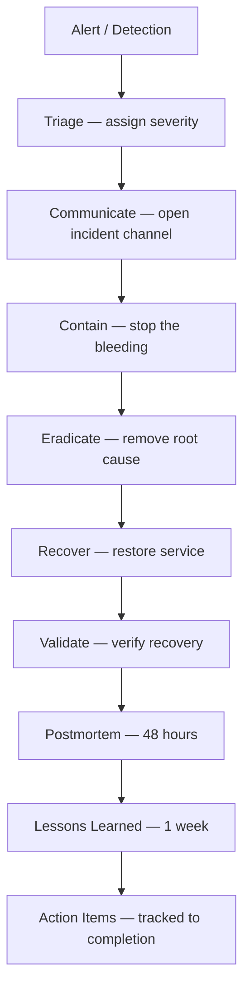
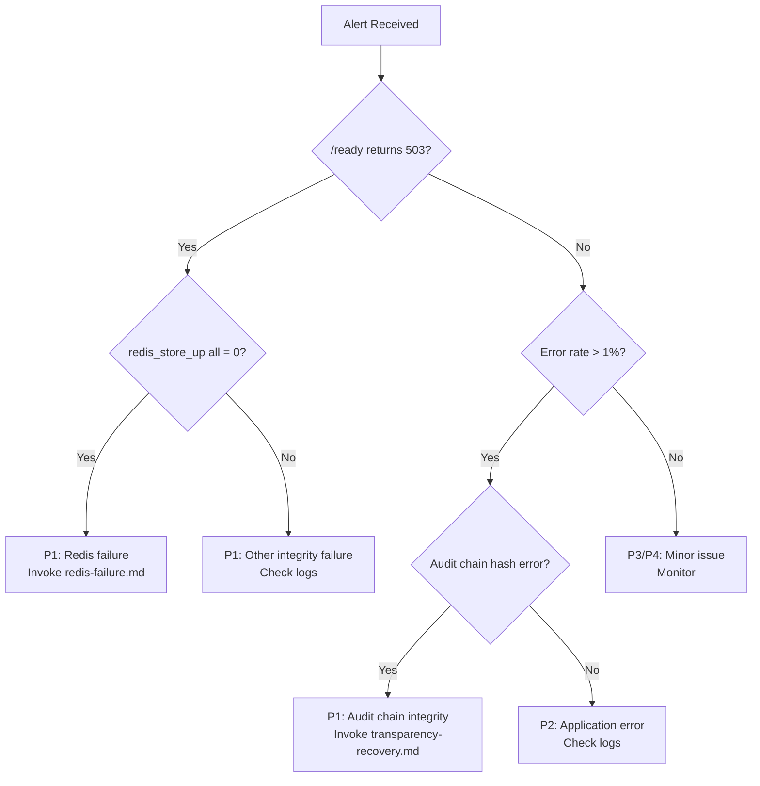

# QODIQA Incident Response Guide

**Operations & Production Readiness**

| Field | Value |
|-------|-------|
| Document | Incident Response Guide |
| Version | 1.0.0 |
| Owner | SRE / Security |
| Audience | All Engineering, CISO, Product, Legal, Customer Success |
| Classification | Internal — Operational |
| Last Updated | 2026-07-03 |

---

## Table of Contents

1. [Overview](#1-overview)
2. [Severity Definitions](#2-severity-definitions)
3. [Incident Classification](#3-incident-classification)
4. [Communication Flow](#4-communication-flow)
5. [Ownership and Roles](#5-ownership-and-roles)
6. [Triage](#6-triage)
7. [Containment](#7-containment)
8. [Eradication](#8-eradication)
9. [Recovery](#9-recovery)
10. [Postmortem](#10-postmortem)
11. [Root Cause Analysis](#11-root-cause-analysis)
12. [Lessons Learned](#12-lessons-learned)
13. [Evidence Preservation](#13-evidence-preservation)
14. [Audit Trail](#14-audit-trail)
15. [Timeline Reconstruction](#15-timeline-reconstruction)
16. [Break-Glass: Ops Authentication Recovery](#16-break-glass-ops-authentication-recovery)
17. [Consent Revocation Propagation Failures](#17-consent-revocation-propagation-failures)

---

## 1. Overview

QODIQA's incident response process is structured around four phases: **Detect → Contain → Eradicate → Recover**. Every incident, regardless of severity, concludes with a postmortem to prevent recurrence.



**Incident response applies to all events that affect QODIQA's:**
- Availability (service down or degraded)
- Integrity (audit chain, artifacts, or keys compromised)
- Confidentiality (data exposure or unauthorized access)
- Compliance (regulatory or contractual obligations affected)

---

## 2. Severity Definitions

### P1 — Critical

**Definition:** Complete service outage, security breach, or integrity compromise.

**Characteristics:**
- QODIQA enforcement is completely unavailable (all requests fail).
- A cryptographic key or certificate is compromised.
- The audit chain integrity is broken.
- Data loss is occurring or has occurred.
- Active unauthorized access is detected.

**Response SLA:** Incident Commander assigned within **5 minutes**; first customer communication within **30 minutes**.

**Examples:**
- All `/ai/chat` enforcement requests returning 5xx.
- Redis completely unavailable (fail-closed means all enforcement blocked).
- Consent revocation subscriber disconnected (`GET /ready` →
  `components.consentSubscriber: false`) — all `REQUIRE_CONSENT` requests on
  the affected node(s) are denied; see [Redis Failure Runbook §12](redis-failure.md#12-consent-subsystem-consentcache-and-revocation-subscriber).
- Ed25519 signing key exposed in logs or repository.
- Audit chain hash mismatch detected.
- Unauthorized access to signing API.

### P2 — High

**Definition:** Significant degradation affecting a subset of functionality or customers.

**Characteristics:**
- Enforcement success rate < 95%.
- Single customer or tenant affected.
- PostgreSQL unavailable (enforcement continues but observability degraded).
- Certificate expiring within 72 hours with no renewal in progress.

**Response SLA:** Incident Commander assigned within **15 minutes**; first communication within **1 hour**.

### P3 — Medium

**Definition:** Service degraded but functional; single non-critical feature impacted.

**Characteristics:**
- Elevated latency (p95 > 2×baseline) without errors.
- Non-critical dashboard or compliance feature unavailable.
- Certificate expiring within 14 days.
- Policy simulation or visual builder unavailable.

**Response SLA:** Assigned to SRE within **1 hour**; update to stakeholders within **4 hours**.

### P4 — Low

**Definition:** Cosmetic issue, minor degradation, or pre-emptive investigation.

**Characteristics:**
- Single user reporting intermittent errors.
- Non-production environment issue.
- Configuration drift from expected state.
- Informational security scan findings.

**Response SLA:** Assigned within **1 business day**; resolved within **1 week**.

---

## 3. Incident Classification

Use this matrix to determine the initial severity classification:

| Symptom | Default Severity | Escalate if |
|---------|-----------------|-------------|
| `qodiqa_execution_integrity_full{}` = 0 | P1 | — |
| `/ready` returning 503 | P1 | — |
| Redis completely unavailable | P1 | — |
| `/ready` `components.consentSubscriber` = false (Redis reachable otherwise) | P1 | — |
| Key material suspected exposed | P1 | — |
| Audit chain integrity failure | P1 | — |
| Enforcement error rate > 5% | P1 | > 30 min duration |
| Enforcement error rate 1–5% | P2 | > 15 min duration → P1 |
| PostgreSQL unavailable | P2 | > 1 hour → P1 |
| Latency p95 > 2×baseline | P3 | Error rate increases → P2 |
| Certificate ≤ 14 days | P3 | ≤ 72 hours → P2 |
| Certificate ≤ 72 hours | P2 | Expired → P1 |
| Policy load failure | P2 | Enforcement affected → P1 |
| Single user issue | P4 | Multiple users → P3 |

**Reclassify up immediately** if the initial assessment proves optimistic.

---

## 4. Communication Flow

### 4.1 Internal Communication

```
DETECTION
├── On-call SRE (paged automatically by monitoring)
│   └── Creates incident in incident management system
│       └── Opens #incident-YYYY-MM-DD-P{1,2,3} Slack channel
│
P1/P2 ESCALATION (within 5/15 min)
├── Incident Commander (IC) assigned
├── SRE Lead notified
├── Engineering Lead notified
└── P1 only: CISO and VP Engineering notified
    └── P1 security: Legal, Compliance notified
│
ONGOING UPDATES
└── Every 15 minutes during P1/P2 active phase
    Every 30 minutes during P3 active phase
    Posted to incident channel and status page
```

### 4.2 External Communication

| Severity | Customer Notification | SLA |
|----------|--------------------|-----|
| P1 (outage) | Status page update + proactive customer email | Within 30 min of detection |
| P1 (security breach) | Direct notification to affected customers | Within 72 hours (regulatory) |
| P2 | Status page update | Within 1 hour |
| P3 | Status page update (optional) | If externally visible |
| P4 | None | — |

### 4.3 Status Page Template (P1)

```
[INVESTIGATING] QODIQA Enforcement Degraded
2026-07-03 14:30 UTC

We are investigating reports of enforcement errors affecting [all customers / specific region].

Impact: AI authorization enforcement requests may be failing or experiencing elevated latency.
Start time: 2026-07-03 14:15 UTC
Next update: 2026-07-03 14:45 UTC

Our team is actively working to resolve this issue.
```

---

## 5. Ownership and Roles

### Incident Commander (IC)

**Owns:** The incident end-to-end. Decides when the incident is resolved. Coordinates all responders.

**Does:**
- Opens the incident channel.
- Assigns roles.
- Posts status updates every 15 minutes.
- Calls escalation if needed.
- Declares resolution.
- Schedules postmortem.

### SRE Lead

**Owns:** Technical remediation. Executes the runbooks.

**Does:**
- Executes investigation and containment steps.
- Reports technical findings to IC.
- Invokes specific runbooks (Redis, PostgreSQL, key compromise, etc.).
- Validates recovery.

### Security Engineer (for P1 security incidents)

**Owns:** Forensic evidence preservation, security analysis.

**Does:**
- Preserves evidence before remediation.
- Assesses security impact scope.
- Determines notification obligations.
- Coordinates with Legal.

### Communication Lead

**Owns:** All external communications.

**Does:**
- Updates status page.
- Drafts customer notifications.
- Coordinates with Customer Success for affected customers.

---

## 6. Triage

### 6.1 First Responder Actions (within 5 minutes of P1 alert)

```bash
# 1. Confirm the alert is real (not a false positive)
curl -sf http://QODIQA_HOST/ready
# 503 = confirmed P1; 200 = possible false positive

# 2. Check the integrity metric
# /metrics is ops-authenticated (src/app.js:179): OPS_AUTH_HEADER_FILE is a 0600 file holding one line
# "Authorization: Bearer <operator API key>" (curl -H @file keeps the key out of argv; docs/operations/deployment-runbook.md §8).
curl -sf -H @"$OPS_AUTH_HEADER_FILE" http://QODIQA_HOST/metrics | grep qodiqa_execution_integrity_full
# 0 = integrity failure; 1 = integrity OK

# 3. Check recent error logs
kubectl logs -l app=qodiqa -n qodiqa --since=10m | \
  jq 'select(.level=="error" or .level=="fatal")' | tail -30

# 4. Determine the affected component
curl -sf -H @"$OPS_AUTH_HEADER_FILE" http://QODIQA_HOST/metrics | grep -E 'redis_store_up|execution_integrity'
# redis_store_up = 0 → Redis failure
# Other → investigate further

# 5. Assign severity based on classification matrix (Section 3)
```

### 6.2 Triage Decision Tree



---

## 7. Containment

Containment stops the bleeding — it does not fix the root cause.

### 7.1 Traffic Containment

```bash
# Remove QODIQA from load balancer rotation while investigating
# (Only if the investigation requires QODIQA to stop processing requests)
# WARNING: This blocks all enforcement — coordinate with IC before doing this

# Kubernetes: scale to zero (last resort)
kubectl scale deployment qodiqa --replicas=0 -n qodiqa

# More targeted: remove pod from endpoints without killing it
kubectl label pod <pod-name> -n qodiqa app=qodiqa-isolated --overwrite
# (The Service selector 'app: qodiqa' no longer matches this pod)
```

### 7.2 Key Compromise Containment

For any suspected key compromise:

```bash
# Immediately revoke the key (Section 48.9)
# Do not delay for investigation — revoke first
curl -sf -X POST http://localhost:3000/keys/revoke \
  -H "Authorization: Bearer $QODIQA_OPS_TOKEN" \
  -H "Content-Type: application/json" \
  -d '{"keyId": "SUSPECTED_KEY_ID", "reason": "KEY_COMPROMISE"}'
```

**For Vault Transit / HSM / KMS-backed keys, this call alone does not guarantee the provider has stopped signing with the key** — complete the provider-side step in the runbook below.

See [Key Compromise Runbook](key-compromise-runbook.md) (Section 5.4 covers the required provider-side step for native-signing deployments).

### 7.3 Data Access Containment

If unauthorized data access is suspected:

```bash
# Revoke compromised API credentials immediately
# Rotate QODIQA_OPS_TOKEN in secrets manager
vault kv patch secret/qodiqa/production \
  QODIQA_OPS_TOKEN="$(openssl rand -hex 32)"

# Restart QODIQA to pick up new credentials
kubectl rollout restart deployment/qodiqa -n qodiqa
```

```bash
# TRUST-1: there is no single shared sign token to rotate — each caller
# authenticates with its own individually-issued sk_... signing API key
# (src/core/signing/signingIdentityStore.js). Revoke the specific
# compromised identity's key directly — see key-compromise-runbook.md
# §4.2 for the full procedure (listSigningIdentities() / revokeSigningKey()).
```

---

## 8. Eradication

Eradication removes the root cause. This follows the specific runbook for the failure type.

### 8.1 Runbook Index for Eradication

| Root Cause | Runbook |
|------------|---------|
| Redis failure | [Redis Failure Runbook](redis-failure.md) |
| PostgreSQL failure | [PostgreSQL Failure Runbook](postgresql-failure.md) |
| Application bug | [Rollback Runbook](rollback-runbook.md) |
| Key compromise | [Key Compromise Runbook](key-compromise-runbook.md) |
| Certificate expiration | [Certificate Expiration Runbook](certificate-expiration.md) |
| Transparency log corruption | [Transparency Recovery](transparency-recovery.md) |
| Infrastructure loss | [Disaster Recovery](disaster-recovery.md) |
| Deployment failure | [Rollback Runbook](rollback-runbook.md) |

### 8.2 Eradication Documentation

For every eradication action taken, document:

```
ERADICATION LOG — Incident [INCIDENT_ID]
Action: [What was done]
Operator: [Who did it]
Time: [When it was done]
Expected outcome: [What should happen]
Actual outcome: [What happened]
Verified: [Yes/No]
```

---

## 9. Recovery

Recovery restores the service to full operational status.

### 9.1 Recovery Validation

Before declaring recovery, all of the following must be confirmed:

```bash
# 1. Liveness
curl -sf http://localhost:3000/health && echo "Liveness: OK"

# 2. Readiness  
curl -sf http://localhost:3000/ready && echo "Readiness: OK"

# 3. Integrity metric
INTEGRITY=$(curl -sf -H @"$OPS_AUTH_HEADER_FILE" http://localhost:3000/metrics | grep qodiqa_execution_integrity_full | awk '{print $NF}')
[[ "$INTEGRITY" == "1" ]] && echo "Integrity: OK" || echo "FAIL"

# 4. Full smoke test
curl -fsS http://localhost:3000/health

# 5. Error rate back to baseline
# Monitor for 15 minutes minimum before declaring recovery
```

### 9.2 Traffic Restoration

Restore traffic gradually:

```bash
# Step 1: 10% traffic
# (update ingress/load balancer weight)
kubectl scale deployment qodiqa --replicas=2 -n qodiqa
# Kubernetes adds pods to endpoints automatically when readiness probe passes

# Monitor for 5 minutes at 10% traffic

# Step 2: Full traffic (Kubernetes default behavior — all ready pods get traffic)
# Monitor for 15 minutes

# Step 3: Declare recovery complete
```

### 9.3 Recovery Declaration

The Incident Commander declares recovery when:
- Full smoke tests pass.
- Error rate is at or below pre-incident baseline for 15 consecutive minutes.
- Customer-visible impact has ceased.
- All integrity metrics are nominal.

---

## 10. Postmortem

Every P1 and P2 incident requires a postmortem within **48 hours** of resolution.

### 10.1 Postmortem Template

```markdown
# QODIQA Incident Postmortem

**Incident ID:** INC-2026-07-03-001
**Severity:** P1
**Duration:** 14:15 UTC – 15:47 UTC (1 hour 32 minutes)
**Status:** RESOLVED
**Postmortem Date:** 2026-07-05
**Author:** [Name]
**Reviewers:** [Names]

## Summary
[2-3 sentences: what happened, impact, root cause]

## Timeline
| Time | Event |
|------|-------|
| 14:15 | First alert: qodiqa_execution_integrity_full{} = 0 |
| 14:20 | On-call SRE acknowledged |
| 14:22 | P1 declared; IC assigned |
| 14:25 | Root cause identified: Redis OOM killed |
| 14:35 | Redis restarted; QODIQA reconnecting |
| 14:42 | Enforcement restored; smoke tests passing |
| 15:47 | 1-hour monitoring complete; incident resolved |

## Impact
- Duration: 1h 32m
- Customer impact: All enforcement requests failed (fail-closed)
- Requests affected: ~5,000
- Customers affected: All (global outage)
- Revenue impact: [quantify if possible]

## Root Cause
[Detailed technical explanation of what went wrong and why]

## Contributing Factors
1. [Factor 1]
2. [Factor 2]

## What Went Well
1. Alert fired within 2 minutes of failure.
2. Runbook identified root cause in < 5 minutes.
3. Redis restart procedure was documented and executed correctly.

## What Could Be Improved
1. Redis maxmemory was not configured — this allowed OOM to occur.
2. No memory monitoring alert existed prior to this incident.

## Action Items
| Action | Owner | Due Date | Priority |
|--------|-------|----------|----------|
| Set Redis maxmemory in docker-compose.prod.yml | [SRE] | 2026-07-10 | P1 |
| Add Prometheus alert for Redis memory utilization > 80% | [SRE] | 2026-07-10 | P1 |
| Add Redis memory runbook section | [SRE] | 2026-07-15 | P2 |
```

---

## 11. Root Cause Analysis

### 11.1 RCA Methodology

QODIQA uses the **5 Whys** methodology for most incidents, supplemented by **Fishbone (Ishikawa)** analysis for complex, multi-causal incidents.

**5 Whys Example:**

```
Why was enforcement unavailable?
  → Because Redis was unavailable.

Why was Redis unavailable?
  → Because Redis was OOM-killed by the kernel.

Why was Redis OOM-killed?
  → Because it exceeded available memory.

Why did it exceed available memory?
  → Because maxmemory was not configured (unbounded).

Why was maxmemory not configured?
  → Because it was not part of the Redis deployment checklist.

ROOT CAUSE: Incomplete Redis deployment checklist.
```

### 11.2 Evidence Sources for RCA

| Evidence Source | Access Method |
|----------------|--------------|
| QODIQA structured logs | `kubectl logs` / log shipping platform |
| Prometheus metrics | Prometheus / Grafana dashboards |
| Kubernetes events | `kubectl get events -n qodiqa` |
| Redis logs | `docker logs redis` / Redis container logs |
| PostgreSQL logs | PG server logs |
| OS system logs | `dmesg`, `journalctl` |
| Network logs | Cloud provider flow logs |
| Audit chain | `/audit` API or direct file |
| Transparency log | PostgreSQL `transparency_log_entries` |

---

## 12. Lessons Learned

### 12.1 Tracking Lessons Learned

Every postmortem must produce:
1. At least one detection improvement (alert, monitoring, runbook).
2. At least one prevention improvement (architecture, process, automation).
3. Specific, time-bounded action items with named owners.

### 12.2 Knowledge Base Updates

After each incident:

```bash
# Update the docs/operations/troubleshooting.md with the new failure pattern
# Add to the docs/operations/runbook.md if a new procedure was discovered
# Update the relevant runbook in docs/operations/ with improved steps

# Example: After a Redis OOM incident, update redis-failure.md
# Section 5.3 now includes:
# - OOM kill detection via dmesg
# - maxmemory configuration check
```

---

## 13. Evidence Preservation

### 13.1 Evidence Collection Protocol

**Collect evidence BEFORE any remediation action.** Remediation can destroy evidence.

```bash
INCIDENT_ID="INC-$(date +%Y%m%d%H%M)"
EVIDENCE_DIR="/opt/qodiqa/forensic/${INCIDENT_ID}"
mkdir -p "$EVIDENCE_DIR"

# 1. System state snapshot
kubectl get all -n qodiqa -o yaml > "$EVIDENCE_DIR/k8s-state.yaml"
kubectl get events -n qodiqa > "$EVIDENCE_DIR/k8s-events.txt"
kubectl describe pods -n qodiqa > "$EVIDENCE_DIR/pod-descriptions.txt"

# 2. Application logs
kubectl logs -l app=qodiqa -n qodiqa --since=2h > "$EVIDENCE_DIR/qodiqa-logs.txt"
kubectl logs -l app=qodiqa -n qodiqa --previous > "$EVIDENCE_DIR/qodiqa-logs-previous.txt" 2>/dev/null

# 3. Metrics snapshot
curl -sf -H @"$OPS_AUTH_HEADER_FILE" http://localhost:3000/metrics > "$EVIDENCE_DIR/metrics-snapshot.txt"

# 4. Audit log snapshot
cp "$QODIQA_AUDIT_LOG" "$EVIDENCE_DIR/audit.log"
sha256sum "$EVIDENCE_DIR/audit.log" > "$EVIDENCE_DIR/audit.log.sha256"

# 5. Transparency log state
psql "$QODIQA_PG_URL" -c "
  SELECT sequence_number, entry_hash, entry_type, created_at
  FROM transparency_log_entries
  ORDER BY sequence_number DESC LIMIT 100;
" --csv > "$EVIDENCE_DIR/transparency-last100.csv"

# 6. Redis state
redis-cli --tls --cacert "$REDIS_TLS_CA" \
  --cert "$REDIS_TLS_CERT" --key "$REDIS_TLS_KEY" \
  -u "$REDIS_URL" INFO all > "$EVIDENCE_DIR/redis-info.txt"

# 7. Create evidence manifest
find "$EVIDENCE_DIR" -type f | sort | while read f; do
  sha256sum "$f"
done > "$EVIDENCE_DIR/MANIFEST.sha256"

chmod -R 700 "$EVIDENCE_DIR"
echo "Evidence collected: $EVIDENCE_DIR"
echo "Manifest: $EVIDENCE_DIR/MANIFEST.sha256"
```

### 13.2 Evidence Retention

| Incident Type | Retention Period | Storage |
|---------------|-----------------|---------|
| P1 security incident | 7 years | Immutable, encrypted, off-site |
| P1 availability | 1 year | Encrypted, off-site |
| P2 | 90 days | Encrypted, local + off-site |
| P3/P4 | 30 days | Local |

---

## 14. Audit Trail

Every incident action must be recorded in the incident audit trail:

```bash
# Log every action to the incident audit trail
log_incident_action() {
  local incident_id="$1"
  local action="$2"
  local operator="$3"
  local outcome="$4"
  
  cat >> "/opt/qodiqa/forensic/${incident_id}/incident-audit-trail.log" << EOF
$(date -u +%Y-%m-%dT%H:%M:%SZ)|$operator|$action|$outcome
EOF
}

# Usage:
log_incident_action "INC-20260703-1415" \
  "Scaled deployment to 0 replicas" \
  "john.doe" \
  "All pods terminated"

log_incident_action "INC-20260703-1415" \
  "Restarted Redis container" \
  "john.doe" \
  "Redis started and ready (PONG)"
```

The incident audit trail must be immutable and preserved with the evidence package.

---

## 15. Timeline Reconstruction

### 15.1 Automated Timeline from Logs

```bash
INCIDENT_START="2026-07-03T14:00:00Z"
INCIDENT_END="2026-07-03T16:00:00Z"

# Extract relevant events from QODIQA logs
kubectl logs -l app=qodiqa -n qodiqa --since-time="$INCIDENT_START" \
  --until-time="$INCIDENT_END" 2>/dev/null | \
  jq -r 'select(.level == "error" or .level == "fatal" or .level == "warn" or (.msg | test("AUDIT_PG|REDIS|shutdown|startup"))) | [.ts, .level, .msg, .error] | @tsv' | \
  sort

# Extract Redis events
docker logs redis --since "$INCIDENT_START" --until "$INCIDENT_END" 2>&1 | \
  grep -E 'WARN|ERR|FATAL|oops|crash|killed' | \
  awk '{print "[REDIS]", $0}'

# Extract Kubernetes events in the incident window
kubectl get events -n qodiqa \
  --field-selector reason=BackOff,reason=Failed,reason=Unhealthy \
  -o json | \
  jq -r '.items[] | select(.lastTimestamp >= "'$INCIDENT_START'" and .lastTimestamp <= "'$INCIDENT_END'") | [.lastTimestamp, .reason, .message] | @tsv' | \
  sort
```

### 15.2 Timeline Template

```
INCIDENT TIMELINE — INC-[ID]

T+0:00  14:15 UTC  Alert fired: qodiqa_execution_integrity_full{} = 0
T+0:02  14:17 UTC  Redis logs show OOM kill: [excerpt]
T+0:05  14:20 UTC  On-call SRE acknowledged alert
T+0:07  14:22 UTC  P1 declared; IC assigned; incident channel opened
T+0:10  14:25 UTC  Root cause identified: Redis OOM
T+0:15  14:30 UTC  Redis restarted
T+0:20  14:35 UTC  QODIQA started reconnecting to Redis
T+0:27  14:42 UTC  Enforcement restored; smoke tests PASS
T+0:32  14:47 UTC  IC announces recovery; monitoring period begins
T+1:32  15:47 UTC  Incident resolved after 1h monitoring with no recurrence
```

---

## 16. Break-Glass: Ops Authentication Recovery

*Cross-referenced from §7.3 (Data Access Containment), which covers rotating `QODIQA_SIGN_TOKEN`/`QODIQA_OPS_TOKEN` during an active compromise — this section covers the separate scenario of `QODIQA_OPS_TOKEN` being lost, forgotten, or rotated out from under an operator who needed it, and documents it as its own named procedure rather than leaving it to be pieced together from `src/middleware/opsAuth.js` and `scripts/rbac-bootstrap-key.js` during an actual incident.*

### 16.1 Rationale — why there are two ops-authentication paths

`createOpsAuthMiddleware()` (`src/middleware/opsAuth.js:112-174`) checks two credential sources, in this precedence order, for every request to an ops-authenticated endpoint:

1. **Per-operator RBAC API key** (`Authorization: Bearer <key>` or `X-Ops-Token`, resolved via the file-backed RBAC user store, `src/core/rbac/store.js`) — the intended long-term credential. Each operator has their own key, individually revocable, individually auditable (`OPS_AUTH_OK` logs `userId`/`username`/`role`).
2. **Shared `QODIQA_OPS_TOKEN`** (deprecated migration path, checked only if no RBAC key matched) — a single shared secret with no per-operator identity. Every successful use logs `OPS_AUTH_SHARED_TOKEN_USED` at `WARN` specifically to make its continued use visible and auditable, nudging deployments toward per-operator keys.

This ordering means **losing `QODIQA_OPS_TOKEN` is not, by itself, a lockout** — it only removes the fallback path. Any operator who already holds a valid, enabled RBAC API key is completely unaffected and can continue operating (and can issue new operator keys via `POST /rbac/users/:id/api-key`, self-healing the situation without ever touching `QODIQA_OPS_TOKEN` again).

### 16.2 Expected behavior when `QODIQA_OPS_TOKEN` is lost/rotated

| Situation | Behavior |
|---|---|
| At least one operator has a working RBAC API key | No impact. Ops endpoints remain reachable via that key. `QODIQA_OPS_TOKEN` can be removed from the deployment's secret store entirely (see `opsConfig.token` check, `opsAuth.js:157` — a falsy/absent token simply disables that fallback branch, it is never required to be present). |
| No operator has a working RBAC key, `QODIQA_OPS_TOKEN` is lost | Genuine lockout — `opsAuth.js`'s branch 3 (`OPS_AUTH_NOT_CONFIGURED`/`OPS_AUTH_INVALID_TOKEN`) rejects every request with `401 UNAUTHORIZED`. Proceed to §16.3. |
| No operator has a working RBAC key, `QODIQA_OPS_TOKEN` is set but forgotten (not lost — still present in the secrets manager) | Not a lockout at all — retrieve the value from the secrets manager (Vault, AWS/GCP/Azure secret store, sealed-secret source) that provisioned it; it does not need to be rotated or regenerated. |

### 16.3 Recovery procedure (genuine lockout)

This is the actual break-glass path, and it deliberately requires operational access to the runtime environment rather than any network-reachable credential — see `scripts/rbac-bootstrap-key.js`'s header comment for why an HTTP-reachable "issue the first key" endpoint would itself be a privilege-escalation hole this design specifically avoids.

1. Obtain `kubectl exec` (Kubernetes), `docker exec` (Compose/standalone), or direct host/SSH access to a running QODIQA instance — whichever this deployment uses.
2. Run the bootstrap script against the live RBAC store:
   ```bash
   node scripts/rbac-bootstrap-key.js
   ```
   - If no admin account exists yet, this creates one and prints a plaintext API key **exactly once** (`status: "PROVISIONED"`).
   - If an admin account already exists but you don't have its key (the actual lockout case), re-run with `--rotate`:
     ```bash
     node scripts/rbac-bootstrap-key.js --rotate
     ```
     This immediately invalidates the previous key for that account (`status: "ROTATED"`) — expected and safe if that key is genuinely inaccessible, but coordinate first if there is any chance another operator still has it working, since it will stop working the instant this runs.
3. Store the printed plaintext key in the secrets manager immediately — it is never displayed again and is not persisted in plaintext anywhere (`src/core/rbac/store.js` stores only its hash).
4. Use it as `Authorization: Bearer <key>` against `POST /rbac/users/:id/api-key` to provision keys for the actual operators who need access, rather than continuing to share the bootstrap admin's key.
5. Decide whether to re-provision `QODIQA_OPS_TOKEN` at all — per §16.1, it is optional once RBAC keys exist. If you do set a new one (e.g. to keep a legacy integration working during migration), generate it with `openssl rand -hex 32` (see §7.3) and treat it with the same secrecy.

### 16.4 Operational risks

- **The RBAC user store itself is a single file** (`data/rbac-users.json`, `QODIQA_RBAC_STORE_PATH`) and, unlike the audit chain/key store/policy store, is **not currently covered by `scripts/dr/backup.js`'s component list** (`scripts/dr/components.js`) — a total loss of that file (not merely a lost credential) has no automated DR-framework recovery path today and would require re-running the bootstrap procedure above from scratch (all previously-issued operator keys would need reissuing). This is a real, distinct gap from the ops-token-loss scenario this section otherwise covers — recorded here for visibility rather than silently assumed covered by [Disaster Recovery](disaster-recovery.md); closing it is outside this document's scope.
- **`--rotate` is not scoped to "only if locked out"** — running it invalidates the current key unconditionally. Confirm no other operator has a working key before using it outside a genuine lockout.
- **The bootstrap script requires the same filesystem the running server reads** — for the Kubernetes topologies, this means `kubectl exec` into a pod with the `qodiqa-keystore`/data volume actually mounted (see `docs/deployment/cloud-deployment.md`'s topology overlay table), not an arbitrary pod.
- **`OPS_AUTH_SHARED_TOKEN_USED` firing in production logs is itself a signal**, independent of any incident — it means at least one caller is still using the deprecated shared token and per-operator key migration (§16.3 step 4) has not fully completed for that caller.

## 17. Consent Revocation Propagation Failures

`CONSENT_REVOCATION_PROPAGATION_FAILED`, `CONSENT_SUSPENSION_PROPAGATION_FAILED`,
and `CONSENT_REVOCATION_ACTOR_PROPAGATION_FAILED` (`src/core/consent/
ConsentRegistry.js`) mean the same thing in every case: a consent change
already committed to PostgreSQL and invalidated on this node's local cache,
but could not be published to the Redis pub/sub channel other nodes listen
on. Enforcement is never weakened by this — every node independently
verifies consent from the database on a cache miss, and a degraded
subscriber blocks consent-dependent requests fail-closed rather than trust
stale cache state — but other nodes may continue serving a stale cached
`ALLOW` for up to the cache's positive-TTL window until their own cache
entry naturally expires or their subscriber recovers.

**Alerting**: all three events are `CRITICAL`-severity, paged via
the standard alerting pipeline (`src/alerting/detection/
OperationalDetector.js`'s `CONSENT_PROPAGATION_FAILED` rule) — previously
they were logged at `'CRITICAL'` log level but never reached alerting at
all. The alert payload carries `consentId`/`actorId`/`tenantId`
(`revokedCount` instead of `consentId`/`tenantId` for the bulk actor-level
event, which has no single tenant), `correlationId`, `destination`
(`"redis-pubsub"`), `failureReason`, and `retryAttempts`/`willRetry` — both
fixed `0`/`false`: the publish call itself is single-attempt by design (only
the underlying Redis *connection* retries independently, via its own
`reconnectStrategy`); this alert does not imply a retry loop that doesn't
exist.

**Response**: treat as a Redis pub/sub connectivity incident — see [Redis
Failure Runbook](redis-failure.md). Verify `RevocationSubscriber`/
`RevocationPublisher` health on affected nodes (`GET /diagnostics`'s
`revocation` block) and restore Redis connectivity; no manual consent-data
repair is needed, since PostgreSQL (the source of truth) and this node's own
cache were never inconsistent — only *other* nodes' cache freshness is at
risk until they recover.

---

*Cross-references: [Startup Runbook](startup-runbook.md) | [Shutdown Runbook](shutdown-runbook.md) | [Redis Failure Runbook](redis-failure.md) | [PostgreSQL Failure Runbook](postgresql-failure.md) | [Key Compromise Runbook](key-compromise-runbook.md) | [Disaster Recovery](disaster-recovery.md) | [Rollback Runbook](rollback-runbook.md) | [Metrics & Alerting](metrics-and-alerting.md) | [Security Guide](../security/SECURITY_GUIDE.md) | [Threat Model](../security/THREAT_MODEL.md)*
