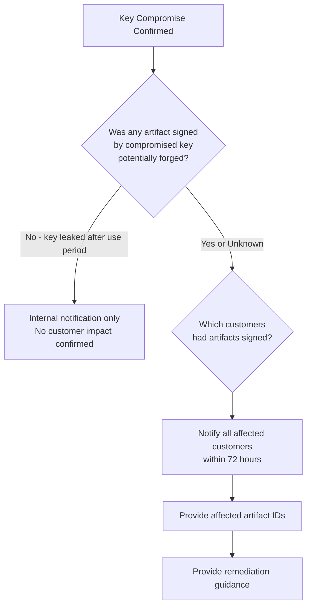

# QODIQA Key Compromise Runbook

**Operations & Production Readiness**

| Field | Value |
|-------|-------|
| Document | Key Compromise Runbook |
| Version | 1.0.0 |
| Owner | Security / Platform Engineering |
| Audience | CISO, Security Engineer, SRE, Incident Commander |
| Classification | Internal — Confidential |
| Last Updated | 2026-07-03 |

---

## Table of Contents

1. [Overview](#1-overview)
2. [Compromise Detection](#2-compromise-detection)
3. [Incident Classification](#3-incident-classification)
4. [Immediate Containment](#4-immediate-containment)
5. [Key Revocation](#5-key-revocation)
6. [Key Rotation](#6-key-rotation)
7. [Artifact Verification Impact Assessment](#7-artifact-verification-impact-assessment)
8. [Trust Chain Update](#8-trust-chain-update)
9. [Customer Notification](#9-customer-notification)
10. [Forensic Preservation](#10-forensic-preservation)
11. [Recovery Validation](#11-recovery-validation)

---

## 1. Overview

QODIQA uses Ed25519 signing keys to guarantee the integrity of every AI authorization decision artifact. Compromise of a signing private key is a **Critical P1 security incident** that:

- Invalidates the integrity guarantee of all artifacts signed by that key.
- Enables an attacker to forge artifacts and forge authorization decisions.
- Requires immediate revocation, rotation, and customer notification.
- Triggers a comprehensive forensic investigation.

> **Revocation scope warning:** Revoking a key within QODIQA (Section 5) updates the application's trust state — QODIQA itself will never again sign or verify with that key — but this does **not** by itself guarantee that an external HSM, Vault Transit engine, or KMS has stopped honoring signing requests for the compromised key. If the deployment uses a native signing provider (`QODIQA_KMS_PROVIDER=vault-transit` or `hsm`), QODIQA's revocation call attempts to propagate to the provider, but that call can fail or be limited by what the provider supports. **Always complete the provider-specific compromise response (disable, revoke, or destroy the key directly in Vault Transit / the HSM console / the KMS) in addition to the QODIQA revocation steps below.** Complete cryptographic enforcement of revoked keys — independent of provider cooperation — is tracked under finding . See `docs/security/key-management.md`'s "External Key Providers (Vault Transit / HSM / KMS)" section for the full explanation.

**Types of key material that may be compromised:**

| Key Type | Location | Impact of Compromise |
|----------|----------|---------------------|
| Ed25519 signing private key | Encrypted in `keys.json` (disk) | Artifact integrity invalidated |
| Key Encryption Key (KEK) | `QODIQA_KEY_ENCRYPTION_KEY` env var / Vault | Signing key ciphertext decryptable |
| Transparency signing key | Derived from signing infrastructure | Transparency log entries forgeable |
| Redis TLS client key | TLS cert store | Replay protection bypass possible |
| PostgreSQL TLS client key | TLS cert store | Database communication interceptable |

---

## 2. Compromise Detection

### 2.1 Automated Detection Signals

```bash
# Check for anomalous signing events in the audit log
grep '"event_type":"KEY_OPERATION"' "$QODIQA_AUDIT_LOG" | \
  jq 'select(.action == "SIGN" and .actor != "qodiqa-service")' | \
  tail -50

# Check for anomalous audit entries
grep '"decision":"ALLOW"' "$QODIQA_AUDIT_LOG" | \
  jq 'select(.signatureValid == false or .keyId == null)' | \
  tail -20

# Check for key access from unexpected IP addresses
grep '"key"' "$QODIQA_AUDIT_LOG" | \
  jq 'select(.clientIp and (.clientIp | test("^(10\\.|172\\.(1[6-9]|2[0-9]|3[01])\\.|192\\.168\\.)|^127\\.") | not))'
```

### 2.2 Manual Detection Sources

| Source | Indicator |
|--------|-----------|
| Vulnerability disclosure | Security researcher reports private key in public repository, log file, or error message |
| Infrastructure breach | Server, container, or secrets manager where `keys.json` or `QODIQA_KEY_ENCRYPTION_KEY` was stored has been accessed by unauthorized party |
| Artifact forgery report | Customer or partner reports a QODIQA-signed artifact with decision mismatch |
| Insider threat | An employee or contractor with access to key material is terminated or suspected |
| Supply chain incident | Third-party dependency or CI pipeline with access to secrets is compromised |
| HSM audit log anomaly | HSM provider reports unauthorized key access |

### 2.3 Compromise Indicators

A key is considered compromised when **any** of the following are true:
- Private key material appears in any log, repository, error message, or network trace.
- An unauthorized actor had access to the secrets store where the KEK or key file is stored.
- `POST /sign` requests are received from unexpected IP addresses or with unexpected bearer tokens.
- Artifacts appear in the transparency log that do not correspond to known enforcement operations.
- HSM provider confirms unauthorized operations were performed with the key.

---

## 3. Incident Classification

Upon confirming compromise indicators, immediately classify the incident:

| Severity | Criteria | Response |
|----------|----------|---------|
| **P1 — Critical** | Confirmed private key exposure; active artifact forgery | < 15 minutes to first action |
| **P1 — Critical** | KEK exposure (all keys potentially compromised) | < 15 minutes to first action |
| **P2 — High** | Unconfirmed exposure; strong indicators | < 1 hour to investigation |
| **P2 — High** | HSM audit anomaly with no confirmed key access | < 1 hour to investigation |

**Do not delay — treat indicators as compromise until proven otherwise.** The cost of a false positive (unnecessary rotation) is far lower than the cost of a missed compromise.

---

## 4. Immediate Containment

**Execute these steps in order, as fast as possible. Target: within 15 minutes of confirmed compromise.**

### 4.1 Stop All QODIQA Instances

```bash
# Kubernetes — stop all signing operations
kubectl scale deployment qodiqa --replicas=0 -n qodiqa

# Docker
docker-compose -f deploy/docker/docker-compose.prod.yml stop qodiqa

# Verify: no QODIQA process is running
kubectl get pods -n qodiqa  # Expected: No resources found
```

**Rationale:** Stopping the process prevents any further artifacts from being signed with the potentially compromised key. This is the highest-priority action.

### 4.2 Revoke Compromised Credentials

```bash
# If QODIQA_OPS_TOKEN may be compromised, rotate it in your secrets manager
vault kv patch secret/qodiqa/production \
  QODIQA_OPS_TOKEN="$(openssl rand -hex 32)"
echo "Ops token rotated — takes effect on next restart"
```

```bash
# TRUST-1: there is no single shared sign token to rotate — each caller
# authenticates with its own individually-issued sk_... signing API key
# (src/core/signing/signingIdentityStore.js). Revoke the specific
# compromised identity's key directly. QODIQA instances are already
# stopped per §4.1, so this is safe to run against the on-disk store.

# List identities to find the affected id:
node -e "console.log(require('./src/core/signing/signingIdentityStore').listSigningIdentities().map(i => ({id: i.id, name: i.name, tenantId: i.tenantId, revoked: i.revoked})))"

# Revoke the compromised identity's key. This invalidates it on disk
# immediately, but the store is loaded once per process
# (signingIdentityStore.js's _ensureLoaded()) — a currently-running
# instance would not see the change without a restart, which §4.1 has
# already ensured:
node -e "require('./src/core/signing/signingIdentityStore').revokeSigningKey('<identityId>', { revokedBy: 'incident-response', reason: 'key-compromise-runbook §4.2' })"
```

### 4.3 Preserve System State

```bash
FORENSIC_DIR="/opt/qodiqa/forensic/key-compromise-$(date +%Y%m%d-%H%M%S)"
mkdir -p "$FORENSIC_DIR"

# Copy audit log (read-only copy)
cp "$QODIQA_AUDIT_LOG" "$FORENSIC_DIR/audit.log"
cp "${QODIQA_AUDIT_LOG}.sum" "$FORENSIC_DIR/audit.log.sum" 2>/dev/null

# Copy keys.json (encrypted — safe to copy)
cp "$QODIQA_KEYS_PATH" "$FORENSIC_DIR/keys.json"

# Capture process environment (redact secrets before archiving externally)
kubectl get configmap -n qodiqa -o yaml > "$FORENSIC_DIR/configmaps.yaml"
kubectl describe deployment qodiqa -n qodiqa > "$FORENSIC_DIR/deployment.txt"

# Capture recent transparency log state
psql "$QODIQA_PG_URL" -c "
  SELECT * FROM transparency_log_entries
  ORDER BY sequence_number DESC LIMIT 100;
" --csv > "$FORENSIC_DIR/transparency-last100.csv"

# Capture recent audit chain from PostgreSQL
psql "$QODIQA_PG_URL" -c "
  SELECT hash, prev_hash, artifact_id, decision, timestamp, key_id, signature
  FROM audit_chain
  ORDER BY sequence_number DESC LIMIT 100;
" --csv > "$FORENSIC_DIR/audit-last100.csv"

chmod -R 700 "$FORENSIC_DIR"
echo "Forensic preservation complete: $FORENSIC_DIR"
```

### 4.4 Alert Security Team

Immediately notify:
- CISO
- Security Engineering
- Platform Engineering lead
- Legal (for regulatory notification obligations)
- Customer Success (for affected customer communication)

---

## 5. Key Revocation

**If this deployment uses a native signing provider (Vault Transit / HSM / KMS), complete Section 5.4 in addition to the steps below — QODIQA revocation alone does not guarantee the provider has stopped signing with this key.**

### 5.1 Revoke via API (if QODIQA is still running)

If QODIQA was not stopped before this step (e.g., the compromise was discovered through a non-operational route):

```bash
COMPROMISED_KEY_ID="$QODIQA_CLIENT_ID:key_v3"

curl -sf \
  -X POST http://localhost:3000/key-admin/$QODIQA_CLIENT_ID/revoke \
  -H "X-Ops-Token: $QODIQA_OPS_TOKEN" \
  -H "Content-Type: application/json" \
  -d "{\"keyId\": \"$COMPROMISED_KEY_ID\"}" | jq .

# Expected: {"revoked": true, "keyId": "...", "clientId": "..."}
```

### 5.2 Revoke via Key Store File (if QODIQA is stopped)

```bash
COMPROMISED_KEY_ID="key-xxxxxxxx-xxxx-xxxx-xxxx-xxxxxxxxxxxx"
KEYS_FILE="$QODIQA_KEYS_PATH"

# Update the key status to 'revoked' in keys.json
# WARNING: This must be done while QODIQA is stopped
node -e "
const fs = require('fs');
const path = '$KEYS_FILE';
const data = JSON.parse(fs.readFileSync(path, 'utf8'));

const key = data.keys.find(k => k.keyId === '$COMPROMISED_KEY_ID');
if (!key) {
  console.error('Key not found:', '$COMPROMISED_KEY_ID');
  process.exit(1);
}

key.status = 'revoked';
key.revokedAt = new Date().toISOString();
key.revocationReason = 'KEY_COMPROMISE';

fs.writeFileSync(path + '.tmp', JSON.stringify(data, null, 2), 'utf8');
fs.renameSync(path + '.tmp', path);
console.log('Key revoked:', '$COMPROMISED_KEY_ID');
"
```

### 5.3 Record Revocation in Transparency Log

```bash
# After QODIQA restarts (with a new active key), record the revocation event
# This creates an immutable record in the transparency log
curl -sf \
  -X POST http://localhost:3000/transparency/record-key-event \
  -H "Authorization: Bearer $QODIQA_OPS_TOKEN" \
  -H "Content-Type: application/json" \
  -d "{
    \"eventType\": \"KEY_REVOKED\",
    \"keyId\": \"$COMPROMISED_KEY_ID\",
    \"reason\": \"KEY_COMPROMISE\",
    \"timestamp\": \"$(date -u +%Y-%m-%dT%H:%M:%SZ)\"
  }" | jq .
```

### 5.4 Provider-Side Revocation (Vault Transit / HSM / KMS) — Required for Native-Signing Deployments

**Skip this section only if the deployment uses local Ed25519 keys with no native signing provider configured** (`QODIQA_KMS_PROVIDER` unset). For any other configuration, this section is mandatory and is not satisfied by Sections 5.1–5.3 alone.

QODIQA's revocation call (`POST /key-admin/:clientId/revoke`, or the emergency-mode rotation in Section 6) attempts to call the provider's own `revokeKey()` at the strongest method the provider advertises supporting — in order of strength: `destroy` (irreversible), `schedule_deletion`, `disable`, `archive`, or (weakest) `deprecate`, which blocks new signing but the provider still considers the key valid for existing purposes. Not every provider supports the stronger methods. This attempt can also fail outright — network partition, insufficient provider-side permissions, provider outage — in which case the API call throws `NATIVE_REVOCATION_FAILED` and the key remains fully live and capable of signing at the provider even though QODIQA has revoked it locally. **Even a reported success only guarantees the provider's strongest available method was applied — for a provider whose strongest method is `archive` or `deprecate`, that is weaker than full destruction/disablement.**

**Do not treat a successful `POST /key-admin/:clientId/revoke` response as confirmation that the provider-side key is disabled.** Independently verify and, if necessary, complete the provider's own compromise procedure:

```bash
# Vault Transit — confirm the key can no longer sign:
vault read transit/keys/$COMPROMISED_KEY_ID
# Check min_encryption_version has advanced past the compromised version,
# or that the key has been destroyed (deletion_allowed / destroyed fields).
# If not, disable or destroy it directly:
vault write -f transit/keys/$COMPROMISED_KEY_ID/config deletion_allowed=true
vault delete transit/keys/$COMPROMISED_KEY_ID

# HSM (PKCS#11) — use the HSM vendor's own key-destruction/disable tooling;
# confirm via the HSM's own audit log that the key object no longer accepts
# sign operations.

# Cloud KMS (AWS KMS / Azure Key Vault / GCP KMS) — schedule key deletion or
# disable the key version via the provider's console/CLI, then confirm via
# the provider's own audit trail (CloudTrail, Azure Activity Log, Cloud Audit Logs).
```

If `NATIVE_REVOCATION_FAILED` was returned during Section 5.1, treat the provider-side key as **still live** until this step is independently confirmed complete — do not proceed to Recovery Validation (Section 11) until it is.

---

## 6. Key Rotation

### 6.1 Generate New Ed25519 Signing Key

During a compromise, rotate immediately rather than waiting for the
automatic rotation scheduler's next cycle — a key-compromise rotation is
always a manual, explicit action, never left to the scheduled cadence.

```bash
# Via API (preferred — creates audit trail)
curl -sf \
  -X POST http://localhost:3000/key-admin/$QODIQA_CLIENT_ID/rotate \
  -H "X-Ops-Token: $QODIQA_OPS_TOKEN" | jq .

# Expected:
# {
#   "keyId": "<clientId>:key_v<n+1>",
#   "version": <n+1>,
#   "clientId": "<clientId>",
#   "fingerprint": "<sha256-hex>"
# }
```

Rotation alone only deprecates the old key (still valid for verification) — a
compromised key must also be explicitly revoked (section 5, performed before
rotation in the incident flow above) so it is blocked entirely, not merely
retired.

### 6.2 Verify New Key is Active

```bash
# Verify the new key is active
curl -sf http://localhost:3000/public-key | jq .
# keyId should be the new key

# Verify the compromised key is not in the JWKS active set
curl -sf http://localhost:3000/.well-known/qodiqa/keys | \
  jq '.keys[] | select(.use == "sig") | .kid'
# Should only show the new key ID

# Verify the revoked key appears in the historical key list (for verification of old artifacts)
curl -sf http://localhost:3000/.well-known/qodiqa/keys?includeRevoked=true | \
  jq '.keys[] | {kid, status}'
```

### 6.3 Test Signing with New Key

$QODIQA_SIGNING_KEY is not a shared secret — there is no QODIQA_SIGN_TOKEN. It is the
sk_... key from a signing identity provisioned for this test (see
docs/guides/quickstart.md#provision-a-signing-identity or scripts/provision-signing-identity.js).

```bash
# Sign a test artifact
REQUEST_OBJ='{"method":"POST","path":"/ai/chat","body":{"prompt":"key-rotation-test"}}'
SIGN_BODY="{\"request\":$REQUEST_OBJ}"
SIGNED=$(curl -sf \
  -X POST http://localhost:3000/sign \
  -H "Content-Type: application/json" \
  -H "Authorization: Bearer $QODIQA_SIGNING_KEY" \
  -d "$SIGN_BODY")

echo "Signed artifact key: $(echo "$SIGNED" | jq -r .meta.keyId)"
# Must match the new key ID

# Verify the signature (dry-run — /verify/v2 takes the artifact directly in
# the JSON body as {artifact, request}, not the x-qodiqa-artifact header
# /ai/chat uses — src/api/routes/verify.js's verifyBodySchema)
ARTIFACT_JSON=$(echo "$SIGNED" | jq -c '.artifact')
VERIFY=$(curl -sf \
  -X POST http://localhost:3000/verify/v2 \
  -H "Content-Type: application/json" \
  -d "{\"artifact\":$ARTIFACT_JSON,\"request\":$REQUEST_OBJ}")
VDECISION=$(echo "$VERIFY" | jq -r '.decision // empty')
[[ "$VDECISION" =~ ^(EXECUTE|BLOCK)$ ]] && echo "PASS: /verify/v2 decision=$VDECISION" || echo "FAIL: /verify/v2 response=$VERIFY"
```

### 6.4 Multi-Pod Rotation Lock Concurrency Guarantees

When multiple QODIQA instances share the same key store (single PVC/EFS
mount — see `docs/deployment/topology.md`'s "Key store sharing"), a post-compromise
rotation (§6.1) issued against any one pod must never race a concurrent
rotation on another pod. `src/infra/keys/rotationLock.js` makes this a
structural guarantee, not an operational discipline:

- **Mechanism**: one Redis key per `clientId`
  (`qodiqa:key-rotation-lock:<clientId>`), acquired via an atomic `SET NX PX`
  and released via a compare-and-delete Lua script (`EVAL`) — a holder can
  never release a lock it doesn't currently hold, including after its own
  TTL has already expired and a different pod has since acquired it.
- **Non-blocking try-lock, not a queued mutex**: a losing pod's `acquire()`
  call returns `{acquired: false}` immediately — it never blocks, waits, or
  queues. This means deadlock is structurally impossible for this primitive
  (no blocking wait exists to deadlock on) — a property of the design, not
  something a timing test can prove by absence of failure.
- **Crashed-owner recovery**: no explicit release is required for
  correctness. If a pod crashes mid-rotation, its lock self-expires via the
  real Redis TTL (`PX`) and the next scheduled tick on any surviving pod
  simply retries — no manual intervention needed.
- **Fail-closed**: if Redis is unreachable, `acquire()` rejects; the
  rotation scheduler treats this as "skip this tick," never as permission to
  rotate unlocked. A transient Redis outage delays rotation — it never
  causes a duplicate/concurrent rotation.

**Verification**: two permanent regression test suites prove these
guarantees hold under contention, not just in isolation:

- `src/infra/keys/__tests__/rotationLock.concurrency.test.js` — 50+
  concurrent simulated pods racing a jittered fake Redis client (randomized
  interleaving, not fixed call order) across many rounds; crashed-owner TTL
  expiry; concurrent release attempts from impostor tokens. Fast, runs in
  every CI build.
- `test/concurrency/rotationLockConcurrency.integration.test.js` — several genuinely
  independent instances of the production `rotationLock.js` module (each
  with its own Redis client, created via `jest.isolateModules()` to behave
  like separate processes) racing for the same lock against one real,
  disposable Redis instance, performing a real `INCR` on a shared
  Redis-resident counter inside the critical section. The final counter
  value equals the number of successful acquisitions exactly, across every
  run — proving zero lost updates and zero corrupted keystore state under
  real multi-pod contention, not a simulation of it. Skips cleanly if no
  controllable Redis backend is available (same convention as every other
  real-Redis integration test in this repository).

**Troubleshooting a stuck rotation**: if `KEY_ROTATION_LOCK_REDIS_ERROR` or
repeated `{acquired: false}` results appear in logs for a `clientId` that
should not be actively rotating, check `GET qodiqa:key-rotation-lock:<clientId>`
directly against Redis — a present key with a TTL near its original value
indicates a legitimately in-progress rotation on another pod; a key that
persists well past its expected TTL indicates Redis itself may be
unreachable from the holder (the key will still self-expire on schedule
regardless — no manual `DEL` is needed or recommended).

---

## 7. Artifact Verification Impact Assessment

### 7.1 Enumerate Artifacts Signed by Compromised Key

```bash
COMPROMISED_KEY_ID="key-xxxxxxxx-xxxx-xxxx-xxxx-xxxxxxxxxxxx"

# Count and identify artifacts in audit chain signed by compromised key
psql "$QODIQA_PG_URL" -c "
  SELECT COUNT(*) as count,
         MIN(created_at) as first_artifact,
         MAX(created_at) as last_artifact
  FROM audit_chain
  WHERE key_id = '$COMPROMISED_KEY_ID';
"

# List artifact IDs (paginated — may be large)
psql "$QODIQA_PG_URL" -c "
  SELECT artifact_id, decision, created_at, tenant_id
  FROM audit_chain
  WHERE key_id = '$COMPROMISED_KEY_ID'
  ORDER BY created_at
  LIMIT 100;
" --csv > /opt/qodiqa/forensic/affected-artifacts.csv
```

### 7.2 Validity Status of Existing Artifacts

Artifacts signed by the compromised key have a complex validity status:

| Scenario | Artifact Validity |
|----------|-----------------|
| Key was NOT leaked (rotation precaution only) | All artifacts valid — signatures are mathematically correct |
| Key was leaked to unauthorized party AFTER signing | Artifacts are valid but may have been forged after the compromise date |
| Key was leaked BEFORE signing period | All artifacts since leak date are potentially forged |

Determine the compromise date from forensic evidence (Section 10) before declaring artifacts invalid.

### 7.3 Re-Verification Against Transparency Log

The transparency log provides an independent integrity check. If a transparency log entry exists for an artifact and matches its hash, the artifact was processed by a QODIQA instance that had access to the transparency log at that moment.

```bash
# For each affected artifact, cross-reference with transparency log
psql "$QODIQA_PG_URL" -c "
  SELECT ac.artifact_id, ac.decision, ac.created_at,
         tl.entry_hash, tl.payload_hash, tl.entry_signature
  FROM audit_chain ac
  LEFT JOIN transparency_log_entries tl ON tl.artifact_id = ac.artifact_id
  WHERE ac.key_id = '$COMPROMISED_KEY_ID'
  ORDER BY ac.created_at;
" --csv > /opt/qodiqa/forensic/artifact-transparency-crossref.csv
```

---

## 8. Trust Chain Update

### 8.1 Update JWKS Endpoint

The JWKS endpoint (`/.well-known/qodiqa/keys`) must reflect:
- New active key: `status: active`
- Compromised key: `status: revoked` (kept in the list for historical verification purposes, with explicit revocation flag)

```bash
# Verify the JWKS endpoint reflects the new state
curl -sf http://localhost:3000/.well-known/qodiqa/keys?includeRevoked=true | jq '.keys'
# Expected: new key with status=active; compromised key with status=revoked
```

### 8.2 SDK and Client Update

Downstream SDKs that cache the public key must be refreshed:

```bash
# Notify SDK users to invalidate their public key cache. Guidance below is
# for the maintained SDKs (sdk/javascript, sdk/python).
#
# JavaScript/TypeScript (RemoteKeyProvider): call refresh() to force a
# re-fetch, or ensure cacheTtlMs is not excessively long (default 300000ms):
#   await keyProvider.refresh()
#
# Python (RemoteKeyProvider / AsyncRemoteKeyProvider): call refresh() to
# force a re-fetch, or ensure cache_ttl_ms is not excessively long
# (default 300000ms):
#   key_provider.refresh()
```

### 8.3 Transparency Log Key Revocation Entry

```bash
# Record the key revocation in the transparency log for an auditable chain of custody
curl -sf \
  -X POST http://localhost:3000/transparency/append \
  -H "Authorization: Bearer $QODIQA_OPS_TOKEN" \
  -H "Content-Type: application/json" \
  -d "{
    \"entryType\": \"SYSTEM\",
    \"payload\": {
      \"event\": \"KEY_REVOKED\",
      \"keyId\": \"$COMPROMISED_KEY_ID\",
      \"reason\": \"KEY_COMPROMISE\",
      \"newActiveKeyId\": \"$NEW_KEY_ID\",
      \"timestamp\": \"$(date -u +%Y-%m-%dT%H:%M:%SZ)\",
      \"revokedBy\": \"security-incident-response\"
    }
  }" | jq .
```

---

## 9. Customer Notification

### 9.1 Notification Decision Tree



### 9.2 Notification Timeline

| Hours | Action |
|-------|--------|
| 0 | Compromise confirmed — internal incident declared |
| 0–1 | Key revoked and rotated |
| 1–4 | Forensic analysis — determine compromise scope |
| 4–24 | Legal and compliance review of notification obligation |
| 24–72 | Customer notification sent (if required by regulation or contractual obligation) |

### 9.3 Customer Notification Template

```
Subject: QODIQA Security Notice — Signing Key Rotation

Dear [Customer],

We are writing to inform you that on [DATE], we detected [describe the incident at 
appropriate level of detail]. 

As a precaution, we have immediately:
1. Revoked the affected signing key (Key ID: [COMPROMISED_KEY_ID])
2. Rotated to a new signing key (Key ID: [NEW_KEY_ID])
3. Preserved forensic evidence for investigation

Impact to your deployment:
- Artifacts created before [DATE] with Key ID [COMPROMISED_KEY_ID] may warrant 
  re-verification against the QODIQA transparency log.
- Artifacts created after [DATE] use the new key and are not affected.
- [If no confirmed forgery: We have no evidence that any artifact was forged.]

Your affected artifact IDs: [LIST or "see attached"]

Recommended actions:
1. Verify your critical artifacts using GET /verify/v2 or the verification portal.
2. Update your local public key cache to use the new key ID [NEW_KEY_ID].
3. Contact your QODIQA account representative with questions.

We will provide an updated incident report within [TIMEFRAME].

We sincerely apologize for any inconvenience.

QODIQA Security Team
```

---

## 10. Forensic Preservation

### 10.1 Evidence Collection

```bash
FORENSIC_DIR="/opt/qodiqa/forensic/key-compromise-$(date +%Y%m%d-%H%M%S)"
mkdir -p "$FORENSIC_DIR"

# 1. Audit log snapshot (read-only)
cp "$QODIQA_AUDIT_LOG" "$FORENSIC_DIR/audit.log"
sha256sum "$FORENSIC_DIR/audit.log" > "$FORENSIC_DIR/audit.log.sha256"

# 2. Encrypted key store (safe to archive — private key is AES-encrypted)
cp "$QODIQA_KEYS_PATH" "$FORENSIC_DIR/keys.json"
sha256sum "$FORENSIC_DIR/keys.json" > "$FORENSIC_DIR/keys.json.sha256"

# 3. Kubernetes events around the compromise window
kubectl get events -n qodiqa --sort-by=.lastTimestamp \
  > "$FORENSIC_DIR/k8s-events.txt"

# 4. Pod logs from the compromise window
kubectl logs -l app=qodiqa -n qodiqa --since=24h \
  > "$FORENSIC_DIR/qodiqa-pod-logs.txt" 2>&1

# 5. Access logs from secrets manager
# (specific to your secrets manager — Vault audit log, AWS CloudTrail, etc.)

# 6. Transparency log snapshot
psql "$QODIQA_PG_URL" -c "
  SELECT * FROM transparency_log_entries ORDER BY sequence_number;
" --csv > "$FORENSIC_DIR/transparency-log-full.csv"

# 7. Create forensic archive with integrity manifest
cd "$(dirname $FORENSIC_DIR)"
tar czf "$(basename $FORENSIC_DIR).tar.gz" "$(basename $FORENSIC_DIR)/"
sha256sum "$(basename $FORENSIC_DIR).tar.gz" > "$(basename $FORENSIC_DIR).tar.gz.sha256"

echo "Forensic archive: $(basename $FORENSIC_DIR).tar.gz"
echo "Archive hash: $(cat $(basename $FORENSIC_DIR).tar.gz.sha256)"
```

### 10.2 Chain of Custody

```
CHAIN OF CUSTODY LOG
===================
Incident: Key Compromise [INCIDENT_ID]
Forensic archive: /opt/qodiqa/forensic/key-compromise-[TIMESTAMP].tar.gz
Archive SHA256: [HASH]
Collected by: [OPERATOR_NAME]
Collection time: [TIMESTAMP]
Storage location: [SECURE_STORAGE]
Access log: [WHO HAS ACCESSED THIS ARCHIVE]
Legal hold: [YES/NO]
```

---

## 11. Recovery Validation

### 11.1 Operational Recovery

```bash
# Verify the system is healthy with the new key
curl -sf http://localhost:3000/health && echo "Liveness: OK"
curl -sf http://localhost:3000/ready && echo "Readiness: OK"

# Verify new key is active
NEW_ACTIVE_KEY=$(curl -sf http://localhost:3000/public-key | jq -r .keyId)
echo "Active key: $NEW_ACTIVE_KEY"
[[ "$NEW_ACTIVE_KEY" != "$COMPROMISED_KEY_ID" ]] && echo "Key rotated: OK" || echo "FAIL: Compromised key still active"

# Verify compromised key is revoked in JWKS
curl -sf "http://localhost:3000/.well-known/qodiqa/keys?includeRevoked=true" | \
  jq --arg kid "$COMPROMISED_KEY_ID" '.keys[] | select(.kid == $kid) | .status'
# Expected: "revoked"

# Run full smoke tests
curl -fsS http://localhost:3000/health
```

### 11.2 Security Recovery Verification

**Note:** the checks below confirm QODIQA's own state (audit trail, transparency log, which key signs new artifacts). For native-signing deployments they do not, by themselves, confirm the compromised key is disabled at the external provider — that is verified separately in Section 5.4 and must be complete before the incident is considered contained.

```bash
# Verify the audit trail of the key revocation is intact
grep '"KEY_REVOKED"\|"KEY_COMPROMISE_ROTATION"' "$QODIQA_AUDIT_LOG" | jq .

# Verify the transparency log has a revocation entry
psql "$QODIQA_PG_URL" -c "
  SELECT entry_type, payload, created_at
  FROM transparency_log_entries
  WHERE payload->>'event' = 'KEY_REVOKED'
  ORDER BY created_at DESC LIMIT 5;
"

# Verify no artifacts are being signed with the revoked key
# (sign a test artifact and confirm it uses the new key)
REQUEST_OBJ='{"method":"POST","path":"/ai/chat","body":{"prompt":"recovery-validation"}}'
SIGN_BODY="{\"request\":$REQUEST_OBJ}"
SIGNED=$(curl -sf \
  -X POST http://localhost:3000/sign \
  -H "Content-Type: application/json" \
  -H "Authorization: Bearer $QODIQA_SIGNING_KEY" \
  -d "$SIGN_BODY")
SIGNED_KEY=$(echo "$SIGNED" | jq -r .meta.keyId)
[[ "$SIGNED_KEY" == "$NEW_KEY_ID" ]] && echo "Signing with new key: OK" || echo "FAIL"
```

### 11.3 Post-Incident Actions

```
POST-INCIDENT ACTIONS (within 7 days)

[ ] Root cause analysis completed
[ ] Compromise date and scope confirmed
[ ] For native-signing deployments (Vault Transit/HSM/KMS): provider-side key
    disablement/destruction independently confirmed (Section 5.4) — not just
    the QODIQA-side revocation response
[ ] All affected customers notified (if applicable)
[ ] Forensic archive stored in secure, immutable storage
[ ] Legal hold applied to forensic archive (if regulatory requirement)
[ ] Key management process updated to prevent recurrence
[ ] Secrets scanning added/enhanced to detect future exposure
[ ] DR exercise scheduled to validate key rotation procedure
[ ] Automatic rotation scheduler confirmed running post-incident (`GET /key-admin/rotation-scheduler/status`) — routine rotation no longer requires a manual step
[ ] Security monitoring enhanced for key operation anomalies
[ ] Post-mortem published (internal)
```

---

*Cross-references: [Certificate Expiration](certificate-expiration.md) | [Disaster Recovery](disaster-recovery.md) | [Incident Response](incident-response.md) | [Key Management](../security/key-management.md) | [Secrets Management](../security/secrets-management.md)*
