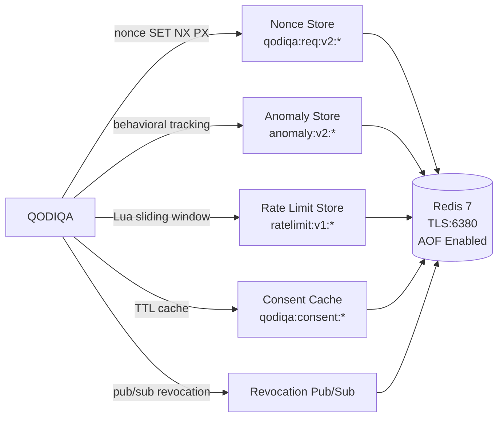

# QODIQA Redis Failure Runbook

**Operations & Production Readiness**

| Field | Value |
|-------|-------|
| Document | Redis Failure Runbook |
| Version | 1.0.0 |
| Owner | Platform Engineering / SRE |
| Audience | SRE, On-Call |
| Classification | Internal — Operational |
| Last Updated | 2026-07-21 |

Added §12 — this runbook previously described only the
generic `Consent cache` fallback-to-PostgreSQL behavior and omitted the
ConsentCache/Revocation Subscriber/Revocation Publisher failure model
entirely, most importantly the revocation subscriber's cluster-wide
fail-closed behavior on disconnect. Also corrected a stale §10.1 description
of single-instance-mode recovery that predated the Finding 49 self-healing
supervisor.

---

## Table of Contents

1. [Overview](#1-overview)
2. [Redis Role in QODIQA](#2-redis-role-in-qodiqa)
3. [Detection and Health Verification](#3-detection-and-health-verification)
4. [Cluster Failure](#4-cluster-failure)
5. [Node Failure](#5-node-failure)
6. [Connection Exhaustion](#6-connection-exhaustion)
7. [Latency Spikes](#7-latency-spikes)
8. [Restart Procedures](#8-restart-procedures)
9. [Failover](#9-failover)
10. [Recovery](#10-recovery)
11. [Validation](#11-validation)
12. [Consent Subsystem: ConsentCache and Revocation Subscriber](#12-consent-subsystem-consentcache-and-revocation-subscriber)

---

## 1. Overview

Redis is a **critical dependency** for QODIQA enforcement. QODIQA implements fail-closed semantics: when Redis is unavailable, **all enforcement requests are blocked**. This is a deliberate security decision to prevent replay attacks, which Redis's nonce store guards against.

**The Redis-fail-closed / PG-best-effort asymmetry.** Redis and [PostgreSQL](postgresql-failure.md) receive deliberately opposite treatment, and both are correct for what they each back: Redis backs security-critical, real-time control planes (replay protection, consent-revocation propagation) where an unreachable store means serving traffic on stale or missing state would itself be the security failure — so QODIQA blocks rather than degrades. PostgreSQL backs compliance/observability surfaces where a temporary gap is an operational inconvenience, not a security exposure, and defaults to best-effort degradation instead. **Operational consequence:** a Redis outage of any duration is a P1 (active enforcement outage — see the impact matrix below); an equivalent-duration PostgreSQL outage is a P2/P3 (degraded queryability only). Do not under-react to a Redis alert on the assumption "it's just like a PG outage." See § for the source finding and cross-reference [PostgreSQL Failure Runbook §1](postgresql-failure.md#1-overview) for the mirror-image framing.

**Redis failure impact matrix:**

| Redis Store | Purpose | Failure Impact |
|-------------|---------|---------------|
| Nonce store | Replay protection | All `/ai/chat` requests blocked — fail-closed |
| Anomaly store | Behavioral detection | Enforcement continues with degraded anomaly detection |
| Rate limit store | Request throttling | Enforcement continues without rate limiting |
| Consent cache (`ConsentCache`) | Consent TTL cache | Falls through to PostgreSQL (increased latency only — never denies or allows by itself) |
| **Consent revocation subscriber (`RevocationSubscriber`)** | Instant consent-revocation propagation | **All `REQUIRE_CONSENT` policy evaluations on the affected node(s) are denied** (`CONSENT_REVOCATION_SYNC_UNAVAILABLE`) — fail-closed, cluster-wide, no grace period. Startup failure is fatal (`process.exit(1)`). See §12. |
| Consent revocation publisher (`RevocationPublisher`) | Instant consent-revocation propagation (outbound) | The revoking node's own cache is unaffected (invalidated directly, not via pub/sub); other nodes rely on their own subscriber's fail-closed gate. See §12.3. |

**The consent cache and the consent revocation subscriber are separate Redis
clients with opposite failure philosophies** — this distinction did not exist
in earlier revisions of this table, which collapsed both under one "Consent
cache" row and understated the revocation subscriber's much larger blast
radius. See §12 for the full behavioral audit.

The `qodiqa_execution_integrity_full{}` metric is `1` only when ALL stores above are connected. `/ready` returns 503 if ANY store above is disconnected. This is the broadest possible fail-closed posture. **`/ready`'s `REQUIRED_COMPONENTS` list (`src/api/routes/ready.js`) already includes `consentSubscriber`** — a disconnected revocation subscriber alone is sufficient to flip `/ready` to 503 and pull the pod out of load-balancer rotation, exactly like a nonce-store outage. `consentCache` is also surfaced in `/ready`'s `components` block for visibility but is **deliberately excluded** from the required/gating set (by design — see §12.1). `qodiqa_execution_integrity_full{}`, however, is **not** wired to either consent component (§3.1) — use `/ready`'s `components.consentSubscriber` field, `/health/redis`, or `/consent/health` (§12.6) for consent-specific polling.

**Persistence recovery queue is no longer a Redis store.** Its durable
store is the PostgreSQL `persistence_recovery_queue` table (migration 032) —
Redis being down or absent entirely has zero impact on it. "Durable Postgres-Backed
Persistence Recovery Queue" decision.

---

## 2. Redis Role in QODIQA

QODIQA maintains **four separate Redis clients**, each for a distinct purpose
(plus a fifth pub/sub connection for revocation notifications — see below).
The Persistence Recovery Queue is intentionally not in this list — see the
note above.



All clients use the same Redis instance with mTLS on port 6380. All authenticate with `REDIS_PASSWORD`.

---

## 3. Detection and Health Verification

### 3.1 Metrics-Based Detection

```bash
# /metrics is ops-authenticated (src/app.js:179): the Authorization header is read from a 0600 file holding
# "Authorization: Bearer <operator API key>", so the key never appears in argv.
# Check the execution integrity metric — 0 means at least one Redis store is down
curl -sf -H @"$OPS_AUTH_HEADER_FILE" http://localhost:3000/metrics | grep qodiqa_execution_integrity_full
# Healthy: qodiqa_execution_integrity_full{} 1
# Degraded: qodiqa_execution_integrity_full{} 0

# Check individual store status
curl -sf -H @"$OPS_AUTH_HEADER_FILE" http://localhost:3000/metrics | grep qodiqa_redis_store_up
# Expected all values = 1:
# qodiqa_redis_store_up{store="nonce"} 1
# qodiqa_redis_store_up{store="anomaly"} 1
# qodiqa_redis_store_up{store="rate_limit"} 1
```

Per-connection state: `qodiqa_redis_connection_state_code{purpose}` — one series per managed Redis client (e.g. `nonce`, `anomaly`, `rateLimit`, `rateLimitPolicy`, `consentCache`, `revocationPublisher`, `revocationSubscriber`, `keyRotationLock`, `idempotency`, `authLockout`, `orgStatus*`)
— 3 HEALTHY, 2 RECOVERING, 1 DEGRADED, 0 DISCONNECTED. `QodiqaRedisConnectionDegraded` fires when a purpose has not
been HEALTHY for 5 minutes. A recovery attempt that cannot complete its connection handshake within
`connectTimeout + REDIS_COMMAND_DEADLINE_MS` (default 5,000 + 2,000 ms) is abandoned and retried with backoff
(`REDIS_RECOVERY_ATTEMPT_FAILED … CONNECT did not complete`), so a partition that heals is recovered from without a
restart. `REDIS_CLIENT_LISTENER_FAILED` (ERROR) means a component's own handler threw while the Redis client
announced a state change; the client itself is unaffected — report it as a bug in the named `purpose`'s owner.

### 3.2 Readiness Probe Failure

```bash
curl -sf http://localhost:3000/ready
# Returns 503 when any Redis store is disconnected
```

### 3.3 Direct Redis Health Check

```bash
# Test Redis connectivity directly (bypasses QODIQA)
redis-cli \
  --tls \
  --cacert "$REDIS_TLS_CA" \
  --cert "$REDIS_TLS_CERT" \
  --key "$REDIS_TLS_KEY" \
  -u "$REDIS_URL" \
  PING
# Expected: PONG
# Failure: Could not connect to Redis
```

### 3.4 Redis Server Health

```bash
redis-cli \
  --tls \
  --cacert "$REDIS_TLS_CA" \
  --cert "$REDIS_TLS_CERT" \
  --key "$REDIS_TLS_KEY" \
  -u "$REDIS_URL" \
  INFO server | grep -E 'redis_version:|uptime_in_seconds:|connected_clients:|blocked_clients:'
```

### 3.5 AOF Status Verification

```bash
redis-cli \
  --tls --cacert "$REDIS_TLS_CA" \
  --cert "$REDIS_TLS_CERT" --key "$REDIS_TLS_KEY" \
  -u "$REDIS_URL" \
  INFO persistence | grep -E 'aof_enabled:|aof_rewrite_in_progress:|aof_last_bgrewrite_status:'
# aof_enabled: must be 1 in production
# aof_last_bgrewrite_status: must be 'ok'
```

---

## 4. Cluster Failure

### 4.1 Detection

```bash
# If Redis is deployed in cluster mode:
redis-cli --cluster check <host>:<port> \
  --tls --cacert "$REDIS_TLS_CA" \
  --cert "$REDIS_TLS_CERT" --key "$REDIS_TLS_KEY"
```

### 4.2 What Happens in QODIQA

When the Redis cluster fails completely:
1. All QODIQA Redis clients disconnect simultaneously.
2. `qodiqa_execution_integrity_full{}` drops to 0.
3. `/ready` starts returning 503.
4. Kubernetes readiness probe fails after `failureThreshold: 3` (15 seconds).
5. The pod is removed from the Service endpoint — Kubernetes load balancer stops routing traffic to it.
6. All enforcement requests that arrive are rejected with 503.

**Security properties during Redis failure:**
- No artifacts are signed (signing requires an enforcement decision, which is blocked).
- No new nonce keys are issued (no replay risk from new requests).
- Existing audit log is unaffected (file-authoritative, not Redis-dependent).
- Transparency log is unaffected (PostgreSQL-backed).

### 4.3 Recovery Path

1. Restore Redis cluster (Section 8).
2. QODIQA reconnects automatically (exponential backoff capped at 30 s, no attempt limit).
3. `qodiqa_execution_integrity_full{}` returns to 1.
4. `/ready` returns 200.
5. Kubernetes readiness probe passes.
6. Pod is re-added to Service endpoints.
7. Traffic resumes.

---

## 5. Node Failure

For a single-node Redis deployment (production Docker Compose setup):

### 5.1 Symptoms

- `/ready` returns 503 immediately after Redis node failure.
- Enforcement requests fail with connection error.
- Logs contain repeated:
  ```json
  {"level":"error","msg":"Redis connection failed","store":"nonce","error":"ECONNREFUSED","ts":"..."}
  ```

### 5.2 Identify Failure Cause

```bash
# Check Redis process status
systemctl status redis || docker ps | grep redis

# Check Redis logs
journalctl -u redis -n 100 --since="30 minutes ago"
# OR for Docker:
docker logs redis --tail=100

# Common causes:
# - OOM: Redis consumed all available memory (maxmemory not set)
# - Disk full: AOF write failed
# - OOM kill: Linux OOM killer terminated Redis
# - Config change: invalid redis.conf caused restart failure
```

### 5.3 Check OOM Kill

```bash
# Check if Redis was OOM killed by the Linux kernel
dmesg | grep -i "redis\|oom" | tail -20
# OR in container:
docker inspect redis --format='{{.State.OOMKilled}}'
```

### 5.4 Check Disk Space

```bash
# Verify disk space is available for AOF
df -h $(dirname "$REDIS_AOF_DIR")
# AOF file must have at least 2× its current size available
```

---

## 6. Connection Exhaustion

### 6.1 Detection

```bash
redis-cli --tls --cacert "$REDIS_TLS_CA" \
  --cert "$REDIS_TLS_CERT" --key "$REDIS_TLS_KEY" \
  -u "$REDIS_URL" \
  INFO clients | grep -E 'connected_clients:|maxclients:|blocked_clients:'
```

**Alert threshold:** `connected_clients` approaching `maxclients`.

QODIQA maintains at least 15 Redis clients per instance (audit 2026-10-20 counted ≥15 managed clients — the five below were the original set: nonce + anomaly + rate_limit + consent + revocation pub/sub — the persistence recovery queue is PostgreSQL-backed, not Redis, ). With 2 Kubernetes replicas, that is 10 connections. If `maxclients` is low (e.g., 100), connection exhaustion is unlikely from QODIQA alone but can occur if other clients are sharing the Redis instance.

### 6.2 Resolution

```bash
# Check which clients are connected
redis-cli --tls --cacert "$REDIS_TLS_CA" \
  --cert "$REDIS_TLS_CERT" --key "$REDIS_TLS_KEY" \
  -u "$REDIS_URL" \
  CLIENT LIST | head -50

# Increase maxclients if legitimate client count is high
redis-cli --tls --cacert "$REDIS_TLS_CA" \
  --cert "$REDIS_TLS_CERT" --key "$REDIS_TLS_KEY" \
  -u "$REDIS_URL" \
  CONFIG SET maxclients 200

# Kill stale/idle connections
redis-cli --tls --cacert "$REDIS_TLS_CA" \
  --cert "$REDIS_TLS_CERT" --key "$REDIS_TLS_KEY" \
  -u "$REDIS_URL" \
  CLIENT NO-EVICT on

# Check the ulimits (Redis requires open file descriptors)
cat /proc/$(pgrep redis-server)/limits | grep "Open files"
```

---

## 7. Latency Spikes

### 7.1 Detection

```bash
# Check Redis latency
redis-cli --tls --cacert "$REDIS_TLS_CA" \
  --cert "$REDIS_TLS_CERT" --key "$REDIS_TLS_KEY" \
  -u "$REDIS_URL" \
  LATENCY LATEST

# Monitor real-time latency
redis-cli --tls --cacert "$REDIS_TLS_CA" \
  --cert "$REDIS_TLS_CERT" --key "$REDIS_TLS_KEY" \
  -u "$REDIS_URL" \
  --latency -i 1

# Check slow log for commands exceeding 10ms
redis-cli --tls --cacert "$REDIS_TLS_CA" \
  --cert "$REDIS_TLS_CERT" --key "$REDIS_TLS_KEY" \
  -u "$REDIS_URL" \
  SLOWLOG GET 20
```

### 7.2 Impact on QODIQA

Redis latency directly impacts enforcement latency:
- The nonce `SET NX PX` call is on the critical path for every `/ai/chat` request.
- The rate limit Lua script evaluation adds latency to every request.
- Latency > 100ms causes enforcement request p99 to degrade significantly.

### 7.3 Causes and Remediation

| Cause | Diagnosis | Remediation |
|-------|-----------|-------------|
| AOF fsync blocking I/O | `appendfsync always` instead of `everysec` | Change to `appendfsync everysec` |
| Large key deletion | `DEL` on a large key blocks | Use `UNLINK` for async deletion |
| Slow Lua scripts | `SLOWLOG GET` shows EVAL commands | Review rate limit Lua scripts |
| Memory swap | `redis-cli INFO memory | grep mem_allocator` | Add memory; disable swap |
| CPU saturation | `top` shows Redis at 100% CPU | Scale horizontally |
| TLS overhead | TLS handshake on every reconnect | Enable persistent connections (already default) |

```bash
# Fix AOF fsync if set to 'always'
redis-cli --tls --cacert "$REDIS_TLS_CA" \
  --cert "$REDIS_TLS_CERT" --key "$REDIS_TLS_KEY" \
  -u "$REDIS_URL" \
  CONFIG SET appendfsync everysec
echo "AOF fsync mode set to everysec"
```

---

## 8. Restart Procedures

### 8.1 Graceful Restart (Docker)

```bash
# Graceful shutdown — Redis saves AOF before exiting
docker-compose -f deploy/docker/docker-compose.prod.yml stop redis
# Redis sends SHUTDOWN NOSAVE — AOF has already persisted all writes

# Start Redis
docker-compose -f deploy/docker/docker-compose.prod.yml start redis

# Wait for Redis to be ready
until redis-cli --tls --cacert "$REDIS_TLS_CA" \
  --cert "$REDIS_TLS_CERT" --key "$REDIS_TLS_KEY" \
  -u "$REDIS_URL" PING 2>/dev/null | grep -q PONG; do
  echo "Waiting for Redis..."
  sleep 1
done
echo "Redis restarted and ready"
```

### 8.2 Graceful Restart (Kubernetes)

```bash
# Delete the Redis pod — StatefulSet or Deployment recreates it
kubectl delete pod redis-0 -n qodiqa

# Wait for Redis to be ready
kubectl rollout status statefulset/redis -n qodiqa --timeout=60s
# OR
kubectl wait pod/redis-0 -n qodiqa --for=condition=Ready --timeout=60s
```

### 8.3 Force Restart (Process Kill)

Only use if graceful restart fails:

```bash
# Send SIGTERM to Redis (same as graceful shutdown)
kill -SIGTERM $(pgrep redis-server)
sleep 5

# If still running after 5s, send SIGKILL
kill -0 $(pgrep redis-server) 2>/dev/null && kill -SIGKILL $(pgrep redis-server)

# Start Redis
systemctl start redis

# CRITICAL: After force kill, verify AOF integrity
redis-check-aof --fix /var/lib/redis/appendonly.aof
```

### 8.4 Post-Restart AOF Verification

```bash
redis-cli --tls --cacert "$REDIS_TLS_CA" \
  --cert "$REDIS_TLS_CERT" --key "$REDIS_TLS_KEY" \
  -u "$REDIS_URL" \
  CONFIG GET appendonly
# Expected: appendonly = yes

redis-cli --tls --cacert "$REDIS_TLS_CA" \
  --cert "$REDIS_TLS_CERT" --key "$REDIS_TLS_KEY" \
  -u "$REDIS_URL" \
  INFO persistence | grep aof_
# aof_enabled: 1
# aof_last_bgrewrite_status: ok (may be 'none' immediately after start)
```

**CRITICAL:** If AOF is not enabled after restart, QODIQA will refuse to start (`STRICT_REPLAY_PROTECTION=true`). Re-enable AOF and restart Redis before starting QODIQA.

---

## 9. Failover —

**Updated.** Everything below the original single-instance
description in this section is superseded. QODIQA now supports three Redis
deployment modes, selected entirely by configuration
(`src/infra/redis/haConfig.js`, `src/infra/redis/managedClient.js`) — no code
changes are required to move between them, and every existing single-instance
deployment continues to work unmodified (`REDIS_MODE` defaults to `single`).

| Mode | `REDIS_MODE` | Failover | Config |
|---|---|---|---|
| Single instance (default, unchanged) | `single` (or unset) | Manual (§9.1 below) | `REDIS_URL` only |
| Redis Sentinel | `sentinel` | **Automatic** — no restart required | `REDIS_SENTINEL_HOSTS`, `REDIS_SENTINEL_MASTER_NAME` |
| Redis Cluster | `cluster` | **Automatic** (per-shard) | `REDIS_CLUSTER_HOSTS` |

All 8 Redis-backed control planes (replay/nonce protection, anomaly
detection, both rate-limit stores, consent cache, consent revocation
pub/sub, key-rotation locking) construct their
client through the single shared factory,
`createManagedRedisClient({ purpose, ... })`, so enabling Sentinel or Cluster
mode covers every one of them simultaneously.

### 9.1 Single-instance mode: manual failover to a replica

Unchanged from before still the correct procedure if you have not
migrated to Sentinel mode:

```bash
# Promote a replica to master
redis-cli --tls --cacert "$REDIS_TLS_CA" \
  --cert "$REDIS_TLS_CERT" --key "$REDIS_TLS_KEY" \
  -h REPLICA_HOST -p 6380 \
  REPLICAOF NO ONE

# Update REDIS_URL to point to the new master
# Kubernetes: update the redis-service ClusterIP or the REDIS_URL secret
kubectl patch secret qodiqa-secrets -n qodiqa \
  --patch='{"stringData":{"REDIS_URL":"rediss://REPLICA_HOST:6380"}}'

# Restart QODIQA to use the new Redis endpoint
kubectl rollout restart deployment/qodiqa -n qodiqa
```

### 9.2 Sentinel mode: automatic failover — no restart

Set:

```bash
REDIS_MODE=sentinel
REDIS_SENTINEL_HOSTS=sentinel1:26379,sentinel2:26379,sentinel3:26379
REDIS_SENTINEL_MASTER_NAME=mymaster
```

QODIQA uses node-redis v5's native `createSentinel()` client — master
discovery, replica tracking, and reconnection to a newly promoted master
after a real Sentinel-driven failover are all handled by that (already
maintained, already tested) client internally; QODIQA's own code
(`managedClient.js`) normalizes it onto the same connection-event contract
every store already used, and adds health tracking, structured logs, and
Prometheus metrics on top (see §10 and §11 below). **No `kubectl rollout
restart` is needed or expected after a Sentinel failover.**

Verify Sentinel is functioning independently of QODIQA at any time:

```bash
redis-cli -h sentinel-host -p 26379 SENTINEL masters
redis-cli -h sentinel-host -p 26379 SENTINEL get-master-addr-by-name mymaster
```

And verify QODIQA's own view of the topology and failover history:

```bash
curl -s http://localhost:PORT/health/redis | jq .
```

### 9.3 Cluster mode

Set:

```bash
REDIS_MODE=cluster
REDIS_CLUSTER_HOSTS=node1:7000,node2:7001,node3:7002
```

Uses node-redis v5's native `createCluster()` client. Failure/failover
handling is per-shard (cluster resharding), a different model from
Sentinel's single global master — see `managedClient.js`'s header comment
for what health/metric detail is (and isn't) tracked in this mode.

---

## 10. Recovery

### 10.1 Automatic Recovery

**Single-instance mode (`REDIS_MODE=single`, default) — corrected.**
The paragraph in earlier revisions of this section ("unchanged...
after 5 failed attempts the client enters a degraded state... requires
manual intervention if Redis does not recover within ~30 seconds") predates
the **Finding 49 self-healing supervisor** in `managedClient.js` and was
stale — it described the pre-Finding-49 behavior, not the code as it exists
today. The corrected behavior, verified against
`_createSelfHealingSingleClient()` in `src/infra/redis/managedClient.js`:

- Each consumer's own bounded `reconnectStrategy` (e.g. ConsentCache's and
  RevocationPublisher's 5-attempt, RevocationSubscriber's 10-attempt
  exponential backoff) still governs *socket-level* reconnect attempts on
  the current TCP connection, and can still exhaust and emit a terminal
  `end` — exactly as it always has.
- Unlike before Finding 49, a terminal `end` is no longer a dead end. The
  self-healing supervisor wrapping every `single`-mode client tears down the
  dead client and, on an **unbounded** exponential-backoff-with-jitter timer
  (`REDIS_RECONNECT_BASE_DELAY_MS`/`REDIS_RECONNECT_MAX_DELAY_MS`/
  `REDIS_RECONNECT_JITTER_RATIO`, defaults 100ms/2000ms/±20%), constructs a
  **completely fresh client** and reconnects — forever, with no attempt
  ceiling and no terminal failure state.
- A successful reconnect is only declared `HEALTHY` after a live `PING`
  round-trip, not merely a `ready` event (TCP + AUTH) — see
  `_verifyAndAnnounceReady()`.
- **No manual intervention is ever required for automatic recovery in
  single-instance mode, regardless of outage duration** — this is the
  structural fix Finding 49 made, matching the guarantee's Sentinel/
  Cluster modes already provided (§10.1 Sentinel/Cluster bullet below).
  Redis being down for 30 seconds or 30 minutes changes only how long
  requests are denied/degraded (§4.2, §12.5) — not whether the node
  eventually reconnects on its own.
- This applies identically to `nonce`, `anomaly`, `rate_limit`,
  `consentCache`, `revocationSubscriber`, and `revocationPublisher` — all six
  single-mode clients share the exact same supervisor. See §12 for the
  consent-specific consequences (in particular, that the revocation
  subscriber's own fail-closed gate — not this reconnect logic — is what
  determines correctness during the outage itself).
- §10.2 below ("Manual Recovery After Prolonged Outage") is retained for
  operational reference (a rolling restart is still a legitimate way to force
  an immediate fresh connection attempt rather than waiting out the backoff
  timer) but is **no longer required** for correctness — it is now purely an
  optional latency optimization, not a recovery necessity.

**Sentinel/Cluster mode — genuine automatic failover, no restart:**
- Per-node socket reconnects use a shared bounded strategy
  (`src/infra/redis/reconnectStrategy.js`): exponential backoff with
  randomized jitter (`REDIS_RECONNECT_JITTER_RATIO`, default ±20%, to avoid
  reconnect-storm synchronization across many connections), and a circuit
  breaker (`REDIS_CIRCUIT_BREAKER_COOLDOWN_MS`, default 30s) that stops
  hammering one dead node and retries it again after the cooldown.
- Exhausting retries against ONE node does not end the connection — the
  Sentinel/Cluster topology layer above it keeps rediscovering the current
  master/shards independently (`REDIS_SENTINEL_SCAN_INTERVAL_MS`, default
  10s) and reconnects there. **There is no "give up permanently" state in
  these modes** — this is the structural fix for's core finding.
- Check `GET /health/redis` for live per-store state
  (HEALTHY/DEGRADED/DISCONNECTED/RECOVERING), current master, and
  reconnect/failover counters; check the `qodiqa_redis_*` Prometheus metrics
  for historical trend (reconnects, failovers, recovery duration, latency).

### 10.2 Manual Recovery After Prolonged Outage (single-instance mode only)

If Redis was down for > 5 minutes and QODIQA's Redis clients have exhausted retries:

```bash
# Option 1: Rolling restart of QODIQA pods
# This triggers a fresh connection attempt to Redis
kubectl rollout restart deployment/qodiqa -n qodiqa
kubectl rollout status deployment/qodiqa -n qodiqa --timeout=120s

# Option 2: Wait for QODIQA to self-heal
# QODIQA's reconnection logic continues attempting in the background
# Monitor: watch -n 5 'curl -sf http://localhost:3000/ready'
```

### 10.3 Nonce State After Recovery

After a Redis restart (planned or forced), the nonce store is empty. This means:
- Any request IDs used before the Redis restart can be replayed once within the TTL window.
- This is a known trade-off. The replay window equals the nonce TTL, which defaults to the request timeout + buffer.

**Mitigation:** Clients should use monotonically increasing request IDs (timestamp-based) to ensure post-restart IDs are always new. The QODIQA SDK enforces this.

---

## 11. Validation

### 11.1 Post-Recovery Validation

```bash
# Step 1: Redis health
redis-cli --tls --cacert "$REDIS_TLS_CA" \
  --cert "$REDIS_TLS_CERT" --key "$REDIS_TLS_KEY" \
  -u "$REDIS_URL" PING
# Expected: PONG

# Step 2: AOF enabled
redis-cli --tls --cacert "$REDIS_TLS_CA" \
  --cert "$REDIS_TLS_CERT" --key "$REDIS_TLS_KEY" \
  -u "$REDIS_URL" CONFIG GET appendonly | tail -1
# Expected: yes

# Step 3: QODIQA integrity metric
# /metrics is ops-authenticated (src/app.js:179): OPS_AUTH_HEADER_FILE is a 0600 file holding one line
# "Authorization: Bearer <operator API key>" (curl -H @file keeps the key out of argv; docs/operations/deployment-runbook.md §8).
curl -sf -H @"$OPS_AUTH_HEADER_FILE" http://localhost:3000/metrics | grep qodiqa_execution_integrity_full
# Expected: 1

# Step 4: All Redis stores up
curl -sf -H @"$OPS_AUTH_HEADER_FILE" http://localhost:3000/metrics | grep redis_store_up
# All three stores must be 1

# Step 5: Readiness
curl -sf http://localhost:3000/ready
# Expected: 200 {"status":"ready"}

# Step 6: Test enforcement (verify replay protection is working)
# $QODIQA_SIGNING_KEY is not a shared secret — there is no QODIQA_SIGN_TOKEN. It
# is the sk_... key from a provisioned signing identity (see
# docs/guides/quickstart.md#provision-a-signing-identity or scripts/provision-signing-identity.js).
# /ai/chat takes a signed artifact via the x-qodiqa-artifact header, not a bearer
# token, and its body is {"prompt": ...} — src/api/routes/aiChat.js:291.
REQUEST_OBJ='{"method":"POST","path":"/ai/chat","body":{"prompt":"redis recovery test"}}'
SIGN_BODY="{\"request\":$REQUEST_OBJ}"
SIGNED=$(curl -sf \
  -X POST http://localhost:3000/sign \
  -H "Content-Type: application/json" \
  -H "Authorization: Bearer $QODIQA_SIGNING_KEY" \
  -d "$SIGN_BODY")
ARTIFACT_B64=$(node -e "
  const d = JSON.parse(require('fs').readFileSync('/dev/stdin','utf8'));
  process.stdout.write(Buffer.from(JSON.stringify(d.artifact)).toString('base64'));
" <<< "$SIGNED")

RESPONSE=$(curl -sf \
  -X POST http://localhost:3000/ai/chat \
  -H "Content-Type: application/json" \
  -H "x-qodiqa-artifact: $ARTIFACT_B64" \
  -d '{"prompt":"redis recovery test"}')
echo "Decision: $(echo "$RESPONSE" | jq -r .decision)"

# Test replay protection — real replay detection is keyed off the artifact's
# own server-generated requestId (src/validation/registerNonce.js:71,
# REPLAY_DETECTED), not a client-supplied header. Resubmit the identical
# artifact instead of inventing an X-Request-ID.
REPLAY=$(curl -sf \
  -X POST http://localhost:3000/ai/chat \
  -H "Content-Type: application/json" \
  -H "x-qodiqa-artifact: $ARTIFACT_B64" \
  -d '{"prompt":"redis recovery test"}')
REPLAY_REASON=$(echo "$REPLAY" | jq -r '.reason // empty')
[[ "$REPLAY_REASON" == "REPLAY_DETECTED" ]] && echo "Replay blocked: OK" || echo "Replay blocked: FAIL (reason=$REPLAY_REASON)"
```

### 11.2 Validation Checklist

```
REDIS RECOVERY VALIDATION CHECKLIST
Date: __________  Operator: __________
Failure Type: __________  Duration: __________

REDIS HEALTH
[ ] Redis PING: PONG
[ ] AOF enabled: yes
[ ] Redis version: __________
[ ] Connected clients: __________ (expected ≈ 10 for 2-pod QODIQA)
[ ] Memory usage within limits

QODIQA HEALTH
[ ] qodiqa_execution_integrity_full{} = 1
[ ] qodiqa_redis_store_up{store="nonce"} = 1
[ ] qodiqa_redis_store_up{store="anomaly"} = 1
[ ] qodiqa_redis_store_up{store="rate_limit"} = 1
[ ] /ready → 200
[ ] /ready components.consentSubscriber = true
[ ] /consent/health → cacheReady, revocationPublisherReady, revocationSubscriberReady all true (§12.6)
[ ] PUBSUB NUMSUB qodiqa:consent:revocation == healthy replica count (§12.6)
[ ] If a revocation occurred during the outage: consent cache flush performed or TTL window elapsed (§12.4)

ENFORCEMENT VALIDATION
[ ] Enforcement request returns valid decision
[ ] Replay protection active (duplicate request rejected)
[ ] Rate limiting active (tested with rapid requests)

PERSISTENCE RECOVERY (informational only — PostgreSQL-backed since CHAIN-3,
not affected by this Redis incident; included here only as a general
health check, not a Redis-recovery signal)
[ ] Persistence recovery queue drained: entries = ___ (GET /v1/prq/stats)
[ ] PG audit_chain sync current

SIGN-OFF
Operator: __________  Time: __________
```

---

## 12. Consent Subsystem: ConsentCache and Revocation Subscriber

**Added.** The sections above (§1–§11) predate this remediation
and describe the consent cache only in passing, as a single row in §1's
impact matrix ("falls through to PostgreSQL"). That description is accurate
for the cache itself but was silently read as covering the whole consent
subsystem — it does not. This section documents the two components §1–§11
omitted: the revocation subscriber (a required, fail-closed control-plane
dependency) and the revocation publisher, and the one genuine residual
security consideration in how they interact with Redis outages (§12.4).

### 12.0 Three Clients, Not One

| Client (`purpose` in `GET /health/redis`) | Direction | Source | Failure semantics |
|---|---|---|---|
| `consentCache` | read/write | [`src/core/consent/ConsentCache.js`](../../src/core/consent/ConsentCache.js) | **Fail-open on the cache itself** — transparently bypassed, falls through to PostgreSQL. Never denies or allows by itself. |
| `revocationSubscriber` | inbound (SUBSCRIBE) | [`src/core/consent/revocation/RevocationSubscriber.js`](../../src/core/consent/revocation/RevocationSubscriber.js) | **Fail-closed on every `REQUIRE_CONSENT` request on this node** — see §12.2. Already a *required* component of `/ready` (`src/api/routes/ready.js`'s `REQUIRED_COMPONENTS`). |
| `revocationPublisher` | outbound (PUBLISH) | [`src/core/consent/revocation/RevocationPublisher.js`](../../src/core/consent/revocation/RevocationPublisher.js) | Fail-open locally (the revoking node invalidates its own cache directly, not via pub/sub); degrades *cross-node* propagation only — see §12.3. |

All three are constructed through the same `createManagedRedisClient()`
factory (`src/infra/redis/managedClient.js`) used by every other Redis-backed
store — everything in §9 (Sentinel/Cluster failover) and the corrected §10.1
(single-mode self-healing) applies to these three clients exactly as it does
to the nonce/anomaly/rate-limit stores. Nothing about consent required its
own reconnect/failover implementation.

### 12.1 ConsentCache

**Purpose:** read-through TTL cache in front of the PostgreSQL consent
registry (`src/core/consent/ConsentStore.js`), keyed
`qodiqa:consent:<actor_id>:<action>:<tenant_id|"*">`. Positive (ACTIVE)
results cached `CONSENT_CACHE_TTL_S` (default 60s); negative results
(DENIED/NOT_FOUND/REVOKED/EXPIRED/SUSPENDED) cached
`CONSENT_CACHE_NEGATIVE_TTL_S` (default 10s).

**Verified behavior when Redis is unavailable** (`ConsentCache.js`):

| Operation | Behavior |
|---|---|
| `get()` (cache read) | Returns `null` on any error — never throws. `ConsentVerifier` treats `null` as a cache miss and queries PostgreSQL. |
| `set()` (cache write) | Silently no-ops on error. The verification result already computed is still returned to the caller; only the write-back is skipped. |
| `invalidate()` / `invalidateActor()` | Silently no-ops on error — see §12.4 for the staleness window this can create. |
| `isReady()` | Flips to `false` the instant the client reports `error` or `reconnecting`, not only on full disconnect. |

**There is no fail-open path in ConsentCache, and none is needed** — every
degraded path above resolves to "ask PostgreSQL" or "skip a non-critical
write," never to "assume allowed." The actual decision is made by
`ConsentVerifier.verify()`: on a cache miss it queries PostgreSQL; if
PostgreSQL is *also* unavailable it returns `CONSENT_STORE_UNAVAILABLE`
(deny); if the query throws, `CONSENT_STORE_ERROR` (deny). A
`consentCache`-only outage therefore degrades to "every request pays a
PostgreSQL round-trip instead of a Redis GET" — never a denial or an
incorrect allow.

**Recovery:** fully automatic, no operator action. Once the self-healing
supervisor's `ready` event fires again (§10.1), `_ready` returns to `true`
and cache reads/writes resume transparently. Because a Redis-down period
produces zero cache writes, there is nothing to reconcile on this component
alone — see §12.4 for the one scenario where reconnection alone is *not*
sufficient.

**Cache invalidation is explicit, not TTL-only** — every mutation path
(`grant`, `revoke`, `suspend`, `resume` in `ConsentRegistry.js`) calls
`cache.invalidate(...)` synchronously, before the API call returns. TTLs
exist as a bound on staleness for the case where that explicit invalidation
itself fails (Redis down at the moment of mutation) — see §12.4.

**Operator actions:** none required after a `consentCache`-only outage. A
manual flush is always safe if ever desired (the cache is fully derived
state — deleting it can only increase PostgreSQL load, never permit anything
it shouldn't):

```bash
redis-cli --tls --cacert "$REDIS_TLS_CA" --cert "$REDIS_TLS_CERT" --key "$REDIS_TLS_KEY" \
  -u "$REDIS_URL" --scan --pattern 'qodiqa:consent:*' | \
  xargs -r redis-cli --tls --cacert "$REDIS_TLS_CA" --cert "$REDIS_TLS_CERT" --key "$REDIS_TLS_KEY" -u "$REDIS_URL" DEL
```

**Monitoring indicators:**
- `GET /ready` → `components.consentCache` (informational only — **not** in `REQUIRED_COMPONENTS`, does not gate readiness, by design; see the classification comment in `src/api/routes/ready.js`).
- `GET /health/redis` → `stores.consentCache.state`, `.reconnectCount`, `.connectionUptimeSeconds`.
- `GET /consent/health` → `cacheReady` (boolean).
- Logs: `CONSENT_CACHE_READY` (INFO), `CONSENT_CACHE_ERROR` (WARN), `CONSENT_CACHE_AUTH_ERROR` / `CONSENT_CACHE_TLS_ERROR` (ERROR), `CONSENT_CACHE_CONNECT_FAILED` (WARN).
- No dedicated `qodiqa_redis_store_up{store=...}` label exists for `consentCache` today (that gauge only covers `nonce`/`anomaly`/`rate_limit` — see [Metrics & Alerting §3.5](metrics-and-alerting.md#35-infrastructure)); use `/health/redis` or `/consent/health` for polling instead.

### 12.2 Revocation Subscriber — the control that actually matters

This is the component earlier revisions of this runbook omitted entirely,
and it is the one with real operational weight: **its disconnection denies
every `REQUIRE_CONSENT` request on that node, cluster-wide if every node is
affected, regardless of PostgreSQL or ConsentCache health.**

**Contract, verified against `RevocationSubscriber.js`, `ConsentVerifier.js`, and `src/api/routes/ready.js`:**

1. **Startup is fatal-on-failure.** `server.js` calls `await consentSubscriber.start()` during boot, before the HTTP server starts accepting traffic. `start()` throws if it cannot connect *and* `SUBSCRIBE` within `REVOCATION_SUBSCRIBER_STARTUP_TIMEOUT_MS` (default 10,000ms). On throw, `server.js` logs `REVOCATION_SUBSCRIBER_STARTUP_FAILED` at `FATAL`/`SECURITY` and calls `process.exit(1)`. Reproduced verbatim in `test/acceptance/logs/AT-006-revocation-subscriber-failure.log`, where a Redis ACL denying `SUBSCRIBE` (`NOPERM User default has no permissions to run the 'subscribe' command`) produces exactly this fatal exit.
2. **Runtime disconnection is fail-closed, immediately, per node.** `ConsentVerifier.verify()`'s very first check (step 0, before the cache lookup) is:
   ```js
   const sub = _subscriber;
   if (sub.isStarted && !sub.isReady) {
     return _deny('CONSENT_REVOCATION_SYNC_UNAVAILABLE');
   }
   ```
   `isReady()` flips to `false` the instant the client reports `error` or `reconnecting` — not only on a fully torn-down socket. There is no grace period and no fallback to "trust the cache/DB for N more seconds." A disconnected subscriber means every `REQUIRE_CONSENT` policy evaluation on that node returns `CONSENT_REVOCATION_SYNC_UNAVAILABLE` until the subscription is restored.
3. **This is already wired into the Kubernetes readiness contract.** `consentSubscriber` is one of five entries in `/ready`'s `REQUIRED_COMPONENTS` (alongside `nonceStore`, `anomalyStore`, `rateLimitStore`, `persistenceStore`) — a disconnected revocation subscriber alone flips `/ready` to 503 and pulls the pod out of Service endpoints, exactly like a nonce-store outage (§4.2). This was true; it was simply never documented in this runbook.
4. **This is deliberate, not a bug.** `RevocationSubscriber.js`'s header states it explicitly: a node not subscribed to the revocation channel cannot guarantee a revocation published during its outage is ever enforced, so it must not trust any cached — or even freshly database-read — ALLOW result while disconnected.

**Recovery is automatic — no manual resubscribe:**
- The client is built through the same self-healing factory as every other store (§10.1/§12.0); there is no permanent give-up state in any `REDIS_MODE`.
- Critically, **resubscription is automatic, not just reconnection**: `RevocationSubscriber.js`'s `client.on('ready', ({isReconnect}) => ...)` handler re-issues `SUBSCRIBE qodiqa:consent:revocation` on every `ready` event where `isReconnect === true` — firing both after a single-mode self-heal (a fresh client has zero memory of the old subscription) and after a Sentinel/Cluster topology change. Confirm it happened via `REVOCATION_SUBSCRIBER_SUBSCRIPTION_RESTORED` in logs and `qodiqa_redis_subscription_recovery_total{purpose="revocationSubscriber"}`.
- Once restored, `isReady()` returns `true` and `/ready` returns 200 for that component again — the pod re-enters rotation automatically.

**Operator actions during an outage:** there is nothing to do to *improve*
correctness — enforcement is already fail-closed and cannot be made more
correct. The only available actions are (a) restoring Redis reachability
(§8–§9) to end the outage, and (b) deciding, per incident policy, whether
affected pods should stay in rotation returning 503/denials or be scaled
down — both are safe. **Do not** disable the subscriber check, bypass
`REQUIRE_CONSENT` policies, or manually force readiness — that reopens
exactly the instant-revocation gap this control exists to close.

**Monitoring indicators:**
- `GET /ready` → `components.consentSubscriber` — the field that actually gates traffic; **treat `false` with the same severity as `qodiqa_execution_integrity_full == 0`.**
- `GET /health/redis` → `stores.revocationSubscriber.state`.
- `GET /consent/health` → `revocationSubscriberReady` (richer, consent-specific view; requires the same admin auth as the rest of `/consent/*`, unlike `/ready`).
- Logs: `REVOCATION_SUBSCRIBER_READY` (INFO), `REVOCATION_SUBSCRIBER_RECONNECTING` (WARN — message explicitly states "consent enforcement is fail-closed until reconnected"), `REVOCATION_SUBSCRIBER_ERROR` / `_AUTH_ERROR` / `_TLS_ERROR`, `REVOCATION_SUBSCRIBER_SUBSCRIPTION_RESTORED` (INFO — confirms resubscribe succeeded, not just reconnect), `REVOCATION_SUBSCRIBER_RESUBSCRIBE_FAILED` (WARN — see §12.8, escalate).
- Metrics: `qodiqa_consent_subscriber_reconnects_total{type="subscriber"}`, `qodiqa_redis_subscription_recovery_total{purpose="revocationSubscriber"}` (increments only on a *successful* resubscribe — use it to confirm subscription health, not just socket health).
- Every denial writes `CONSENT_REVOCATION_SYNC_UNAVAILABLE` to the consent audit log (`ConsentStore.logVerification`) — count these during an incident to quantify blast radius.

### 12.3 Revocation Publisher

A separate client with a separate failure mode from the subscriber — do not conflate them.

- `ConsentRegistry.revoke()` / `.revokeAll()` always (a) commit the revocation to PostgreSQL, then (b) invalidate the *local* node's cache directly (`cache.invalidate(...)` — not via pub/sub, so the revoking node's own cache is always correct immediately regardless of Redis pub/sub health), then (c) attempt `publisher.publish(...)` so *other* nodes invalidate theirs.
- If the publish fails, the revocation is **not rolled back** — PostgreSQL already committed it, and the API call still returns success. A `CONSENT_REVOCATION_PROPAGATION_FAILED` (or `_ACTOR_PROPAGATION_FAILED` for bulk) event is emitted at `CRITICAL`, explicitly noting other nodes "cannot receive instant notification" but will be "fail-closed by their own subscriber readiness check."
- **This is why §12.2's fail-closed gate is the actual control, not this publisher.** If the publisher can't reach Redis, it is almost certainly because Redis itself is down or partitioned — meaning every other node's *subscriber* is also disconnected and already denying consent-gated traffic independently. The publisher's own health is a secondary signal, useful for alerting (§12.8), not the thing preventing a stale ALLOW.
- Redis pub/sub has no message durability or replay. A published event with no live subscriber at publish time is gone, permanently — see §12.4.

**Monitoring:** `GET /health/redis` → `stores.revocationPublisher.state`; `GET /consent/health` and `GET /consent/:id/status` → `revocationPublisherReady` / `propagation.publisherReady`; logs `REVOCATION_PUBLISHER_READY` / `_ERROR` / `_AUTH_ERROR` / `_TLS_ERROR`; metrics `qodiqa_consent_revocation_published_total{result="ok"|"skipped"|"error"}`.

### 12.4 Residual Risk: Missed Revocation Events After Recovery

This is the one genuine, bounded security consideration in how the consent
subsystem interacts with Redis outages, and it was not documented anywhere
prior to. State it plainly for on-call:

**Scenario:** Node A caches `ALLOW` for `(actor, action)` at T0 (TTL up to
`CONSENT_CACHE_TTL_S`, default 60s). Redis becomes unreachable at T1
(T0 < T1 < T0+60s). While Redis is down, an operator revokes that consent
via Node B — PostgreSQL commit succeeds, Node B's own cache is invalidated
directly (§12.3), but the pub/sub event either fails to publish or is
published to a channel with no connected subscribers (fire-and-forget; not
queued). Redis recovers at T2; every node's subscriber reconnects and
resubscribes (§12.2). **Node A never received the revocation event and
never invalidated its own cache entry** — that pub/sub message is
unrecoverably lost, not merely delayed.

**What actually bounds this risk:**
- **During** T1–T2: zero risk of a stale ALLOW being served anywhere, because a real Redis outage disconnects every node's subscriber simultaneously, so §12.2's fail-closed gate denies all consent-gated traffic on every node — there is no cache read to be stale in the first place.
- **After** T2 (reconnection): the fail-closed gate lifts as soon as `isReady()` returns `true` again, but **no bulk cache resync or reconciliation happens on reconnect** — `RevocationSubscriber.js` only re-subscribes; it never flushes `ConsentCache` or replays missed events (Redis pub/sub has nothing to replay from). If a revocation's event was genuinely lost during the outage, Node A can serve a stale cached `ALLOW` for up to `CONSENT_CACHE_TTL_S` (default 60s) after reconnection, until that specific key's TTL naturally expires.
- This is exactly the "eventual consistency" trade-off `ConsentCache.js`'s own code comments describe. It is bounded (≤60s by default) and requires the specific combination of (a) a pre-existing positive cache entry on a node other than the one handling the revocation, (b) a revocation landing during a Redis outage, and (c) that revocation's publish event having zero live subscribers — narrower than "any revocation during any outage," but real, and previously undocumented as an operational consideration.

**Operator action after any outage during which a revocation is known or
suspected to have occurred** (check `consent_audit_log` / grep
`CONSENT_REVOKED` for `created_at` inside the outage window):

```bash
# Targeted — invalidate one actor+action+tenant key cluster-wide (all nodes
# share the same Redis instance, so a single DEL is sufficient)
redis-cli --tls --cacert "$REDIS_TLS_CA" --cert "$REDIS_TLS_CERT" --key "$REDIS_TLS_KEY" \
  -u "$REDIS_URL" DEL "qodiqa:consent:<actor_id>:<action>:<tenant_id>"

# Broad — flush the entire consent cache namespace (safe; see §12.1)
redis-cli --tls --cacert "$REDIS_TLS_CA" --cert "$REDIS_TLS_CERT" --key "$REDIS_TLS_KEY" \
  -u "$REDIS_URL" --scan --pattern 'qodiqa:consent:*' | \
  xargs -r redis-cli --tls --cacert "$REDIS_TLS_CA" --cert "$REDIS_TLS_CERT" --key "$REDIS_TLS_KEY" -u "$REDIS_URL" DEL
```

Alternatively, simply wait — the risk self-resolves within
`CONSENT_CACHE_TTL_S` (default 60s) of Redis recovery with zero operator
action, if that latency is acceptable for the incident at hand.
`CONSENT_CACHE_TTL_S` is a tunable, not a fixed constant — lowering it
shrinks this window at the cost of more PostgreSQL load in normal operation;
set it per the deployment's consent-freshness requirements (see
Compliance — GDPR if consent freshness has a
regulatory SLA).

### 12.5 Failure Mode Matrix

| Redis unavailable during... | Affected component(s) | Security impact | Operational impact | Expected logs | Recovery |
|---|---|---|---|---|---|
| **Startup** | `revocationSubscriber` | None — node never accepts traffic | Process exits (`process.exit(1)`); pod fails liveness/readiness and never joins rotation | `REVOCATION_SUBSCRIBER_STARTUP_FAILED` (FATAL/SECURITY) | Fix Redis reachability/ACLs; restart the process — startup failure is a hard stop by design, not auto-retried |
| **Normal operation, brief blip (seconds)** | All 3 consent clients | None — fail-closed gate covers the gap | Brief spike in `CONSENT_REVOCATION_SYNC_UNAVAILABLE` denials; `consentCache` falls through to PG (latency only) | `REVOCATION_SUBSCRIBER_RECONNECTING`, `CONSENT_CACHE_ERROR` | Automatic; no action |
| **Normal operation, prolonged outage** | All 3 | See §12.4 for the post-recovery residual window | `/ready` returns 503 (`components.consentSubscriber: false`) — pod removed from Service endpoints, same as a nonce-store outage (§4.2) | Repeated `REDIS_RECOVERY_ATTEMPT` (rate-limited after 10 attempts, §10.1) | Automatic reconnect once Redis is back; then §12.4's cache check |
| **Reconnect in progress (RECOVERING state)** | All 3 | None additional | Still denying (subscriber) / still falling through to PG (cache) until `ready` fires | `REDIS_RECOVERY_STARTED` → `REDIS_RECOVERY_ATTEMPT`(×N) → `REDIS_RECOVERY_COMPLETED` | Automatic |
| **Failover (Sentinel mode)** | All 3 | None — `isReady()` still gates correctly through a `MASTER_CHANGE` | Brief denial window during failover (`RECOVERING`); resubscribe fires on the post-failover `ready` event, same code path as single-mode | `REDIS_HA_MASTER_SWITCH`, `REVOCATION_SUBSCRIBER_SUBSCRIPTION_RESTORED` | Automatic — no restart, per §9.2 |
| **Rolling restart of Redis (planned)** | All 3, briefly per restart step | None | Same as "brief blip" above | Same as brief blip | Automatic |
| **Network partition** (QODIQA node ↔ Redis; Redis itself healthy) | Whichever node(s) are partitioned | None on the partitioned node (fail-closed); nodes with connectivity operate normally — **inconsistent enforcement across the cluster during a partition is expected and safe** (a partitioned node only ever denies more, never allows incorrectly) | Partitioned node's `/ready` returns 503 and it exits rotation; unaffected nodes serve normally | `REVOCATION_SUBSCRIBER_ERROR` on the partitioned node only | Automatic once the partition heals |
| **Rolling QODIQA deployment while Redis is degraded** | New pods | None | New pods' own `consentSubscriber.start()` fails/times out if Redis is still unreachable, so they fail readiness and the rollout stalls rather than replacing healthy pods with non-functional ones | `REVOCATION_SUBSCRIBER_STARTUP_FAILED` on new pods only | Fix Redis first, then resume/retry the rollout |

### 12.6 Operational Verification

```bash
# 1. Readiness — the field that actually gates traffic
curl -s http://localhost:PORT/ready | jq '.ready, .components.consentSubscriber, .components.consentCache'

# 2. Per-store Redis HA health (mode, state, reconnect/failover counters)
curl -s http://localhost:PORT/health/redis | jq '.stores.consentCache, .stores.revocationSubscriber, .stores.revocationPublisher'

# 3. Consent-subsystem-specific readiness (admin-authenticated; matches ConsentVerifier's own view)
curl -s -H "Authorization: Bearer $QODIQA_OPS_TOKEN" http://localhost:PORT/consent/health | jq .
# Healthy example: {"ok":true,"pgEnabled":true,"pgHealthy":true,
#   "cacheReady":true,"revocationPublisherReady":true,"revocationSubscriberReady":true}
# revocationSubscriberReady:false is the signal that matters most.

# 4. Confirm the subscriber actually holds the subscription (not just a live
#    socket) — cross-check against Redis's own view of subscriber count:
redis-cli --tls --cacert "$REDIS_TLS_CA" --cert "$REDIS_TLS_CERT" --key "$REDIS_TLS_KEY" \
  -u "$REDIS_URL" PUBSUB NUMSUB qodiqa:consent:revocation
# Expect subscriber count == number of healthy QODIQA replicas

# 5. End-to-end propagation test (use a disposable test actor_id — never a
#    production actor_id):
#      a. Grant consent for a throwaway actor_id/action.
#      b. Verify it (should ALLOW).
#      c. Revoke it via POST /consent/:id/revoke.
#      d. Verify again on the SAME node (should DENY, CONSENT_REVOKED) —
#         proves local invalidation works regardless of Redis pub/sub.
#      e. On a SECOND node, if clustered, verify again — should also DENY
#         within milliseconds if pub/sub propagation is healthy; if it only
#         flips to DENY after up to the cache TTL instead, propagation is
#         degraded (§12.3) even though local enforcement is still correct.

# 6. Metrics
curl -s -H @"$OPS_AUTH_HEADER_FILE" http://localhost:3000/metrics | grep -E \
  'qodiqa_consent_revocation|qodiqa_redis_subscription_recovery_total'
```

### 12.7 Monitoring

Add these alongside the nonce/anomaly/rate-limit signals already covered in
[Metrics & Alerting](metrics-and-alerting.md):

| Signal | Source | Watch for |
|---|---|---|
| `components.consentSubscriber` | `GET /ready` | `false` — this is what actually removes the pod from rotation |
| `stores.revocationSubscriber.state` | `GET /health/redis` | Any value other than `HEALTHY` |
| `revocationSubscriberReady` | `GET /consent/health` | `false` |
| `qodiqa_consent_subscriber_reconnects_total{type="subscriber"}` | Prometheus | Rate increasing |
| `qodiqa_redis_subscription_recovery_total{purpose="revocationSubscriber"}` | Prometheus | Should increment shortly after every reconnect; if reconnects increment but this doesn't, resubscribe is failing (`REVOCATION_SUBSCRIBER_RESUBSCRIBE_FAILED` in logs) — escalate, this is worse than a plain disconnect |
| `qodiqa_consent_revocation_published_total{result="skipped"\|"error"}` | Prometheus | Any increment — a revocation didn't propagate; correlate with §12.4 |
| `qodiqa_consent_revocation_received_total{result="invalid"}` | Prometheus | Sustained non-zero — malformed/unsigned/expired events; check `REVOCATION_MAX_EVENT_AGE_MS` clock skew, a MAC keyring that is not the same file on every node, or an earlier (v1) publisher still running during a rolling upgrade |
| `qodiqa_consent_revocation_propagation_latency_ms` | Prometheus | p99 approaching `REVOCATION_MAX_EVENT_AGE_MS` (default 30s) — events at risk of being rejected as expired |
| Log volume of `CONSENT_REVOCATION_SYNC_UNAVAILABLE` | Log aggregation | Non-zero for > 30s — active fail-closed enforcement in progress |

**Recommended follow-up (not implemented):** extend
`qodiqa_redis_store_up` ([Metrics & Alerting §3.5](metrics-and-alerting.md#35-infrastructure))
with `store="consentCache"` / `"revocationSubscriber"` / `"revocationPublisher"`
values so these can use the identical Prometheus alerting-rule pattern as
§6.1's "Redis nonce store down" alert instead of requiring a separate
`/health/redis` poll. Left as a follow-up rather than done here because it
changes a metric's label cardinality — see that document's own §11.1/§11.2
"Known Architectural Notes" for the precedent on how such changes are
staged.

### 12.8 Alerting

| Alert | Trigger | Severity | Operator action |
|---|---|---|---|
| Revocation subscriber disconnected | `GET /ready` → `components.consentSubscriber == false` for > 30s (equivalently, `revocationSubscriberReady == false` via `/consent/health`, or sustained `REVOCATION_SUBSCRIBER_RECONNECTING` logs) | **CRITICAL** | All `REQUIRE_CONSENT` requests on this node are being denied. Follow §12.2 / §8–§9 to restore Redis connectivity. Do not attempt to bypass the check. |
| Revocation subscriber startup failure | `REVOCATION_SUBSCRIBER_STARTUP_FAILED` (FATAL) | **CRITICAL** | Process exited and will not serve traffic. Fix Redis reachability/ACL first — `NOPERM ... 'subscribe'` is a common cause; verify the Redis ACL grants `SUBSCRIBE` to the QODIQA user. |
| Resubscribe failed after reconnect | `REVOCATION_SUBSCRIBER_RESUBSCRIBE_FAILED` | **CRITICAL** | Worse than a plain disconnect: the socket may be up while the channel subscription did not restore. Verify with `PUBSUB NUMSUB` (§12.6 step 4); consider a manual pod restart if it does not self-correct within one more reconnect cycle. |
| Revocation publish failures | `qodiqa_consent_revocation_published_total{result="error"\|"skipped"}` increasing, or `CONSENT_REVOCATION_PROPAGATION_FAILED` / `_ACTOR_PROPAGATION_FAILED` (CRITICAL-level application log) | **HIGH** (escalate to CRITICAL if sustained) | Confirm other nodes' subscribers are also degraded (expected if Redis itself is down/partitioned) or investigate why only the publisher is affected (e.g. ACL grants `SUBSCRIBE` but not `PUBLISH`) |
| Excessive reconnect attempts | `qodiqa_consent_subscriber_reconnects_total` rate high over a sustained window | **HIGH** | Possible flapping Redis node or network issue — investigate the infrastructure layer, not application code |
| Prolonged degraded cache | `stores.consentCache.state` = `DEGRADED`/`RECOVERING` for > 5 min | **MEDIUM** | PostgreSQL load will be elevated (every request is a cache miss); confirm PG has headroom. Not a correctness risk (§12.1). |
| Stale-cache exposure window (post-recovery) | No automated signal — Redis cannot alert on a pub/sub event it never received | **Operator judgment** | If a revocation occurred (or may have occurred) during a confirmed Redis outage, proactively run §12.4's flush procedure rather than waiting for an alert that does not and cannot exist |

### 12.9 Recovery Procedures

**Revocation subscriber recovery** (a specialization of §8–§10's general Redis recovery — nothing additional to *do*, but verify these specific signals):
1. Restore Redis reachability (§8 restart / §9 failover, as applicable).
2. Watch for `REVOCATION_SUBSCRIBER_READY` then `REVOCATION_SUBSCRIBER_SUBSCRIPTION_RESTORED` in logs, in that order — the second is the one that actually matters.
3. Confirm `qodiqa_redis_subscription_recovery_total{purpose="revocationSubscriber"}` incremented.
4. Confirm `GET /ready` → `components.consentSubscriber: true` and `GET /consent/health` → `revocationSubscriberReady: true` on every node.
5. Confirm `PUBSUB NUMSUB qodiqa:consent:revocation` subscriber count matches the healthy replica count (§12.6 step 4) — the one check that catches a "socket reconnected, subscription not restored" state that a naive `isReady()`-only check would miss if `REVOCATION_SUBSCRIBER_RESUBSCRIBE_FAILED` fired and was silently retried.
6. **Cache resynchronization check (§12.4):** determine whether any revocation was issued during the outage window (grep `CONSENT_REVOKED` / query `consent_audit_log` for `created_at` inside the window). If yes, run §12.4's flush procedure rather than assuming the default 60s TTL already covered it — a flush is cheap and idempotent; an unnoticed stale ALLOW is not.
7. Run the end-to-end propagation test (§12.6 step 5) before declaring the incident resolved.

**Cluster / rolling-deployment recovery:** identical to general Redis
recovery (§9–§10) — the consent subsystem has no cluster-specific recovery
steps beyond what every other Redis-backed store already does, because it
shares the same `createManagedRedisClient()` factory (§12.0). The one
consent-specific difference is §12.5's "startup is fatal" row: new pods
added during a rolling deployment while Redis is still degraded will fail
their own startup and never join rotation — this is the intended
containment, not a bug to route around.

### 12.10 Security Considerations Summary

- **No fail-open behavior exists, and none was introduced by this
  remediation.** Every degraded path in ConsentCache, RevocationSubscriber,
  and RevocationPublisher resolves to either "ask PostgreSQL" or "deny" —
  never "allow." This audit found the implementation already correct; the
  finding was that this guarantee was undocumented, not that it was
  violated.
- **The revocation subscriber's fail-closed gate — already wired into
  `/ready` — is the load-bearing security control, not the cache.**
  Operators should treat `components.consentSubscriber: false` with the same
  severity as `qodiqa_execution_integrity_full == 0` (§1), even though it
  was previously absent from this runbook's failure-impact matrix and from
  `metrics-and-alerting.md`'s alert catalog.
- **The one accepted residual risk** is the bounded (≤`CONSENT_CACHE_TTL_S`,
  default 60s) post-recovery stale-cache window described in §12.4, limited
  to revocations whose pub/sub event was lost during a genuine Redis
  outage. It requires operator awareness and, optionally, the §12.4 flush
  procedure — not a code change.
- **Escalate to security/on-call, not just SRE, when:**
  `REVOCATION_SUBSCRIBER_RESUBSCRIBE_FAILED` persists across more than one
  reconnect cycle (possible ACL/config drift rather than transient network
  failure), or when a revocation is confirmed to have occurred during an
  outage and the §12.4 flush was not performed promptly.
- **Backward compatible:** this section documents pre-existing behavior. No
  runtime defaults, APIs, or failure semantics changed as part of

---

*Cross-references: [Startup Runbook](startup-runbook.md) | [Incident Response Guide](incident-response.md) | [Disaster Recovery](disaster-recovery.md) | [Certificate Expiration](certificate-expiration.md) | [Metrics & Alerting](metrics-and-alerting.md) | [Redis Deployment Guide](../deployment/redis.md) | [Redis TLS Guide](../deployment/redis-tls.md) | [Redis Persistence Guide](../deployment/redis-persistence.md) | GDPR Compliance*
