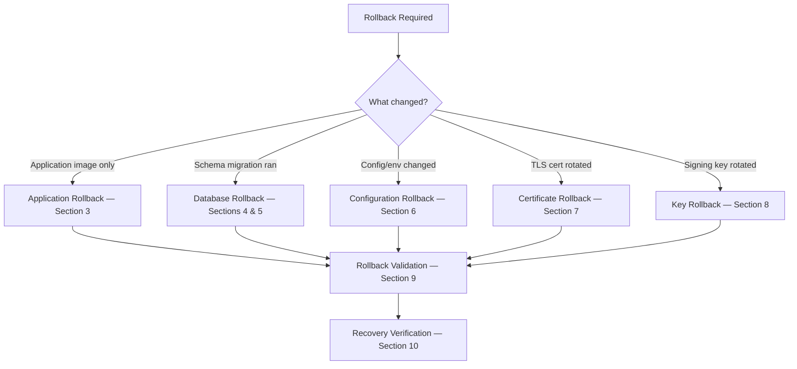

# QODIQA Rollback Runbook

**Operations & Production Readiness**

| Field | Value |
|-------|-------|
| Document | Rollback Runbook |
| Version | 1.0.0 |
| Owner | Platform Engineering |
| Audience | SRE, Platform Engineer, On-Call |
| Classification | Internal — Operational |
| Last Updated | 2026-07-03 |

---

## Table of Contents

1. [Overview](#1-overview)
2. [Rollback Decision Matrix](#2-rollback-decision-matrix)
3. [Application Rollback](#3-application-rollback)
4. [Database Rollback](#4-database-rollback)
5. [Schema Rollback](#5-schema-rollback)
6. [Configuration Rollback](#6-configuration-rollback)
7. [Certificate Rollback](#7-certificate-rollback)
8. [Key Rollback](#8-key-rollback)
9. [Rollback Validation](#9-rollback-validation)
10. [Recovery Verification](#10-recovery-verification)
11. [Rollback Checklist](#11-rollback-checklist)

---

## 1. Overview

A rollback restores QODIQA to its previously known-good state. The rollback scope depends on what changed:



**Topology.** Production is single-node only: the Kubernetes workload is the **StatefulSet**
`qodiqa` with `replicas: 1` (`deploy/kubernetes/overlays/single-node/statefulset.yaml`; a correctness bound — one
audit-chain writer), its Service is `qodiqa`, and the Docker reference is one `qodiqa` container in
`deploy/docker/docker-compose.prod.yml`. There is no blue/green or canary deployment to roll back (both are not
supported in production — [Deployment Runbook §4/§6](deployment-runbook.md#4-bluegreen-deployment)). Commands below use
`PGHOST`/`PGPORT`/`PGUSER` + `PGPASSFILE` for PostgreSQL (never a password in a URL or on the command line) and read
bearer credentials from `0600` header files with `curl -H @file` (`OPS_AUTH_HEADER_FILE`, `SIGN_AUTH_HEADER_FILE` —
[Deployment Runbook §8](deployment-runbook.md#8-deployment-smoke-tests)).

**Time-to-rollback targets:**
- Application rollback (Kubernetes): < 3 minutes
- Application rollback (Docker): < 5 minutes
- Database rollback from backup: < 30 minutes (dependent on backup size)
- Configuration rollback: < 2 minutes
- Certificate rollback: < 5 minutes

---

## 2. Rollback Decision Matrix

Trigger rollback immediately when these conditions are met:

| Condition | Rollback Scope | Priority |
|-----------|---------------|----------|
| Smoke test failure post-deploy | Application | P1 — Immediate |
| Audit chain integrity failure | Application + Database | P1 — Immediate |
| `/ready` not returning 200 after 5 minutes | Application | P1 — Immediate |
| `qodiqa_execution_integrity_full{}` = 0 for > 60s | Application | P1 — Immediate |
| Migration failed partially | Database | P1 — Immediate |
| Error rate > 1% above pre-deploy baseline | Application | P1 within 15 min |
| Enforcement decisions inconsistent with policy | Application + Config | P1 within 15 min |
| Latency p95 > 2× baseline for > 15 min | Application | P2 |
| New key fails to sign artifacts | Key | P1 — Immediate |
| TLS handshake failures after cert rotation | Certificate | P1 — Immediate |

---

## 3. Application Rollback

### 3.1 Kubernetes Application Rollback

```bash
# View rollout history (StatefulSet revisions)
kubectl rollout history statefulset/qodiqa -n qodiqa
# REVISION  CHANGE-CAUSE
# 5         Deploy qodiqa:1.0.0 — change ref: abc123
# 6         Deploy qodiqa:1.1.0 — change ref: def456

# Roll back to previous revision (revision N-1) — the single pod qodiqa-0 is replaced in place
kubectl rollout undo statefulset/qodiqa -n qodiqa

# OR roll back to a specific revision
kubectl rollout undo statefulset/qodiqa -n qodiqa --to-revision=5

# Monitor rollback
kubectl rollout status statefulset/qodiqa -n qodiqa --timeout=120s

# Verify previous image is running
kubectl get pods -n qodiqa -o jsonpath='{range .items[*]}{.metadata.name}{"\t"}{.spec.containers[0].image}{"\n"}{end}'
```

### 3.2 Docker Application Rollback

```bash
export ROLLBACK_VERSION="1.0.0"  # The previous known-good version
export FAILED_VERSION="1.1.0"

# Stop the failing version
docker-compose -f deploy/docker/docker-compose.prod.yml stop --timeout 60 qodiqa

# Update the image tag in docker-compose.prod.yml
sed -i "s/qodiqa:${FAILED_VERSION}/qodiqa:${ROLLBACK_VERSION}/" \
  deploy/docker/docker-compose.prod.yml

# Verify the rollback image is available locally
docker image inspect qodiqa:${ROLLBACK_VERSION} > /dev/null 2>&1 || {
  echo "Image not available locally — pulling"
  docker pull qodiqa:${ROLLBACK_VERSION}
}

# Start the previous version
docker-compose -f deploy/docker/docker-compose.prod.yml up -d qodiqa

# Monitor startup
docker-compose -f deploy/docker/docker-compose.prod.yml logs -f qodiqa &
LOG_PID=$!

# Wait for readiness
MAX_WAIT=60
ELAPSED=0
until curl -sf http://localhost:3000/ready > /dev/null 2>&1; do
  echo "Waiting for rollback instance... ($ELAPSED/$MAX_WAIT s)"
  sleep 3
  ELAPSED=$((ELAPSED + 3))
  [[ $ELAPSED -ge $MAX_WAIT ]] && { echo "FATAL: Rollback instance not ready after ${MAX_WAIT}s"; kill $LOG_PID; exit 1; }
done
kill $LOG_PID
echo "Rollback instance READY"
```

### 3.3 Blue/Green Rollback

> **NOT SUPPORTED IN PRODUCTION.** Blue/green keeps two gateways writing the same audit chain
> during the switch; production allows exactly one writer (single-node StatefulSet, `replicas: 1`; the multi-writer
> `distributed` topology is refused by the production boot validator until). The Service is named `qodiqa`
> (`overlays/single-node/service.yaml`), not `qodiqa-service`, and the pods carry no `slot` label, so the previous
> selector-switch commands could not have worked. Roll back with §3.1 (Kubernetes) or §3.2 (Docker). The previous text
> remains in git history.

---

## 4. Database Rollback

Database rollback from backup is required when:
- A migration has corrupted data.
- A migration cannot be cleanly reversed with a forward migration.
- A migration ran and the schema is incompatible with the previous application version.

**Before executing:** Verify you have the pre-deployment backup created by the deployment runbook.

### 4.1 Identify the Correct Backup

```bash
# The pre-deployment backup is a normal pg-backup.sh full backup (Deployment Runbook §3): an encrypted, sealed
# ${QODIQA_BACKUP_DIR}/full[/<tier>]/qodiqa_<YYYYMMDDTHHMMSSZ>.dump.enc with its .seal beside it
# (QODIQA_BACKUP_DIR defaults to /var/backups/qodiqa; the Kubernetes backup ConfigMap sets /backups/pg).
ls -lt "${QODIQA_BACKUP_DIR:-/var/backups/qodiqa}"/full/*.dump.enc "${QODIQA_BACKUP_DIR:-/var/backups/qodiqa}"/full/*/*.dump.enc 2>/dev/null | head -20
# Pick the one whose UTC timestamp is just before the failed deployment
```

### 4.2 Application Shutdown Before Database Restore

**CRITICAL: Stop all QODIQA instances before restoring the database.** Active connections during restore will corrupt the restore.

```bash
# Kubernetes
kubectl scale statefulset/qodiqa --replicas=0 -n qodiqa
kubectl get pods -n qodiqa -l app.kubernetes.io/name=qodiqa,app.kubernetes.io/component=gateway  # Must show no pods

# Docker
docker-compose -f deploy/docker/docker-compose.prod.yml stop qodiqa

# Verify no QODIQA connections to PostgreSQL
psql -d "${QODIQA_PG_DATABASE:-qodiqa}" -c "
  SELECT pid, usename, application_name, state, query_start
  FROM pg_stat_activity
  WHERE datname = 'qodiqa' AND usename = 'qodiqa_app';
"
# Expected: 0 rows
```

### 4.3 Database Restore Execution

> ** This section was replaced.** The previous procedure ran
> `DROP DATABASE qodiqa`, recreated it `OWNER qodiqa_app`, restored as `postgres` with `pg_restore --no-owner --no-acl`
> and then ran a non-existent behind `|| true`. Every one of those steps was unsafe:
> it destroyed the only copy before a validated restore existed, made the application role able to disable RLS,
> made every SECURITY DEFINER function superuser-owned (OA4-F1 /), and dropped every grant. The previous text
> remains in git history.

**Database restore: use [`restore-runbook.md` §5](restore-runbook.md#5-database-restore) exactly.** Restore into a
**new** database as `qodiqa_test` with `./scripts/pg-backup.sh restore` (encrypted `*.dump.enc` backups with a valid
`.seal` only; `./scripts/pg-backup.sh verify` first), validate it (§5.2: migration count and `max(version)` equal to
the source, SECURITY DEFINER owners, PM-01, chain verifier), then switch per §5.3.

- Never `DROP DATABASE qodiqa`; the old database is renamed aside and kept, and only with explicit approval (§5.3).
- Never restore as `postgres` (or any superuser) or as `qodiqa_app`.
- Never create the database `OWNER qodiqa_app`.
- Never use `--no-acl`: grants are part of the security model and are restored from the dump.
- If the restored database is behind the application's expected schema, bring it forward with the migration runner
  only (`QODIQA_PG_MIG_USER=qodiqa_test node src/infra/postgres/migrate.js --dry-run`, then without `--dry-run`),
  never with `psql -f`.

### 4.4 Post-Restore Database Verification

```bash
node src/infra/postgres/migrate.js --status
# or: psql -d "${QODIQA_PG_DATABASE:-qodiqa}" -c "SELECT version, name, applied_at FROM qodiqa_migrations ORDER BY version DESC LIMIT 5;"
# (the tracking table's columns are version, name, checksum, applied_at, applied_by — there is no migration_name)
# Verify the schema version matches the pre-deployment state

psql -d "${QODIQA_PG_DATABASE:-qodiqa}" -c "
  SELECT tablename, rowsecurity
  FROM pg_tables
  WHERE schemaname = 'public'
  AND tablename IN ('audit_chain','transparency_log_entries','signing_keys');
"
# Verify RLS is enabled
```

---

## 5. Schema Rollback

Some schema changes are reversible through a compensating forward migration without requiring a full restore.

### 5.1 When Schema Rollback Is Safe

| Change Type | Safe to Roll Forward | Requires Backup Restore |
|-------------|---------------------|------------------------|
| Adding a new nullable column | Yes — drop the column | No |
| Adding a new table | Yes — drop the table | No |
| Adding an index | Yes — drop the index | No |
| Dropping a column | No — data is lost | Yes |
| Modifying column type | Depends on data loss risk | Usually yes |
| Dropping a table | No — data is lost | Yes |
| Modifying RLS policies | Yes — restore previous policy | No |

### 5.2 Rolling Back a Schema Change

> ** §5.2–§5.3 were replaced.** The previous template ran `DROP INDEX CONCURRENTLY`
> inside `BEGIN … COMMIT` (PostgreSQL refuses that), deleted a `qodiqa_migrations` row by a non-existent
> `migration_name` column, and applied the file with `psql -f`. Deleting tracking rows breaks `migrate.js`'s checksum
> integrity guard, and the project rule is additive migrations only (no down-migrations).

Schema changes are rolled back by restoring the pre-migration backup into a new database
([`restore-runbook.md` §5](restore-runbook.md#5-database-restore)), or by a **new additive compensating migration**
applied through `migrate.js` (`node src/infra/postgres/migrate.js --dry-run`, then without `--dry-run`). Never edit or
delete `qodiqa_migrations` rows, and never apply a migration file with `psql -f`. The "Safe to Roll Forward" column in
§5.1 describes what a compensating migration may do, not a manual procedure.

### 5.3 Verify Schema State After Rollback

```bash
node src/infra/postgres/migrate.js --status
# or: psql -d "${QODIQA_PG_DATABASE:-qodiqa}" -c "SELECT version, name, applied_at FROM qodiqa_migrations ORDER BY version;"
```

---

## 6. Configuration Rollback

### 6.1 Environment Variable Rollback

Environment variables are managed through secrets management (Kubernetes Secrets, Vault, or environment files).

**Kubernetes:**

```bash
# View the current secret
kubectl get secret qodiqa-secrets -n qodiqa -o yaml

# Roll back to a previous version if using Helm or GitOps
# With GitOps (ArgoCD/Flux): revert the commit and sync
git revert HEAD  # Reverts the config change
git push
# ArgoCD/Flux syncs automatically

# Manual rollback — restore from backup YAML
kubectl apply -f /opt/qodiqa/backups/secrets-backup-YYYYMMDD.yaml -n qodiqa

# Trigger rolling restart to pick up reverted config
kubectl rollout restart statefulset/qodiqa -n qodiqa
kubectl rollout status statefulset/qodiqa -n qodiqa --timeout=120s
```

**Docker:**

```bash
# Restore the previous env file from backup
cp /opt/qodiqa/backups/env-YYYYMMDD /etc/qodiqa/env

# Restart with old config
docker-compose -f deploy/docker/docker-compose.prod.yml restart qodiqa
```

### 6.2 Policy File Rollback

**Superseded (see `server/startup.js` and [Control plane](control-plane.md)).**
the enforced policy set is control-plane state in PostgreSQL (`control_plane_records`); `POLICY_FILE` is an import
source only. Copying an old policy file into place and sending `SIGHUP` does **not** roll anything back: `SIGHUP`
re-derives the enforced set from the control plane (log `POLICIES_RELOADED`, `source: control-plane`) and never
re-reads the file. There is no `/policy/status` endpoint.

Roll a policy back through the policy API, which versions every policy:

```bash
# Inspect versions (operator key with READ_POLICIES; Authorization header from a 0600 file)
curl -sf -H @"$OPS_AUTH_HEADER_FILE" http://localhost:3000/policy-ui/policies/<policyId>/versions | jq .
curl -sf -H @"$OPS_AUTH_HEADER_FILE" http://localhost:3000/policy-ui/policies/<policyId>/versions/<v> | jq .
# Then re-submit the previous version, or disable/enable the policy, through /policy-ui/policies (write calls need
# MANAGE_POLICIES-level rights and MFA step-up) or the governance workflow (/v1/policy/governance).
# Confirm with the enforced list:
curl -sf -H @"$OPS_AUTH_HEADER_FILE" http://localhost:3000/policy-ui/policies | jq .
```

### 6.3 ConfigMap Rollback (Kubernetes)

```bash
# ConfigMaps have no rollout history (`kubectl rollout history` works only on Deployments, DaemonSets and
# StatefulSets). The previous version comes from git (deploy/kubernetes/overlays/single-node + base, re-applied with
# `kubectl apply -k`) or from a saved `kubectl get configmap qodiqa-config -o yaml` export.

# Restore previous ConfigMap from backup
kubectl apply -f /opt/qodiqa/backups/configmap-YYYYMMDD.yaml -n qodiqa

# Restart pods to apply the reverted ConfigMap
kubectl rollout restart statefulset/qodiqa -n qodiqa
```

---

## 7. Certificate Rollback

### 7.1 Redis TLS Certificate Rollback

```bash
# Restore previous Redis TLS certificates from backup
CERT_BACKUP_DIR="/opt/qodiqa/backups/certs-YYYYMMDD"

cp "$CERT_BACKUP_DIR/redis-client.crt" "$REDIS_TLS_CERT"
cp "$CERT_BACKUP_DIR/redis-client.key" "$REDIS_TLS_KEY"
cp "$CERT_BACKUP_DIR/redis-ca.crt" "$REDIS_TLS_CA"

# For Kubernetes: update the TLS secret
kubectl create secret tls redis-client-tls \
  --cert="$CERT_BACKUP_DIR/redis-client.crt" \
  --key="$CERT_BACKUP_DIR/redis-client.key" \
  -n qodiqa \
  --dry-run=client -o yaml | kubectl apply -f -

# Restart QODIQA to pick up the previous certificates
kubectl rollout restart statefulset/qodiqa -n qodiqa
kubectl rollout status statefulset/qodiqa -n qodiqa --timeout=120s

# Verify Redis connectivity with previous certificates (password from REDISCLI_AUTH, exported from your secret
# store — never -a <password> or a password inside REDIS_URL)
redis-cli \
  --tls \
  --cacert "$REDIS_TLS_CA" \
  --cert "$REDIS_TLS_CERT" \
  --key "$REDIS_TLS_KEY" \
  -u "$REDIS_URL" \
  PING
```

### 7.2 PostgreSQL TLS Certificate Rollback

```bash
CERT_BACKUP_DIR="/opt/qodiqa/backups/certs-YYYYMMDD"

cp "$CERT_BACKUP_DIR/pg-client.crt" "$QODIQA_PG_SSL_CERT"
cp "$CERT_BACKUP_DIR/pg-client.key" "$QODIQA_PG_SSL_KEY"
cp "$CERT_BACKUP_DIR/pg-ca.crt" "$QODIQA_PG_SSL_CA"

# Restart to apply
kubectl rollout restart statefulset/qodiqa -n qodiqa

# Verify PostgreSQL connectivity
psql -d "${QODIQA_PG_DATABASE:-qodiqa}" -c "SELECT 1;" && echo "PG connectivity: OK"
```

---

## 8. Key Rollback

**Key rollback is distinct from key compromise.** Key rollback reverses a key rotation that caused operational issues. Key compromise invokes the [Key Compromise Runbook](key-compromise-runbook.md).

### 8.1 When to Roll Back a Key Rotation

- The new signing key has a format incompatible with a downstream verifier.
- The new key's `keyId` is not accepted by client SDKs.
- Signature verification is failing for artifacts signed by the new key.

### 8.2 Key Rollback Procedure

Ed25519 signing keys are stored in the encrypted `keys.json` file. Previous key states are not automatically backed up by the application — you must have taken an explicit backup before rotation.

```bash
# Restore keys.json from pre-rotation backup
cp /opt/qodiqa/backups/keys-pre-rotation-YYYYMMDD.json "$QODIQA_KEYS_PATH"

# Verify the restored file decrypts correctly (do this before restart)
# corrected from a previous example referencing
# `./src/infra/keys/keyManager.js` with `.initialize()`/`.getActiveKey()` —
# that module path does not exist anywhere in this repository. Reproduced
# directly: the previous example threw `Cannot find module`. The real,
# current module is services/artifact/keyManager.js (the same one Step 1 of
# deployment-lifecycle.md uses); its exports are synchronous and read the
# already-decrypted keystore state directly, no separate initialize() step.
node -e "
const km = require('./services/artifact/keyManager');
const key = km.getActivePublicKey('<client-id>');
console.log('Restored key ID:', key.keyId);
"
```

**If the active key in the backup is the key you want to restore as active:**

```bash
# Restart QODIQA to load the restored key store
kubectl rollout restart statefulset/qodiqa -n qodiqa

# Verify the correct key is now active
curl -sf http://localhost:3000/public-key | jq '.keyId'
# Must match the expected previous key ID
```

### 8.3 Key Rollback Impact on Existing Artifacts

After key rollback, artifacts signed by the rotated key (the one being rolled back) remain valid for their signature — they were signed with a key that existed at signing time. Verifiers using the JWKS endpoint (`/.well-known/qodiqa/keys`) will continue to see the key listed if it is in the key store as `inactive` rather than `revoked`.

Verify:

```bash
# Check the key is listed in the JWKS endpoint
curl -sf http://localhost:3000/.well-known/qodiqa/keys | jq '.keys[] | .keyId'
```

---

## 9. Rollback Validation

After any rollback, run the complete validation suite before reopening traffic.

### 9.1 System State Verification

```bash
# Verify running version
kubectl get pods -n qodiqa -o jsonpath='{range .items[*]}{.metadata.name}{" "}{.spec.containers[0].image}{"\n"}{end}'

# Verify health endpoints
curl -sf http://localhost:3000/health | jq .
curl -sf http://localhost:3000/ready | jq .

# Verify integrity metric (/metrics is ops-authenticated: src/app.js:179)
curl -sf -H @"$OPS_AUTH_HEADER_FILE" http://localhost:3000/metrics | grep '^qodiqa_execution_integrity_full'
# Expected: 1
```

### 9.2 Full Smoke Test Suite

Run the eight smoke tests of [Deployment Runbook §8.1](deployment-runbook.md#81-core-endpoint-smoke-tests) by hand
All 8 must pass.

### 9.3 Audit Chain Verification

```bash
# Verify audit chain continuity spans the rollback period
psql -d "${QODIQA_PG_DATABASE:-qodiqa}" -c "
  SELECT MIN(recorded_at), MAX(recorded_at), COUNT(*)
  FROM audit_chain
  WHERE recorded_at > NOW() - INTERVAL '2 hours';
"

# Verify no gaps in the local audit file. audit-log.js has no verifyChain(); its synchronous
# validateChainIntegrity() only checks the in-memory window of the running process. Use the DR probe, which loads
# the file through the real module and validates it from the durable store:
QODIQA_AUDIT_LOG="$QODIQA_AUDIT_LOG" node scripts/dr/probes/auditChainProbe.js
# Exit 0 and "valid":true = continuous and untampered
```

### 9.4 Decision Consistency Check

```bash
# Submit a test request and verify the decision matches pre-rollback policy behaviour
# $QODIQA_SIGNING_KEY is not a shared secret — there is no QODIQA_SIGN_TOKEN. It
# is the sk_... key from a provisioned signing identity (see
# docs/guides/quickstart.md#provision-a-signing-identity or scripts/provision-signing-identity.js).
# /ai/chat takes a signed artifact via the x-qodiqa-artifact header, not a bearer
# token, and its body is {"prompt": ...} — src/api/routes/aiChat.js:291.
REQUEST_OBJ='{"method":"POST","path":"/ai/chat","body":{"prompt":"rollback validation test"}}'
SIGN_BODY="{\"request\":$REQUEST_OBJ}"
SIGNED=$(curl -sf \
  -X POST http://localhost:3000/sign \
  -H "Content-Type: application/json" \
  -H @"$SIGN_AUTH_HEADER_FILE" \
  -d "$SIGN_BODY")
ARTIFACT_B64=$(node -e "
  const d = JSON.parse(require('fs').readFileSync('/dev/stdin','utf8'));
  process.stdout.write(Buffer.from(JSON.stringify(d.artifact)).toString('base64'));
" <<< "$SIGNED")

RESPONSE=$(curl -sf \
  -X POST http://localhost:3000/ai/chat \
  -H "Content-Type: application/json" \
  -H "x-qodiqa-artifact: $ARTIFACT_B64" \
  -d '{"prompt":"rollback validation test"}')

echo "Decision: $(echo "$RESPONSE" | jq -r .decision)"
# /ai/chat's response has no top-level policyHash field (src/api/routes/aiChat.js:882-897)
# — the policy hash is embedded in the artifact's own payload at sign time
# (src/api/routes/sign.js:286), so read it from the signed artifact instead.
echo "Policy hash: $(echo "$SIGNED" | jq -r .artifact.payload.policyHash)"
# Verify policyHash matches the expected policy version for the rolled-back configuration
```

---

## 10. Recovery Verification

Recovery is verified when all of the following conditions are met simultaneously:

| Criterion | Verification Command | Expected |
|-----------|---------------------|----------|
| Pod running expected version | `kubectl get pods -o jsonpath...` | `qodiqa-0` on the rollback target image |
| Pod ready | `kubectl get pods -n qodiqa` | `qodiqa-0` `1/1 Running` (one pod — `replicas: 1`) |
| `/ready` returning 200 | `curl -sf /ready` | `{"ready":true,"components":{…}}` with every required component `true` |
| `integrity_full` = 1 | `curl -H @"$OPS_AUTH_HEADER_FILE" /metrics \| grep integrity_full` | `1` |
| Audit chain valid | `node scripts/dr/probes/auditChainProbe.js` (§9.3) | `valid: true` |
| Policies correct | `curl -H @"$OPS_AUTH_HEADER_FILE" /policy-ui/policies` (§6.2) | Expected enforced set |
| Schema version correct | `node src/infra/postgres/migrate.js --status` | Correct version |
| Smoke tests all passing | Deployment Runbook §8.1, run by hand | All PASS |
| Error rate normal | log analysis | Within baseline |
| No rollback triggers active | review all triggers from Section 2 | None active |

When all criteria are met, the rollback is complete. Open an incident post-mortem and schedule a root cause analysis for the deployment failure.

---

## 11. Rollback Checklist

```
ROLLBACK CHECKLIST — QODIQA
Date: __________  Operator: __________
Rollback From: __________  Rollback To: __________
Rollback Trigger: __________
Incident Reference: __________

DECISION
[ ] Rollback trigger confirmed from rollback decision matrix
[ ] Rollback scope determined: [ ] App [ ] DB [ ] Schema [ ] Config [ ] Cert [ ] Key
[ ] Rollback plan reviewed by secondary operator: __________

PRE-ROLLBACK
[ ] All rollback-target artifacts available:
    [ ] Previous Docker image: qodiqa:__________
    [ ] Previous database backup: __________
    [ ] Previous config/secrets backup: __________
    [ ] Previous cert backup (if cert rollback): __________
    [ ] Previous keys.json backup (if key rollback): __________
[ ] Traffic removed from failing instance(s) (if possible)
[ ] Incident channel opened: __________

APPLICATION ROLLBACK (if applicable)
[ ] Previous image available locally or in registry
[ ] kubectl rollout undo / docker image swap executed
[ ] Pod qodiqa-0 running previous image: confirmed
[ ] Rollout completed without errors

DATABASE ROLLBACK (if applicable)
[ ] All QODIQA instances stopped before restore
[ ] Test restore to staging database: PASS
[ ] Production database restore completed
[ ] Schema version verified: __________
[ ] RLS policies verified active

CONFIGURATION ROLLBACK (if applicable)
[ ] Previous env/secrets restored
[ ] Policies rolled back through the policy API (§6.2; POLICY_FILE is import-only)
[ ] Application restarted with previous config

POST-ROLLBACK VALIDATION
[ ] /health → 200
[ ] /ready → 200
[ ] qodiqa_execution_integrity_full{} = 1
[ ] All Redis stores up (nonce, anomaly, rate_limit)
[ ] All smoke tests: PASS (8/8)
[ ] Audit chain valid
[ ] Enforced policy set correct
[ ] Error rate within baseline
[ ] No active rollback triggers

INCIDENT ACTIONS
[ ] Rollback completion time recorded: __________
[ ] Total time from trigger to recovery: _____ minutes
[ ] Post-mortem scheduled: __________
[ ] Root cause analysis opened: __________
[ ] Failed deployment artifacts archived for analysis

SIGN-OFF
Operator: __________  Time: __________
Secondary approver: __________
```

---

*Cross-references: [Deployment Runbook](deployment-runbook.md) | [Restore Runbook](restore-runbook.md) | [Disaster Recovery](disaster-recovery.md) | [Key Compromise Runbook](key-compromise-runbook.md) | [Incident Response](incident-response.md)*
