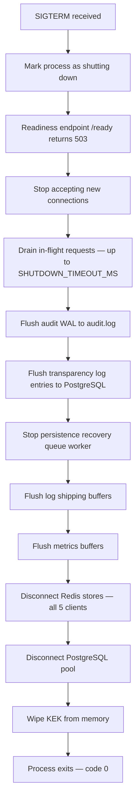

# QODIQA Shutdown Runbook

**Operations & Production Readiness**

| Field | Value |
|-------|-------|
| Document | Shutdown Runbook |
| Version | 1.0.0 |
| Owner | Platform Engineering |
| Audience | SRE, Platform Engineer, On-Call |
| Classification | Internal — Operational |
| Last Updated | 2026-07-03 |

---

## Table of Contents

1. [Overview](#1-overview)
2. [Graceful Shutdown](#2-graceful-shutdown)
3. [Connection Draining](#3-connection-draining)
4. [Request Completion](#4-request-completion)
5. [Database Consistency](#5-database-consistency)
6. [Artifact and Audit Persistence](#6-artifact-and-audit-persistence)
7. [Transparency Log Flushing](#7-transparency-log-flushing)
8. [Metrics and Log Flushing](#8-metrics-and-log-flushing)
9. [Shutdown Ordering](#9-shutdown-ordering)
10. [Forced Shutdown Procedure](#10-forced-shutdown-procedure)
11. [Verification Checklist](#11-verification-checklist)

---

## 1. Overview

QODIQA implements a graceful shutdown that completes all in-flight requests, flushes every persistence layer, and cleanly disconnects from infrastructure dependencies before the process exits.

The shutdown window is **30 seconds** (`SHUTDOWN_TIMEOUT_MS=30000`). Docker is configured with `stop_grace_period: 60s` and Kubernetes with `terminationGracePeriodSeconds: 60`, both exceeding the application timeout to ensure the process exits cleanly before the container runtime issues SIGKILL.



**Shutdown failure analysis:** If the process does not exit within `SHUTDOWN_TIMEOUT_MS`, it logs a forced-shutdown event and exits with code `1`. Infrastructure (Docker/Kubernetes) will issue SIGKILL after its grace period expires.

---

## 2. Graceful Shutdown

### 2.1 Initiating Shutdown

**Standard graceful shutdown — send SIGTERM:**

```bash
# systemd managed
systemctl stop qodiqa

# Docker
docker-compose -f deploy/docker/docker-compose.prod.yml stop --timeout 60 qodiqa

# Kubernetes — drain from a specific pod
kubectl delete pod <pod-name> -n qodiqa --grace-period=60

# Direct process signal
kill -SIGTERM <PID>
```

**Never send SIGKILL as a first action.** SIGKILL prevents flush of the audit WAL and transparency log, risking data loss for those two. The persistence recovery queue is not at risk from SIGKILL either way — its store is PostgreSQL (`persistence_recovery_queue` table, migration 032), so every enqueued item is already durably committed at enqueue time, independent of a graceful worker shutdown; see §5.3.

### 2.2 SIGTERM Handler Behaviour

When QODIQA receives SIGTERM:

1. Sets internal `shuttingDown = true` flag immediately.
2. `/ready` begins returning `503 Service Unavailable` — load balancers and Kubernetes readiness probes stop routing new traffic within one probe interval.
3. HTTP server calls `server.close()` — stops accepting new TCP connections.
4. In-flight requests are allowed to complete up to `SHUTDOWN_TIMEOUT_MS`.
5. Flush sequence begins after all connections drain or timeout.

### 2.3 Policy Hot-Reload (SIGHUP)

SIGHUP performs a **policy reload only** — it does not initiate shutdown. Do not confuse these signals.

```bash
# Hot-reload policies without shutdown
kill -SIGHUP <PID>
# Expected log: {"level":"info","msg":"Policy file reloaded","policyCount":N}
```

### 2.4 Pre-Shutdown Actions

Before sending SIGTERM in a planned shutdown, complete these actions:

```bash
# 1. Remove the instance from load balancer rotation (if not using K8s readiness)
# Varies by load balancer; example for HAProxy:
echo "disable server qodiqa_backend/$(hostname)" | socat stdio /run/haproxy/admin.sock

# 2. Wait for active connections to drain (check nginx/haproxy stats)
# Allow 10–15 seconds for in-flight requests to complete naturally

# 3. Verify no audit chain writes are in progress (check audit PG lag)
# /metrics is ops-authenticated (src/app.js:179): OPS_AUTH_HEADER_FILE is a 0600 file holding one line
# "Authorization: Bearer <operator API key>" (curl -H @file keeps the key out of argv; docs/operations/deployment-runbook.md §8).
curl -sf -H @"$OPS_AUTH_HEADER_FILE" http://localhost:3000/metrics | grep qodiqa_audit
```

---

## 3. Connection Draining

### 3.1 Kubernetes Connection Draining

Kubernetes drain sequence (automatic when a pod is deleted or during rolling update):

1. Pod readiness probe fails → endpoint removed from Service.
2. `preStop` hook (if configured) runs.
3. SIGTERM sent to the container process.
4. `terminationGracePeriodSeconds: 60` begins.
5. QODIQA drains connections for up to `SHUTDOWN_TIMEOUT_MS` (30s).
6. Process exits cleanly with code 0.
7. After 60 seconds, Kubernetes sends SIGKILL (should not be reached).

Monitor drain during a rolling update:

```bash
kubectl rollout status deployment/qodiqa -n qodiqa
kubectl get pods -n qodiqa -w
```

### 3.2 Docker Connection Draining

```bash
# Stop with explicit timeout matching terminationGracePeriod
docker-compose -f deploy/docker/docker-compose.prod.yml stop --timeout 60 qodiqa
```

The Docker runtime sends SIGTERM, waits 60 seconds, then sends SIGKILL. QODIQA should complete shutdown well within 30 seconds.

### 3.3 Verifying Drain Completion

```bash
# Watch for the shutdown log sequence
journalctl -u qodiqa -f | grep -E '(shutdown|drain|SIGTERM|exit)'
```

Expected log during drain (actual event names emitted by `src/runtime/shutdown.js` via `services/logger.js`):
```json
{"ts":"...","level":"INFO","event":"SHUTDOWN_SIGNAL_RECEIVED","category":"OPERATIONAL","signal":"SIGTERM"}
{"ts":"...","level":"INFO","event":"SHUTDOWN_STARTED","category":"OPERATIONAL","timeoutMs":30000}
{"ts":"...","level":"INFO","event":"SHUTDOWN_READY_FALSE","category":"OPERATIONAL"}
{"ts":"...","level":"INFO","event":"SHUTDOWN_HTTP_CLOSE_STARTED","category":"OPERATIONAL"}
{"ts":"...","level":"INFO","event":"SHUTDOWN_HTTP_CLOSED","category":"OPERATIONAL"}
{"ts":"...","level":"INFO","event":"SHUTDOWN_DRAIN_STARTED","category":"OPERATIONAL","active":N}
{"ts":"...","level":"INFO","event":"SHUTDOWN_DRAIN_COMPLETE","category":"OPERATIONAL","active":0}
```

---

## 4. Request Completion

### 4.1 In-Flight Request Handling

QODIQA's enforcement requests have a maximum timeout of `AI_CHAT_TIMEOUT_MS=30000` (30 seconds) per request. The shutdown window is also 30 seconds, ensuring every in-flight request either completes or times out before shutdown forces termination.

Requests in flight at shutdown time are handled as follows:

| Request Type | Maximum Duration | Shutdown Behaviour |
|-------------|-----------------|-------------------|
| `POST /ai/chat` | 30s (`AI_CHAT_TIMEOUT_MS`) | Completes or times out within shutdown window |
| `POST /sign` | 5s | Completes before shutdown |
| `POST /verify/v2` | 5s (`VERIFY_TIMEOUT_MS`) | Completes before shutdown |
| `GET /audit` | 10s (`AUDIT_TIMEOUT_MS`, default `10000`ms) | Completes before shutdown |
| `GET /health`, `GET /ready`, `GET /metrics` | <100ms | Completes instantly |

### 4.2 Requests That Cannot Complete

If a request exceeds `SHUTDOWN_TIMEOUT_MS`, the force-exit timer fires and QODIQA logs (`src/runtime/shutdown.js`) before terminating:

```json
{"ts":"...","level":"WARN","event":"SHUTDOWN_TIMEOUT","category":"OPERATIONAL","timeoutMs":30000,"message":"Shutdown exceeded configured timeout — forcing process termination"}
```

The upstream client will receive a connection reset. The request is **not** recorded in the audit chain (it was not completed). Callers should implement retry logic with idempotent request IDs.

---

## 5. Database Consistency

### 5.1 Audit Chain Dual-Write Flush

The audit chain writes to both the local NDJSON file (authoritative) and PostgreSQL (queryable replica, fire-and-forget async). During shutdown:

1. The audit WAL (`audit.log.wal`) is synchronously flushed to `audit.log`.
2. The checksum file (`audit.log.sum`) is updated with the final `{count, tailHash}`.
3. Pending async PostgreSQL writes are drained from the write queue, bounded by the overall `SHUTDOWN_TIMEOUT_MS` budget — not `AUDIT_TIMEOUT_MS`, which only bounds the `/audit` chain-integrity-walk HTTP endpoint (`src/api/routes/audit.js`) and has no role in the shutdown sequence.

Expected log:
```json
{"level":"info","msg":"Audit WAL flushed to audit.log","entriesFlushed":N,"ts":"..."}
{"level":"info","msg":"Audit checksum updated","count":N,"tailHash":"...","ts":"..."}
{"level":"info","msg":"Audit PG queue drained","pendingWritesFlushed":N,"ts":"..."}
```

### 5.2 PostgreSQL Pool Shutdown

After in-flight requests complete and queues drain, the PostgreSQL connection pool is gracefully closed:

```json
{"level":"info","msg":"PostgreSQL pool closing — draining active queries","ts":"..."}
{"level":"info","msg":"PostgreSQL pool closed","ts":"..."}
```

**Do not force-close the PG pool** while audit writes are in the queue — this can leave the `audit_chain` table out of sync with the file (the file remains authoritative; the table can be rebuilt, but divergence must be detected).

### 5.3 Persistence Recovery Queue Shutdown

The persistence recovery queue's durable store is the PostgreSQL
`persistence_recovery_queue` table (migration 032), not Redis. Every
enqueued item is already durably committed to that table at enqueue time —
there is nothing to "flush" at shutdown, and no risk of losing a pending
item regardless of how the process exits (graceful or SIGKILL).

Graceful shutdown simply stops the background worker from claiming further
items — any items still `PENDING` (or mid-claim, whose claim window will
naturally elapse) are picked up automatically by the worker on the next
startup, with no operator action required:

```json
{"level":"info","msg":"RECOVERY_QUEUE_SHUTDOWN","ts":"..."}
```

If items remain `PENDING` at shutdown, they simply stay in
`persistence_recovery_queue` and resume processing as soon as any QODIQA
instance's worker starts again.

---

## 6. Artifact and Audit Persistence

### 6.1 File Persistence Invariants

The audit chain file (`audit.log`) uses a write-ahead log pattern:

- All entries are first appended to `audit.log.wal`.
- On a clean flush cycle, WAL contents are appended to `audit.log` and the WAL is truncated.
- `audit.log.sum` is updated atomically after WAL flush.

**Recovery after unclean shutdown:** On next startup, QODIQA detects an unflushed WAL and replays it before processing new requests. No audit entries are lost.

### 6.2 Key Store Persistence

The encrypted key store (`keys.json`) is written atomically using a temp-file-then-rename pattern. A partial write leaves the old file intact.

Key store writes occur during:
- Key generation (new Ed25519 keypair)
- Key rotation
- Key status changes (active → inactive → archived)

During shutdown, no key store write should be in progress if no key operation was underway. Verify:

```bash
# On the data volume, check for temporary key files (indicates partial write)
ls -la /opt/qodiqa/data/keys.json.tmp 2>/dev/null && \
  echo "WARNING: Partial key store write detected" || \
  echo "Key store: clean"
```

---

## 7. Transparency Log Flushing

### 7.1 Transparency Log Entry Flush

Transparency log entries are written to PostgreSQL (`transparency_log_entries` table) during enforcement operations. These writes are on-path (not fire-and-forget) for `POST /ai/chat` calls that generate artifacts. In-flight requests complete before shutdown, so entries should be committed.

Pending Merkle root computations (scheduled by `rootScheduler.js`) are completed or deferred:

```json
{"level":"info","msg":"Transparency root scheduler — completing pending root computation","ts":"..."}
{"level":"info","msg":"Transparency root written","rootHash":"...","seqFrom":N,"seqTo":N,"ts":"..."}
```

If a root computation cannot complete within the shutdown window, it is deferred to next startup. Gap detection (`src/core/transparency/scanner/`) will identify and fill the gap.

### 7.2 Transparency Log Integrity at Shutdown

Verify the final state of the transparency log is consistent:

```bash
# Query the last committed transparency log entry before shutdown
psql "$QODIQA_PG_URL" -c "
  SELECT sequence_number, entry_hash, entry_type, created_at
  FROM transparency_log_entries
  ORDER BY sequence_number DESC
  LIMIT 1;
"

# Query the latest Merkle root
psql "$QODIQA_PG_URL" -c "
  SELECT root_id, seq_from, seq_to, root_hash, created_at
  FROM transparency_roots
  ORDER BY seq_to DESC
  LIMIT 1;
"
```

Save this output to the shutdown log for post-restart comparison.

---

## 8. Metrics and Log Flushing

### 8.1 Metrics Flushing

QODIQA's Prometheus metrics are in-memory (`src/observability/metrics.js`). Metrics are not persisted across restarts. Before shutdown, if you need to preserve the final metric state, scrape the metrics endpoint:

```bash
# Capture final metrics snapshot before initiating shutdown
curl -sf -H @"$OPS_AUTH_HEADER_FILE" http://localhost:3000/metrics > "/opt/qodiqa/logs/metrics-snapshot-$(date +%Y%m%d-%H%M%S).txt"
echo "Metrics snapshot saved"
```

### 8.2 Log Shipping Flush

Log shipping buffers (`src/observability/logShipping/`) are flushed during shutdown. Expected log:

```json
{"level":"info","msg":"Log shipping buffer flushing","bufferedLines":N,"ts":"..."}
{"level":"info","msg":"Log shipping buffer flushed","ts":"..."}
```

Verify your external log aggregator (e.g., Loki, Elasticsearch, CloudWatch) received the final log lines before the process exits.

---

## 9. Shutdown Ordering

The correct shutdown ordering is the reverse of startup:

```
1. QODIQA HTTP listener closes (no new connections)
   ↓
2. In-flight requests drain (≤ SHUTDOWN_TIMEOUT_MS = 30s)
   ↓
3. Audit WAL flushed to audit.log
   ↓
4. Audit checksum updated
   ↓
5. Transparency log Merkle root completed (if in progress)
   ↓
6. Persistence recovery queue worker stopped (nothing to drain — every
   pending item is already durably committed in PostgreSQL)
   ↓
7. Log shipping flushed
   ↓
8. Metrics snapshot (manual, pre-SIGTERM)
   ↓
9. All Redis clients disconnect — nonce, anomaly, rate_limit, consent cache
   (`ConsentCache`), revocation subscriber (`RevocationSubscriber`), and
   revocation publisher (`RevocationPublisher`) are three separate consent-
   related clients, not one "consent" client — see
   [Redis Failure Runbook §12.0](redis-failure.md#120-three-clients-not-one).
   No special shutdown ordering is required among them: the revocation
   subscriber's fail-closed gate only matters while the process is serving
   traffic, and shutdown has already stopped accepting new requests by step 1.
   ↓
10. PostgreSQL pool closes
    ↓
11. KEK wiped from memory
    ↓
12. Process exits with code 0
```

**Infrastructure services must shut down after QODIQA**, not concurrently:

```
QODIQA shuts down and exits
    ↓
Redis can now be stopped safely
    ↓
PostgreSQL can now be stopped safely
```

Shutting down Redis while QODIQA is draining causes false connection errors in shutdown logs (nonce/anomaly/rate-limit/consent/revocation). The persistence recovery queue is unaffected either way — it depends on PostgreSQL, not Redis.

---

## 10. Forced Shutdown Procedure

A forced shutdown is required when:

- QODIQA has become unresponsive and does not react to SIGTERM.
- Shutdown must complete faster than the graceful window allows (emergency maintenance).
- The process is stuck in a non-recoverable state.

### 10.1 Escalation Sequence

```bash
# Step 1: Send SIGTERM and wait for graceful shutdown (standard)
kill -SIGTERM <PID>
sleep 35  # Give 35 seconds — 5 seconds more than SHUTDOWN_TIMEOUT_MS

# Step 2: Check if process exited
kill -0 <PID> 2>/dev/null && echo "Process still running" || { echo "Process exited cleanly"; exit 0; }

# Step 3: If still running after 35s, send SIGTERM again
kill -SIGTERM <PID>
sleep 10

# Step 4: Last resort — SIGKILL (data loss risk, document reason)
kill -0 <PID> 2>/dev/null && {
  echo "WARNING: SIGKILL required — document this forced shutdown with timestamp and reason"
  echo "$(date -u +%Y-%m-%dT%H:%M:%SZ) FORCED SHUTDOWN via SIGKILL — reason: ___" >> /opt/qodiqa/logs/forced-shutdown.log
  kill -SIGKILL <PID>
}
```

### 10.2 Post-Forced-Shutdown Recovery

After a SIGKILL, the following data may be inconsistent:

| Component | Risk | Recovery Action |
|-----------|------|----------------|
| Audit WAL | Unflushed WAL entries exist | Startup automatically replays WAL — no manual action |
| Transparency log | Pending root may be missing | Gap scanner detects and fills on next startup |
| Persistence recovery queue | None — items are durably committed in PostgreSQL at enqueue time, not held in process memory or Redis | Worker resumes claiming on next startup — no data lost |
| PostgreSQL pool | Active transactions rolled back by PG | PostgreSQL handles this automatically |
| Key store | Partial write possible (check for `.tmp` file) | Remove `.tmp` file; existing `keys.json` remains valid |

**Document every forced shutdown** in the incident log and verify audit chain integrity on next startup.

### 10.3 Kubernetes Forced Termination

If a Kubernetes pod is stuck:

```bash
# Force delete the pod — bypasses terminationGracePeriodSeconds
kubectl delete pod <pod-name> -n qodiqa --grace-period=0 --force

# After force delete, verify the new pod starts cleanly
kubectl rollout status deployment/qodiqa -n qodiqa --timeout=120s
```

---

## 11. Verification Checklist

```
SHUTDOWN CHECKLIST — QODIQA v1.0.0
Date: __________  Operator: __________  Environment: __________
Shutdown Type: [ ] Planned  [ ] Emergency  [ ] Rollback  [ ] Upgrade

PRE-SHUTDOWN
[ ] Metrics snapshot saved to /opt/qodiqa/logs/metrics-snapshot-{timestamp}.txt
[ ] Final transparency log state recorded (sequence_number, root_hash)
[ ] QODIQA removed from load balancer rotation (or /ready confirmed returning 503)
[ ] Active connections monitored — count reduced before SIGTERM

SHUTDOWN INITIATION
[ ] Method used: [ ] systemctl stop  [ ] docker stop  [ ] kubectl delete pod  [ ] kill -SIGTERM
[ ] SIGTERM sent at: __________
[ ] Readiness probe returning 503 confirmed

DRAIN PHASE
[ ] Log confirms "HTTP server closed — no new connections accepted"
[ ] Log confirms "All in-flight requests completed" (or timeout logged with count)
[ ] Maximum concurrent requests at shutdown time: ___

FLUSH PHASE
[ ] Audit WAL flushed: entries flushed = ___
[ ] Audit checksum updated: count = ___, tailHash = ___
[ ] Transparency root computation completed (or deferred — note if deferred)
[ ] Persistence recovery queue worker stopped (RECOVERY_QUEUE_SHUTDOWN logged) — nothing to flush, items are already durable in PostgreSQL
[ ] Log shipping flushed: lines = ___

DISCONNECT PHASE
[ ] Redis clients disconnected (all 5 stores)
[ ] PostgreSQL pool closed

PROCESS EXIT
[ ] Exit code: [ ] 0 (clean)  [ ] 1 (timeout)  [ ] 9 (SIGKILL — document reason)
[ ] Process exited at: __________
[ ] Total shutdown duration: ___ seconds (expected < 30s for clean shutdown)

POST-SHUTDOWN VERIFICATION
[ ] No orphan processes running: ps aux | grep node | grep qodiqa → none
[ ] Audit log file integrity preserved: tail -1 audit.log | jq .hash → matches sum file
[ ] Key store file intact (no .tmp file present)
[ ] Log files closed cleanly — no truncation

IF FORCED SHUTDOWN (SIGKILL)
[ ] Forced shutdown reason documented: __________
[ ] Incident record created: __________
[ ] Post-restart audit chain replay verified

SIGN-OFF
Operator signature: __________  Time: __________
```

---

*Cross-references: [Startup Runbook](startup-runbook.md) | [Deployment Runbook](deployment-runbook.md) | [Rollback Runbook](rollback-runbook.md) | [Incident Response](incident-response.md)*
