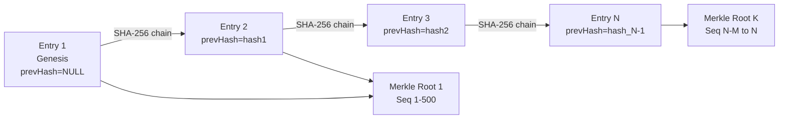

# QODIQA Transparency Recovery Runbook

**Operations & Production Readiness**

| Field | Value |
|-------|-------|
| Document | Transparency Recovery Runbook |
| Version | 1.0.0 |
| Owner | Platform Engineering / Security |
| Audience | SRE, Security Engineer, Incident Commander |
| Classification | Internal — Confidential |
| Last Updated | 2026-07-03 |

---

## Table of Contents

1. [Overview](#1-overview)
2. [Transparency Log Architecture](#2-transparency-log-architecture)
3. [Corruption Detection](#3-corruption-detection)
4. [Missing Entry Detection](#4-missing-entry-detection)
5. [Integrity Verification](#5-integrity-verification)
6. [Rebuild Procedures](#6-rebuild-procedures)
7. [Chain Validation](#7-chain-validation)
8. [Consistency Verification](#8-consistency-verification)
9. [Audit Verification](#9-audit-verification)

---

## 1. Overview

QODIQA's transparency log is an append-only, cryptographically linked record of all AI authorization decisions. Each entry contains:
- A SHA-256 hash linking to the previous entry (`previousEntryHash`)
- An Ed25519 signature over the entry hash
- A Merkle tree structure for external inclusion proofs
- Periodic Merkle root records for batch verification

Transparency log integrity is a non-negotiable property of the QODIQA trust model. Any corruption must be detected, documented, and recovered before the system returns to operation.

**This runbook is scoped to the RFC6962 transparency log** (`transparency_log_entries`/`transparency_roots`) — a separate subsystem from the production **audit chain** (`audit.log`/`audit_chain`) that records the actual enforcement decisions. For audit-chain-specific recovery (hash-chain walk failures, watermark mismatches, the live verifier, `validateChainLinks()` orphan detection), see `docs/operations/audit-chain-integrity-verification.md` instead — do not use this document's field names or procedures for that chain.

**Entry hash scheme:**
```
entry_hash = SHA-256("QODIQA::TRANSPARENCY::V1" || canonical_JSON({
  transparencyId, entryType, artifactId, evidenceChainId, verificationId,
  payloadHash, previousEntryHash, signerKeyId
}))
```

---

## 2. Transparency Log Architecture



**Storage locations:**
- `transparency_log_entries` — all entries (hash, entry_type, payload_hash, previous_entry_hash, signature, id)
- `transparency_roots` — Merkle root records (root_hash, signature, seq_from, seq_to, previous_root_hash)
- `transparency_verifications` — verification requests and results

**Immutability enforcement:**
- Row-Level Security prevents UPDATE and DELETE on `transparency_log_entries`.
- `UNIQUE` constraint on `entry_hash` prevents duplicate entries.
- Entries are INSERT-only at both the application and database levels.

---

## 3. Corruption Detection

### 3.1 Gap Scanner

QODIQA includes a built-in gap scanner (`src/core/transparency/scanner/`):

```bash
# CORRECTION: there is NO `POST /transparency/admin/scan` endpoint. The scanner is a background job that is
# DISABLED by default (TRANSPARENCY_SCANNER_ENABLED=false) and has no HTTP trigger. To check for gaps use the SQL in section 3.2
# (the log's primary key column is `id`; earlier revisions of this runbook used a non-existent `sequence_number`).
```

### 3.2 Database Integrity Check

```bash
# Detect sequence number gaps
psql "$QODIQA_PG_URL" -c "
  WITH numbered AS (
    SELECT id,
           LAG(id) OVER (ORDER BY id) AS prev_seq
    FROM transparency_log_entries
  )
  SELECT
    prev_seq + 1 AS gap_starts_at,
    id - 1 AS gap_ends_at,
    id - prev_seq - 1 AS missing_entries
  FROM numbered
  WHERE prev_seq IS NOT NULL
  AND id != prev_seq + 1
  ORDER BY id;
"
# Expected: 0 rows
```

### 3.3 Hash Chain Verification

```bash
# Verify the hash chain is unbroken
psql "$QODIQA_PG_URL" -c "
  WITH chain AS (
    SELECT
      id,
      entry_hash,
      previous_entry_hash,
      LAG(entry_hash) OVER (ORDER BY id) AS actual_prev_hash
    FROM transparency_log_entries
    ORDER BY id
  )
  SELECT id, entry_hash, previous_entry_hash, actual_prev_hash
  FROM chain
  WHERE id > 1
  AND previous_entry_hash != actual_prev_hash
  ORDER BY id
  LIMIT 10;
"
# Expected: 0 rows (all hash links are valid)
```

### 3.4 Entry Signature Verification

```bash
# Verify all entry signatures using the transparency signing key
# Note: This is computationally intensive for large logs
# Run against a sample or since a specific date

curl -sf \
  -X POST http://localhost:3000/transparency/admin/verify-signatures \
  -H "Authorization: Bearer $QODIQA_OPS_TOKEN" \
  -H "Content-Type: application/json" \
  -d '{"since": "2026-01-01T00:00:00Z", "limit": 10000}' | jq .
```

### 3.5 Merkle Root Verification

```bash
# Verify the latest Merkle root
psql "$QODIQA_PG_URL" -c "
  SELECT root_id, seq_from, seq_to, root_hash, previous_root_hash, created_at
  FROM transparency_roots
  ORDER BY seq_to DESC
  LIMIT 5;
"

# Recompute the Merkle root for the latest batch and compare
curl -sf \
  -X POST http://localhost:3000/transparency/admin/verify-root \
  -H "Authorization: Bearer $QODIQA_OPS_TOKEN" \
  -H "Content-Type: application/json" \
  -d '{"rootId": "ROOT_ID_HERE"}' | jq '.verified'
# Expected: true
```

---

## 4. Missing Entry Detection

### 4.1 Cross-Reference with Audit Chain

Every transparency log entry should have a corresponding audit chain entry for enforcement events:

```bash
# Find audit chain entries without a transparency log entry
psql "$QODIQA_PG_URL" -c "
  SELECT ac.artifact_id, ac.decision, ac.created_at
  FROM audit_chain ac
  LEFT JOIN transparency_log_entries tl ON tl.artifact_id = ac.artifact_id
  WHERE tl.transparency_id IS NULL
  AND ac.created_at > NOW() - INTERVAL '7 days'
  ORDER BY ac.created_at
  LIMIT 100;
"
```

These entries represent transparency log entries that were not written. This can occur when:
- QODIQA crashed during the write.
- The PostgreSQL connection was lost during the transaction.
- The entry was filtered by a bug in the transparency pipeline.

### 4.2 Time-Range Gap Analysis

```bash
# Identify periods with no transparency log entries (potential missing data)
psql "$QODIQA_PG_URL" -c "
  SELECT
    DATE_TRUNC('hour', created_at) AS hour,
    COUNT(*) AS entry_count
  FROM transparency_log_entries
  WHERE created_at > NOW() - INTERVAL '7 days'
  GROUP BY 1
  ORDER BY 1;
"
# Hours with 0 entries during expected activity periods indicate gaps
```

---

## 5. Integrity Verification

### 5.1 Full Chain Verification

```bash
# Full chain verification — compute and verify all hashes
# WARNING: For large logs, this may take minutes to hours
node -e "
const { Pool } = require('pg');
const crypto = require('crypto');
const pool = new Pool({ connectionString: process.env.QODIQA_PG_URL });

async function verifyChain() {
  const client = await pool.connect();
  try {
    const { rows } = await client.query(
      'SELECT id, entry_hash, previous_entry_hash, entry_type, payload_hash, signer_key_id, transparency_id, artifact_id, evidence_chain_id, verification_id FROM transparency_log_entries ORDER BY id'
    );

    let errors = 0;
    let prevHash = null;

    for (const row of rows) {
      // Verify hash chain linkage
      if (row.previous_entry_hash !== prevHash) {
        console.error(\`Hash chain broken at sequence \${row.id}: expected \${prevHash} but got \${row.previous_entry_hash}\`);
        errors++;
      }

      // Recompute entry hash
      const canonical = JSON.stringify({
        transparencyId: row.transparency_id,
        entryType: row.entry_type,
        artifactId: row.artifact_id,
        evidenceChainId: row.evidence_chain_id,
        verificationId: row.verification_id,
        payloadHash: row.payload_hash,
        previousEntryHash: row.previous_entry_hash,
        signerKeyId: row.signer_key_id
      }, Object.keys({
        transparencyId: 1, entryType: 1, artifactId: 1, evidenceChainId: 1,
        verificationId: 1, payloadHash: 1, previousEntryHash: 1, signerKeyId: 1
      }).sort());

      const recomputedHash = crypto
        .createHash('sha256')
        .update('QODIQA::TRANSPARENCY::V1')
        .update(canonical)
        .digest('hex');

      if (recomputedHash !== row.entry_hash) {
        console.error(\`Hash mismatch at sequence \${row.id}: stored=\${row.entry_hash} computed=\${recomputedHash}\`);
        errors++;
      }

      prevHash = row.entry_hash;
    }

    console.log(\`Chain verification complete. Entries: \${rows.length}, Errors: \${errors}\`);
    return errors === 0;
  } finally {
    client.release();
    await pool.end();
  }
}

verifyChain().then(valid => process.exit(valid ? 0 : 1));
"
```

### 5.2 Merkle Proof Verification

For a specific artifact, generate and verify its inclusion proof:

```bash
ARTIFACT_ID="art-abc123"

# Generate inclusion proof
PROOF=$(curl -sf \
  -X GET "http://localhost:3000/transparency/proof/$ARTIFACT_ID" \
  -H "Authorization: Bearer $QODIQA_OPS_TOKEN")
echo "$PROOF" | jq .

# Verify the proof offline
curl -sf \
  -X POST http://localhost:3000/transparency/verify-proof \
  -H "Content-Type: application/json" \
  -d "$PROOF" | jq '.valid'
# Expected: true
```

---

## 6. Rebuild Procedures

### 6.1 When to Rebuild

Rebuild is required when:
- Entries are missing from the database but the hash chain can be reconstructed.
- The PostgreSQL table was accidentally truncated.
- The database was restored from a backup that predates some entries (which exist in the audit chain file).

**Rebuild is NOT possible if:**
- The original entry hashes cannot be recomputed (missing payload).
- The entry signatures cannot be regenerated (signing key is not available for historical signing).

### 6.2 Rebuild from Audit Chain File

The audit chain file contains enough information to recreate audit chain database entries. Transparency log entries are linked by a different hash chain and cannot be recreated from the audit file alone.

```bash
# Export the full audit log to CSV for analysis
# Field names match the actual audit-chain entry shape (src/core/audit/entryBuilder.js)
# — there is no `keyId` field on an audit-chain entry; the key-attribution field is
# `publicKeyId`.
grep '"decision"' "$QODIQA_AUDIT_LOG" | \
  jq -r '[.hash, .artifactId, .decision, .timestamp, .publicKeyId, .signature] | @csv' \
  > /tmp/audit-for-transparency-rebuild.csv

echo "Audit entries available for rebuild: $(wc -l < /tmp/audit-for-transparency-rebuild.csv)"
```

### 6.3 Rebuild from Backup

If the transparency log table was lost:

> Decrypt and seal-check the backup with `./scripts/pg-backup.sh verify` first;
> extraction follows [`restore-runbook.md` §5](restore-runbook.md#5-database-restore)'s identity rules (scratch database
> `OWNER qodiqa_test`, restore as `qodiqa_test`, never `qodiqa_app` or `postgres`, no `--no-acl`, connection from
> `PGHOST`/`PGPORT`, never a literal `localhost:5432`). `pg-backup.sh` writes encrypted `*.dump.enc` + `.seal`, which
> `pg_restore --table` cannot read directly, so the backup is restored in full into the scratch database with
> `./scripts/pg-backup.sh restore`. The earlier `OWNER qodiqa_app` / `--no-owner --no-acl` / `.dump.gz` steps are
> superseded (git history keeps them).

```bash
# Step 1: Choose the latest encrypted PostgreSQL backup that contains transparency log data, and seal-check it
BACKUP_FILE="<chosen .dump.enc; its .seal beside it>"
./scripts/pg-backup.sh verify            # expect BACKUP_SEAL_OK and BACKUP_VERIFY_OK

# Step 2: Restore it into a scratch database as qodiqa_test (transparency tables are read from there)
psql -U postgres -c "CREATE DATABASE qodiqa_transparency_restore OWNER qodiqa_test;"

echo RESTORE | PGHOST="${PGHOST}" PGPORT="${PGPORT}" PGUSER=qodiqa_test PGPASSWORD="${QODIQA_PG_TEST_PASSWORD}" \
  PGDATABASE=qodiqa_transparency_restore ./scripts/pg-backup.sh restore "$BACKUP_FILE"
# (to connect to the scratch database afterwards, reuse the same PGHOST/PGPORT/PGUSER/PGPASSWORD environment with
#  PGDATABASE=qodiqa_transparency_restore — never put the password inside a connection-string URL)

# Step 3: Verify the restored transparency log is consistent
psql -U postgres -d qodiqa_transparency_restore -c "
  SELECT COUNT(*), MAX(id), MIN(created_at), MAX(created_at)
  FROM transparency_log_entries;
"

# Step 4: Determine the overlap with current production data
psql "$QODIQA_PG_URL" -c "SELECT MAX(id) FROM transparency_log_entries;"
# If production has more recent entries, you need to reconstruct from sequence N+1 onwards

# Step 5: Import missing entries from the restore database into production
psql "$QODIQA_PG_URL" -c "
  INSERT INTO transparency_log_entries
  SELECT * FROM dblink(
    'host=${PGHOST} port=${PGPORT} dbname=qodiqa_transparency_restore user=qodiqa_test',
    'SELECT * FROM transparency_log_entries WHERE id > PRODUCTION_MAX_SEQ'
  ) AS t(transparency_id UUID, id BIGINT, -- ... full column list ...)
  ON CONFLICT (entry_hash) DO NOTHING;
"

psql -U postgres -c "DROP DATABASE qodiqa_transparency_restore;"
```

### 6.4 Fill Missing Entries

If specific entries are missing within the chain (not at the end), filling them requires either:

**Option A: Accept the gap** (if the entries cannot be reconstructed)
- Document the gap in the transparency log with a SYSTEM entry.
- Record the gap in the incident log.
- Notify affected customers if the gap corresponds to their artifacts.

```bash
# Record the gap as a SYSTEM entry (creates an auditable record)
curl -sf \
  -X POST http://localhost:3000/transparency/admin/record-gap \
  -H "Authorization: Bearer $QODIQA_OPS_TOKEN" \
  -H "Content-Type: application/json" \
  -d "{
    \"gapStart\": $GAP_START_SEQ,
    \"gapEnd\": $GAP_END_SEQ,
    \"reason\": \"RECOVERY_PROCEDURE\",
    \"incidentRef\": \"$INCIDENT_REF\",
    \"operator\": \"$(whoami)\",
    \"timestamp\": \"$(date -u +%Y-%m-%dT%H:%M:%SZ)\"
  }" | jq .
```

**Option B: Restore from offsite backup** (if the entries exist in an older backup)
- Follow the rebuild from backup procedure (Section 6.3).

---

## 7. Chain Validation

### 7.1 Continuous Hash Chain Validation

```bash
# Validate the hash chain from a specific sequence number
curl -sf \
  -X POST http://localhost:3000/transparency/admin/validate-chain \
  -H "Authorization: Bearer $QODIQA_OPS_TOKEN" \
  -H "Content-Type: application/json" \
  -d '{"fromSequence": 1, "toSequence": null}' | jq .

# Expected response:
# {
#   "valid": true,
#   "entriesVerified": N,
#   "firstEntry": {"sequence": 1, "hash": "..."},
#   "lastEntry": {"sequence": N, "hash": "..."},
#   "merkleRootsVerified": M,
#   "errors": []
# }
```

### 7.2 Root Chain Validation

Each Merkle root references the previous root hash, forming a chain of roots:

```bash
# Verify the root chain
psql "$QODIQA_PG_URL" -c "
  WITH root_chain AS (
    SELECT
      root_id,
      seq_from,
      seq_to,
      root_hash,
      previous_root_hash,
      LAG(root_hash) OVER (ORDER BY seq_to) AS actual_prev_root_hash
    FROM transparency_roots
  )
  SELECT *
  FROM root_chain
  WHERE actual_prev_root_hash IS NOT NULL
  AND previous_root_hash != actual_prev_root_hash
  ORDER BY seq_to;
"
# Expected: 0 rows
```

### 7.3 External Verification

Third parties can verify the transparency log using the public API:

```bash
# The transparency log is publicly verifiable via the verification endpoint
curl -sf "https://your-qodiqa-endpoint/.well-known/qodiqa/transparency/latest-root" | jq .
# Returns the latest signed Merkle root for external verification
```

---

## 8. Consistency Verification

### 8.1 Cross-Reference: Transparency Log vs Audit Chain

```bash
# For every ARTIFACT entry in the transparency log, a corresponding audit chain entry should exist
psql "$QODIQA_PG_URL" -c "
  SELECT tl.transparency_id, tl.artifact_id, tl.created_at,
         ac.hash IS NOT NULL AS in_audit_chain
  FROM transparency_log_entries tl
  LEFT JOIN audit_chain ac ON tl.artifact_id = ac.artifact_id
  WHERE tl.entry_type = 'ARTIFACT'
  AND ac.hash IS NULL
  AND tl.created_at > NOW() - INTERVAL '7 days'
  ORDER BY tl.created_at
  LIMIT 50;
"
# Rows returned indicate transparency entries without corresponding audit chain entries
# This is a consistency warning but not necessarily an error (depends on write timing)
```

### 8.2 Cross-Reference: Transparency Log vs Evidence Chain

```bash
# For EVIDENCE entries in transparency log, verify evidence_chain records exist
psql "$QODIQA_PG_URL" -c "
  SELECT tl.transparency_id, tl.evidence_chain_id, tl.created_at
  FROM transparency_log_entries tl
  LEFT JOIN evidence_chain ec ON tl.evidence_chain_id = ec.evidence_chain_id
  WHERE tl.entry_type = 'EVIDENCE'
  AND ec.evidence_chain_id IS NULL
  ORDER BY tl.created_at
  LIMIT 50;
"
```

---

## 9. Audit Verification

### 9.1 Transparency Log Audit Report

Generate a transparency log audit report for compliance or investigation purposes:

```bash
psql "$QODIQA_PG_URL" -c "
  SELECT
    entry_type,
    COUNT(*) AS total_entries,
    MIN(created_at) AS earliest,
    MAX(created_at) AS latest,
    COUNT(DISTINCT signer_key_id) AS signing_keys_used
  FROM transparency_log_entries
  GROUP BY entry_type
  ORDER BY entry_type;
"
```

### 9.2 Key-Specific Transparency Audit

Verify all entries signed by a specific key (use during key rotation or key compromise investigation):

```bash
KEY_ID="key-xxxxxxxx-xxxx-xxxx-xxxx-xxxxxxxxxxxx"

psql "$QODIQA_PG_URL" -c "
  SELECT COUNT(*), MIN(created_at), MAX(created_at)
  FROM transparency_log_entries
  WHERE signer_key_id = '$KEY_ID';
"
```

### 9.3 Transparency Audit for Regulatory Compliance

```bash
# Generate a compliance report for a specific date range
psql "$QODIQA_PG_URL" -c "
  SELECT
    tl.transparency_id,
    tl.entry_type,
    tl.artifact_id,
    tl.id,
    tl.entry_hash,
    tl.signature,
    tl.signer_key_id,
    tl.created_at,
    tr.root_hash AS merkle_root_hash,
    tr.signature AS merkle_root_signature
  FROM transparency_log_entries tl
  LEFT JOIN transparency_roots tr ON
    tl.id >= tr.seq_from AND tl.id <= tr.seq_to
  WHERE tl.created_at BETWEEN '2026-01-01' AND '2026-06-30'
  ORDER BY tl.id;
" --csv > "/opt/qodiqa/compliance/transparency-audit-H1-2026.csv"

sha256sum "/opt/qodiqa/compliance/transparency-audit-H1-2026.csv" \
  > "/opt/qodiqa/compliance/transparency-audit-H1-2026.csv.sha256"

echo "Compliance report generated and hash recorded"
```

### 9.4 Post-Recovery Transparency Attestation

After completing any transparency log recovery procedure, generate and preserve an attestation:

```bash
cat > "/opt/qodiqa/forensic/transparency-recovery-attestation-$(date +%Y%m%d).json" << EOF
{
  "attestation": "TRANSPARENCY_LOG_RECOVERY",
  "date": "$(date -u +%Y-%m-%dT%H:%M:%SZ)",
  "operator": "${OPERATOR_NAME:-$(whoami)}",
  "incidentRef": "${INCIDENT_REF:-N/A}",
  "scopeOfRecovery": "${RECOVERY_SCOPE:-describe what was recovered}",
  "dataLoss": "${DATA_LOSS:-none confirmed}",
  "entryCountBeforeRecovery": $(psql "$QODIQA_PG_URL" -t -c "SELECT COUNT(*) FROM transparency_log_entries;" | tr -d ' '),
  "chainValid": true,
  "merkleRootsVerified": $(psql "$QODIQA_PG_URL" -t -c "SELECT COUNT(*) FROM transparency_roots;" | tr -d ' '),
  "gapsDocumented": "${GAPS_DOCUMENTED:-none}",
  "signedBy": "$(whoami)@$(hostname)"
}
EOF

echo "Recovery attestation recorded"
```

---

*Cross-references: [Disaster Recovery](disaster-recovery.md) | [Restore Runbook](restore-runbook.md) | [Key Compromise Runbook](key-compromise-runbook.md) | [Incident Response](incident-response.md) | Audit Chain Architecture ADR*
