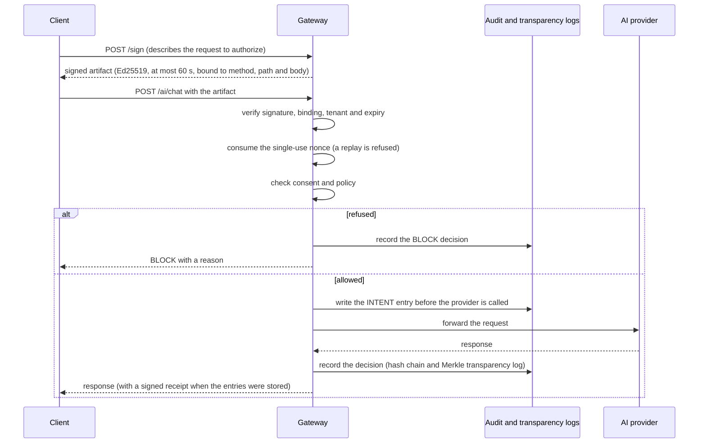

# What QODIQA is

QODIQA is an enforcement gateway that sits between your applications and AI providers. A request reaches a provider only if it carries a cryptographic authorization that the gateway has verified. Every decision, allow or block, is recorded in a tamper-evident log that a third party can check offline.

## The problem it addresses

An application that calls an AI provider directly has no durable, checkable record of who was allowed to do what, under which policy, and what was actually decided. Application logs can be edited, and a provider's own logs belong to the provider. QODIQA moves the decision in front of the provider and makes the record independently verifiable.

## How it works in one pass

1. A client asks the gateway to sign an authorization for a specific request. The authorization is called an artifact: a small document signed with an Ed25519 key (a standard public-key signature scheme) that expires within at most 60 seconds.
2. By default the artifact is bound to the HTTP method, the path and the request body of that one request. An optional newer protocol version (V2) also binds the query string and headers chosen by the issuer.
3. When the request arrives, the gateway verifies the signature, the binding, the tenant and the expiry. An artifact cannot be used twice: it carries a one-time code (a nonce) that the gateway records atomically in Redis, so a replay is rejected even under concurrent requests. Any change to the artifact, including its tenant (the customer or environment it belongs to), invalidates its signature.
4. Consent (the record that the data subject allows this use) and the tenant's policy are checked on every request; after a consent revocation the next request is blocked. A single artifact can also be revoked before it is used.
5. Before the provider is called, the gateway writes an INTENT entry that records what it is about to do, so that even a crash leaves a trace. A refused request has no INTENT entry; it only gets its BLOCK decision.
6. The decision is appended to an audit chain (each entry contains the SHA-256 hash of the previous one, so edits are detectable) and to a transparency log (a Merkle tree that proves an entry is included without revealing the others). When both entries were stored, the response carries a signed receipt; a receipt proves that the gateway recorded the decision, not that the decision was right.

## The path of one request

Later, anyone holding the artifact, the audit entries, the inclusion proof, the signed checkpoint and the receipt can check them offline with the separate verifier, using public keys obtained from a source other than the gateway.

## Try it

`docker compose -f docker-compose.quickstart.yml up` starts a local sandbox on `http://127.0.0.1:3000` with a built-in stand-in for the AI model (it echoes your prompt), disposable databases, and semantic content screening switched off because its model files are not distributed; it takes a few minutes the first time. See the [Quickstart](guides/quickstart.md). The sandbox is for evaluation, not for deployment.

## What a third party can verify

Offline verifiers with no dependency on the gateway's code exist in JavaScript and Python and are pinned by published test vectors; they live in the separate [qodiqa-verify](https://github.com/qodiqa/qodiqa-verify) repository. A proof of one request, with its audit entries, inclusion proof, signed checkpoint and receipt, can be verified with two independent implementations. A checkpoint is a signed snapshot of the log's current state. Checkpoints can be anchored outside the gateway (see [qodiqa-anchors](https://github.com/qodiqa/qodiqa-anchors)) and co-signed by witnesses, which are separate processes with their own keys.

## What else is included

- Agent actions, tool calls and MCP servers are authorized and bound the same way. Authority can be delegated as a chain of signed grants that only narrow, and a consequential action can wait for human approval.
- A global kill switch stops all signing and execution.
- Policy changes go through four steps (draft, review, approve, publish) that can be required to be done by three different operators.
- Optional single sign-on through OIDC, SAML 2.0 and LDAP, and TOTP-based MFA for operators.
- Data loss prevention that can detect and redact or block personal data and secrets in requests and tool results.
- SDKs for JavaScript (TypeScript), Python, Go and Java (guides for JavaScript and Python, a README in the folder of the Go and Java SDKs) and an artifact guard for Express/Connect, FastAPI/ASGI and Django.
- An OpenAPI specification generated from the code and checked in CI.
- Deployment assets for Kustomize, Helm, Terraform, Docker Compose and systemd, with documented backup and restore.

## What it is not

QODIQA enforces at the gateway. It does not intercept traffic that bypasses it; direct access to providers must be closed at the network level. It is not a certification or a legal assessment of compliance. See [Scope and limitations](limitations.md).
